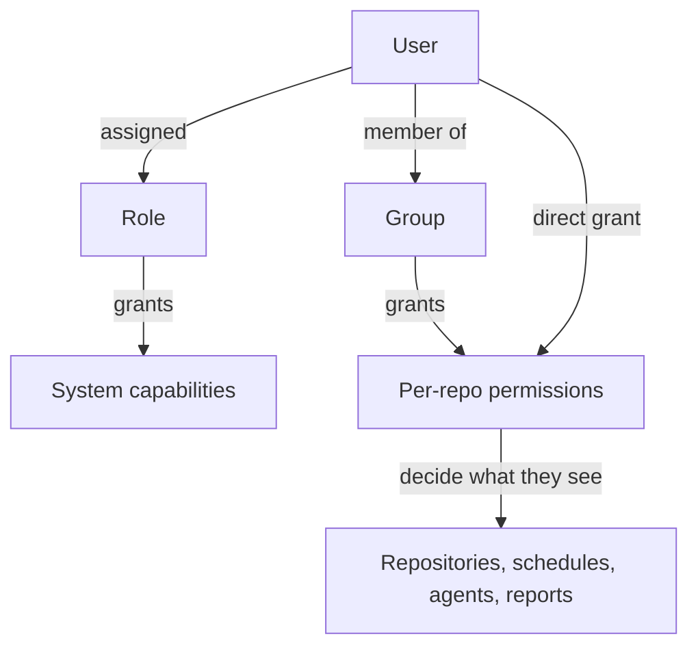
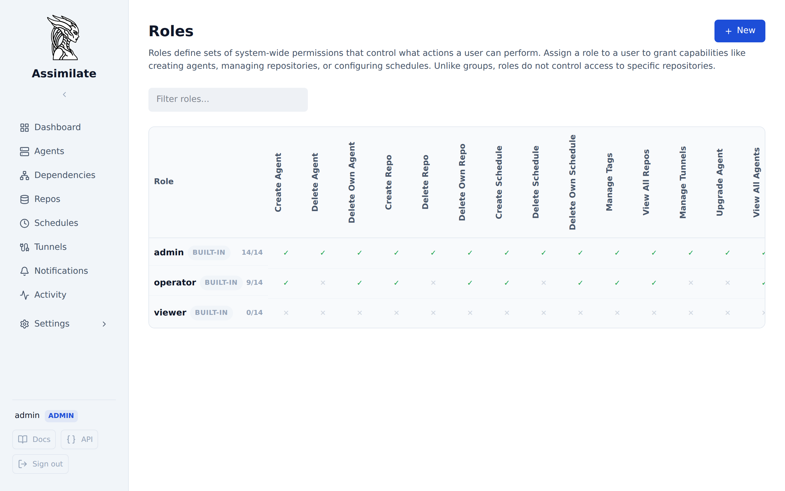
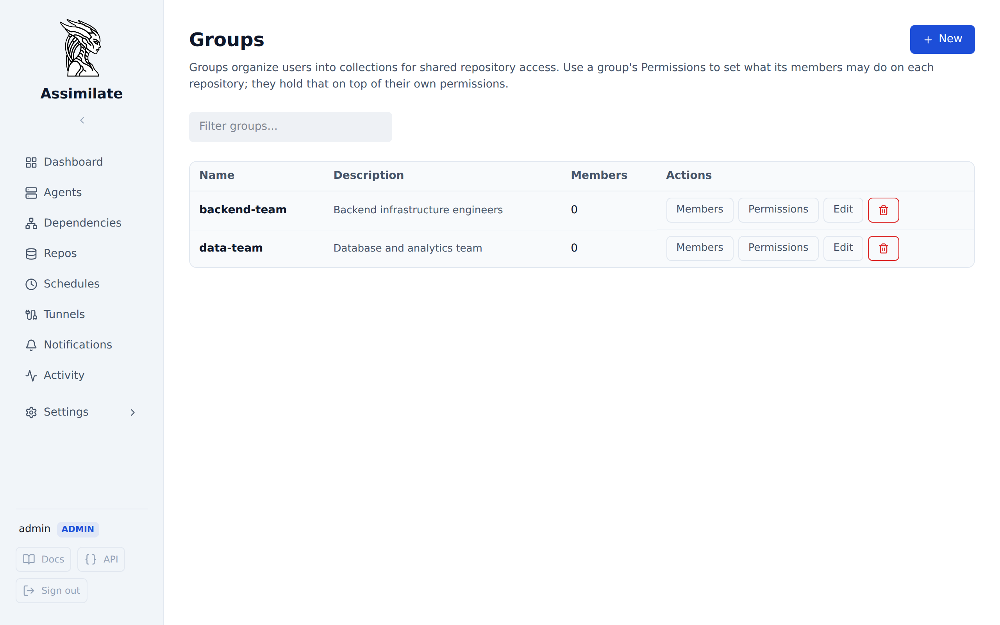
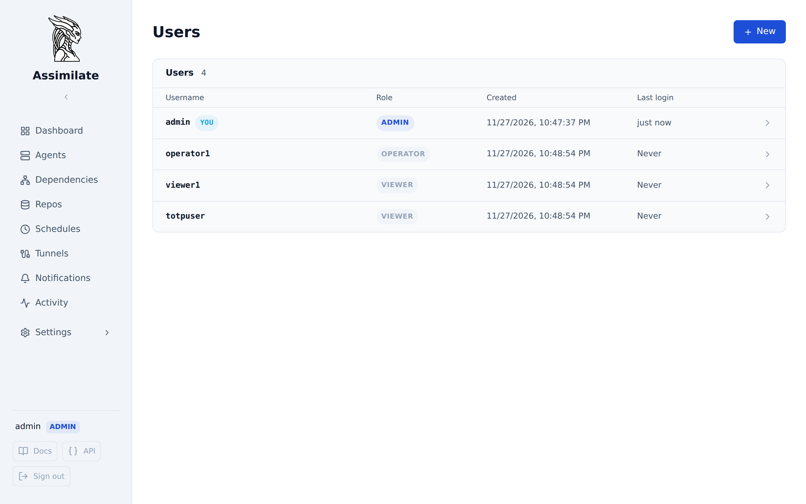

# Access Control

Assimilate uses a role-based access-control model with **roles**, **groups**, and **per-repository permissions**. This page explains how they interact and when to use each.

## Overview

| Concept | Purpose | Scope |
|---------|---------|-------|
| **Role** | Defines what actions a user can perform | System-wide capabilities |
| **Group** | Organizes users for shared repository access | Per-repository permissions |
| **Per-repo permission** | Grants specific operations on a single repository | Individual repository |

## Roles

Users are assigned one or more roles in the **Roles & groups** section of the user's page (**Users**, then click the user). Each role bundles a set of system-wide capabilities. A user's effective permissions are the union of all capabilities across every role they hold.

Built-in roles cannot be deleted:

| Role | Description |
|------|-------------|
| **admin** | Full access to everything. The `can_delete_repo` permission serves as the admin bypass — all permission checks pass for users with this capability. |
| **operator** | Can create and manage agents, repos, and schedules, and sees every repository and agent, but cannot manage users or system settings. |
| **viewer** | Read-only access. Cannot create or modify resources. |

### Custom Roles

Admins can create custom roles with any combination of these capabilities:

| Capability | Effect |
|------------|--------|
| Create Agent | Create new backup agents |
| Delete Agent | Delete any agent |
| Delete Own Agent | Delete only agents the user created |
| Create Repo | Register new borg repositories |
| Delete Repo | Delete any repository |
| Delete Own Repo | Delete only repositories the user created |
| Create Schedule | Create backup schedules, on repositories where the user also holds `can_modify_schedules` |
| Delete Schedule | Delete any schedule |
| Delete Own Schedule | Delete only schedules the user created |
| Manage Tags | Create and assign tags |
| View All Repos | See every repository, schedule, agent, report and statistic regardless of per-repo permissions |
| Manage Tunnels | Configure SSH reverse tunnels |
| Upgrade Agent | Deploy, upgrade and redeploy the agent binary on remote hosts via SSH. Includes **View All Agents**, since deploying to a host needs seeing it |
| View All Agents | See every agent, including a new one no schedule backs up yet, and point schedules at it |

### Admin Bypass

A user with a role that grants `can_delete_repo` bypasses all permission checks — they can view, modify, and delete any resource in the system. The admin built-in role includes this capability. Custom roles can also grant it.

### When to Use Roles

Use roles when you need to control **what kind of actions** a user can perform across the system:

- A new team member who should only monitor backups → assign the **viewer** role.
- A DevOps engineer who manages infrastructure but should not administer users → assign the **operator** role or a custom role with appropriate capabilities.
- A service account that only triggers backups → create a minimal custom role with no create/delete capabilities and use an API token.
- An external auditor who needs read-only access → **viewer** role.

Roles do **not** control which specific repositories a user can see or interact with — that is the job of groups and per-repo permissions.

## Groups

A group is a collection of users that share the same **per-repository permissions**. When you grant a group access to a repository, every member of the group gains that access, on top of their own permissions.

Groups do **not** grant system capabilities — they only control which repositories their members can access and what operations they can perform on those repositories.

### When to Use Groups

Use groups when you need to control **which repositories** a set of users can access:

- A "backend-team" group that can view and backup the production database repositories.
- A "developers" group that has full access to development environment repositories but read-only access to production.
- An "auditors" group that can view all repositories but cannot modify or delete anything.

## Per-Repository Permissions

The following permissions can be granted to a group (with its **Permissions** button on the **Groups** page) or directly to a user (in the **Repository permissions** section of the user's page) for each repository:

| Permission | Effect |
|------------|--------|
| `can_view` | See the repository and its archives |
| `can_backup` | Trigger a backup run |
| `can_modify_schedules` | Create and edit backup schedules for this repository |
| `can_extract` | Browse and extract archive contents |
| `can_delete` | Delete archives from this repository |

!!! warning "Schedules run commands on their agents"
    A schedule's pre- and post-backup hook commands run as a shell on every agent it targets. Treat `can_modify_schedules` as permission to run commands on any agent the user can point a schedule at. A schedule can target only agents the user can see (see below). Creating a schedule for any other agent, or adding one to an existing schedule, fails as if the agent did not exist. A schedule can keep agents an admin already added to it, and the user can still edit it.

### What a User Can See

Everything a user who is not an admin can see follows from their `can_view` grants, their own and their groups'. An admin, and a holder of **View All Repos**, sees everything.

| Resource | Visible when |
|----------|--------------|
| Repository | The user, or a group they belong to, holds `can_view` on it |
| Schedule | The user may see its repository. A schedule with no repository is admin-only |
| Agent | An admin has not hidden it, and one of those schedules backs it up or the user's role has **View All Agents** or **Upgrade Agent**. Give one of those to whoever sets up new agents: a new agent has no schedule yet. Only an admin sees a hidden agent |
| Dependency host | A schedule the user may see needs it for an agent they may see, or the files of an agent they may see require it. One nothing visible needs is admin-only |
| Machine | One of its roles is visible: an agent the user may see, a repository host they may read a repository on, or a dependency host they may see. Only those roles are listed, with only the waits of schedules and repositories the user may see. A schedule's machines leave out those of agents and repositories they may not see |
| Reports, activity, calendar, trends and dashboard figures | They belong to a repository the user may see |
| System events | They name an agent the user may see or none, and concern a repository the user may read or none. Repository syncs and archive deletion or compaction failures concern their repository |
| Live updates | The same rule, applied to every event the UI receives |

A resource the user cannot see is reported as not found, the same as one that does not exist, and is left out of every list, count and total. This covers single-item reads too: a repository's page, a schedule's settings and hook commands, an agent's page, virtual machines, hostname aliases and dependencies.

### Permission Resolution

When evaluating whether a user can perform an action on a repository:

1. **Admin bypass** — if the user has `can_delete_repo` in any of their roles, the action is always allowed.
2. **View All Repos** — a user with this capability may view any repository, but not change it.
3. **Direct user grant** — if the user has been granted the permission on the repository, it is allowed.
4. **Group membership** — if any group the user belongs to has been granted the permission on the repository, it is allowed.
5. **Deny by default** — if none of the above apply, the action is denied.

## Roles vs Groups — Decision Guide

| Question | Answer |
|----------|--------|
| "Should this user be able to create new agents?" | **Role** — this is a system capability |
| "Should this user see repository X?" | **Group** (or direct grant) — `can_view` on X, which also shows its schedules and agents |
| "Should this team share the same repo access?" | **Group** — add all team members to one group |
| "Should this user set up new agents?" | **Role** — **View All Agents**, or **Upgrade Agent** to deploy them too |
| "Should this user be able to delete schedules?" | **Role** — this is a system capability |
| "Should this user trigger backups on repo Y?" | **Group** (or direct grant) — per-repo `can_backup` |

!!! tip "Rule of thumb"
    **Roles** answer "what can they do?" — **Groups** answer "where can they do it?"

## Managing Access in the UI

All access-control settings are under **Settings → Access Control** in the sidebar:

- **Users** — create accounts with **New**, and click a user to open their page. Its collapsible sections are **Role** (the base role), **Roles & groups**, **Repository permissions** (direct per-repo grants: View, Backup, Schedules, Extract, Delete) and **Password** (a reset, which signs the user out of every session and, with **API tokens** turned on, deletes their API tokens). Your own account opens read-only: change your own password on your [profile](profile.md).
- **Groups** — create groups with **New**, and use a group's **Members**, **Permissions** and **Edit** buttons to manage its membership, what its members may do on each repository, and its name and description.
- **Roles** — view and create roles with custom capability sets.

Every change to a user, group, role or per-repository permission is recorded in the [Audit Log](audit-log.md), with what the user, role or permission held before and after, so you can trace who granted what.

## API Endpoints

| Endpoint | Method | Description |
|----------|--------|-------------|
| `/api/roles` | GET | List all roles |
| `/api/roles` | POST | Create a new role |
| `/api/roles/:id` | PUT | Update a role's permissions |
| `/api/roles/:id` | DELETE | Delete a custom role |
| `/api/groups` | GET | List all groups |
| `/api/groups` | POST | Create a new group |
| `/api/groups/:id` | PUT | Update a group |
| `/api/groups/:id` | DELETE | Delete a group |
| `/api/groups/:id/members` | GET | List group members |
| `/api/groups/:id/members` | PUT | Set group membership |
| `/api/groups/:id/permissions` | GET | List a group's repository permissions |
| `/api/groups/:id/permissions/:repo_id` | PUT | Set what a group's members may do on a repository |

See the full [API Reference](api-reference.md) for request/response schemas.

<!--
SPDX-License-Identifier: Apache-2.0
SPDX-FileCopyrightText: 2026 Alexander Mohr
-->
