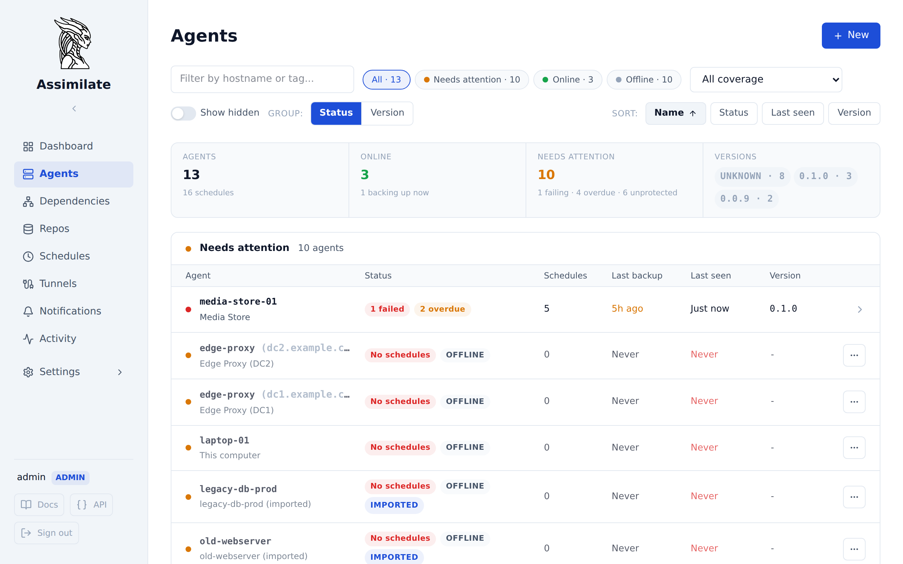
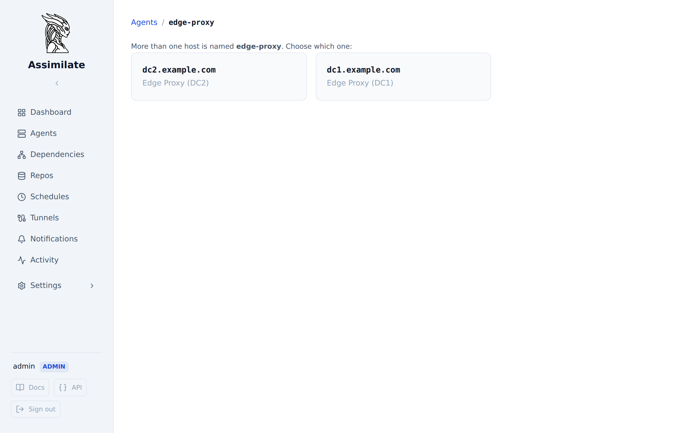
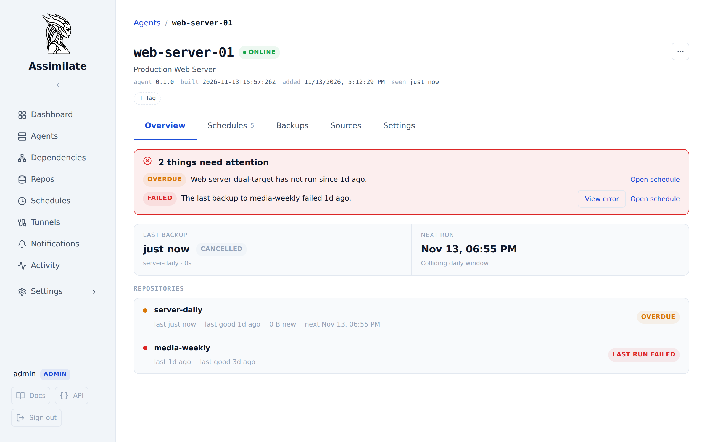
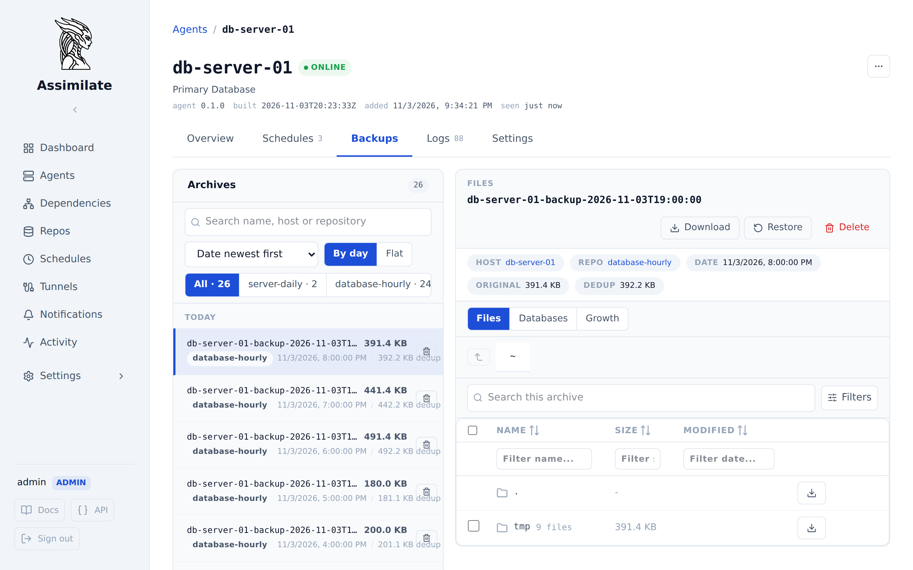

# Agent Management

An *agent* is a machine running the Assimilate agent binary. The server tracks each agent by its hostname (and, when two hosts share a hostname, its domain — see [Duplicate Hostnames](#duplicate-hostnames)), issues it a cryptographically random token, and communicates with it over a persistent WebSocket connection.

See [Getting Started](getting-started.md) for initial setup instructions.

## Adding an Agent

1. Navigate to **Agents** in the sidebar.
2. Click **New**.
3. Enter the machine's hostname.
4. Optionally set a domain — only needed if another host already uses this hostname (see [Duplicate Hostnames](#duplicate-hostnames) below).
5. Optionally set a display name.
6. Click **Create** — the server generates a 32-byte random token and shows it once, together with the server key.
7. Copy the token immediately; it is not shown again. The server key is the same for every agent and stays on the **System** page.

Pass the token to the agent via the `BORG_AGENT_TOKEN` environment variable and the server key via `BORG_SERVER_KEY`:

```bash
BORG_SERVER_URL=https://your-server BORG_AGENT_TOKEN=<token> BORG_SERVER_KEY=<server key> assimilate-agent
```

The agent refuses to start without a server key. See [Encrypted connection](#encrypted-connection) below.



The Agents list page shows every agent as a row in a grouped list. Above it sit a search box and a **Filters** button, with the status pills under them:

- **Search** — filter by hostname, display name, domain, or tag
- **Status pills** — **All**, **Needs attention**, **Online**, and **Offline**, each with a count of the agents it leaves given the other filters. **Online** and **Offline** go by the connection alone; **Needs attention** keeps the agents that carry a **failed**, **overdue**, or **No schedules** chip. The choice is remembered for the next visit.
- **Filters** — opens a card with the rest of the controls, below. The button shows how many of them are narrowing the list.

| Control | What it does |
|---|---|
| **Coverage** | Show protected, unassigned, never-succeeded, or disabled-only agents; dashboard coverage links set this filter automatically |
| **Tags** | Filter by one or more tags |
| **Group by** | Group the rows by **Status** (the default) or **Version**; the choice is remembered |
| **Sort by** | Sort by Name, Status, Last seen, or Version within each group |
| **Show hidden agents** | Reveal hidden imported agents (admin-only) |

A strip of three figures above the list rolls up the whole fleet:

| Figure | Shows |
|---|---|
| Agents | Total agent count, with the number of schedules under it |
| Online | Connected agents, with how many are backing up right now |
| Needs attention | Agents with an issue chip, split into failing, overdue, and (when any) unprotected |

The strip counts the whole fleet, not the filtered list — narrowing the rows below it does not change what the fleet is. To see which versions are in use, group the list by **Version**.

The **Dependencies** page, listed below **Agents** in the sidebar, lists the [dependency hosts](dependency-hosts.md): machines a backup needs besides its agent and repository, such as the server whose share a pre-backup command mounts.

### Grouping by status

By default the list has up to three groups, each in its own panel with a header naming it and counting its agents. A group with no agents is left out.

| Group | Contains |
|---|---|
| Needs attention | Agents with a **failed**, **overdue**, or **No schedules** chip, online or not. Failing agents come first. |
| Online | Connected agents with nothing to look at; the header says how many are backing up now |
| Offline | Disconnected agents with nothing due |

The **Offline** group shows its first five agents. Click **Show N more offline agents** under it to list the rest, and **Show fewer** to fold them again.

### Grouping by version

Choose **Version** under **Group by** to group agents by the version each one reports, newest first, with agents that have never reported a version last under **Unknown**. When the server has an agent binary available, each group header says how it stands against it — **Current** or **Behind**; without one, the UI makes no claim beyond naming the versions.

### Agent rows

Column heads appear once per group. Each row shows:

| Column | Shows |
|---|---|
| Agent | A status dot, the hostname (with its domain when set), and under it the display name, plus **Imported** or **Hidden** for those agents |
| Status | At most one item: the agent's most pressing issue chip, or, while a backup runs, where it is backing up to |
| Schedules | How many schedules target the agent |
| Last backup | The most recent completed backup |
| Last seen | When the agent was last connected |
| Version | The agent version it reports |

The status dot is red for an agent with a failed backup, blue while a backup is running, amber for any other issue, green for a healthy online agent, and grey for an offline one. Offline and hidden agents are dimmed; an offline agent has no chip of its own, its dimmed row and its **Last seen** time say it. Tags are not shown on the row; filter by them, or see them in the agent's header.

Click a row to open the agent's detail page. On a phone, each row stacks into three lines: the hostname with its last backup time, then the display name, schedule count, and version, then the status item.

Two of the figures take a colour of their own:

- **Last backup** reads green when the agent's schedules are on track, amber when one is overdue or its last run failed, and red when the agent has never completed a backup.
- **Last seen** reads amber for an agent that has just gone offline and red once it has been gone for more than a day.

The issue chips are **N failed**, **No schedules**, and **N overdue**, and a row shows only the first that applies, in that order. **failed** opens the [Activity log](activity.md) filtered to that agent's failed runs, where their output is; **overdue** opens the agent's Schedules tab with the overdue schedules highlighted. **No schedules** marks an agent nothing is scheduled to back up at all; it opens that agent's Schedules tab. The chip is only shown once the server has actually answered with schedule counts — a failed request leaves the row silent rather than accusing every agent of having none.

Every row ends in an arrow and opens the agent's page. Actions such as **Deploy agent**, **Upgrade agent**, **Adopt**, **Merge into...** and **Unhide agent** are in that page's [header](#header-actions), not on the list.

**Last backup** is the most recent backup that actually completed on that agent, across all of its schedules — a failed run is not one, however recently it reported. When an agent's latest run failed, the row shows the successful (or warning) run before it, so a single failure never makes a backed-up agent read as unprotected. An agent that has never completed a backup reads **Never**. Whether an agent has fallen *behind* is a separate question, answered by the **overdue** chip, which counts the agent's schedules the server considers overdue; the row does not estimate it a second time from the cron cadence.

## Duplicate Hostnames

An OS hostname is not always globally unique — the same short hostname (e.g. `web-01`) can exist on two different networks or sites, each in its own DNS domain. Assimilate normally identifies an agent by hostname alone, so a second host reusing an already-registered hostname needs a **domain** to tell them apart. When a hostname resolves to more than one agent, the UI never guesses which one you mean — following a link that only carries a hostname (e.g. from search, or an old bookmark) shows a picker instead of a detail page:



Selecting a candidate adds `?domain=` to the URL so the link becomes unambiguous from then on. Every hostname-keyed API call the UI makes on that page — settings, hostname aliases, tags, danger-zone actions — carries the same `domain` query parameter, so it always affects the correct agent even when its hostname is shared.

The domain isn't detected automatically: it's a DNS-level fact about where a host sits on the network, not something the agent process running on the machine can determine about itself. Set it by hand instead, either when adding the agent or later:

1. Open the agent detail page.
2. Open **Settings > Identity** and click **Edit**.
3. Enter the **Domain** field (e.g. `dc1.example.com`).
4. Save.

Leave the domain unset for the common case — a single host with that hostname. Two agents are only required to have different domains when they share a hostname; uniqueness is enforced on the *(hostname, domain)* pair, not on hostname alone.

## Agent Deployment

### Manual

Download the agent binary for your machine's architecture from the assets of a [GitHub release](https://github.com/alexmohr/assimilate/releases), `assimilate-agent-<version>-linux-x86_64` or `assimilate-agent-<version>-linux-aarch64`, and install it on the target machine. The [Nightly](https://github.com/alexmohr/assimilate/releases/tag/nightly) prerelease carries the latest build of `main`.

The Linux agent supports Ubuntu 26.04 or newer and Debian 13 or newer.

```bash
install -m 755 assimilate-agent-<version>-linux-x86_64 /usr/local/bin/assimilate-agent
```

Put the token in a file only root can read:

```bash
install -m 600 /dev/null /etc/assimilate-agent.env
echo 'BORG_AGENT_TOKEN=<token>' > /etc/assimilate-agent.env
```

Create a systemd unit at `/etc/systemd/system/assimilate-agent.service` that loads it:

```ini
[Unit]
Description=Assimilate backup agent
After=network.target

[Service]
Environment=BORG_SERVER_URL=https://your-server
EnvironmentFile=/etc/assimilate-agent.env
Environment=BORG_SERVER_KEY=<server key>
ExecStart=/usr/local/bin/assimilate-agent
Restart=on-failure
RestartSec=10

[Install]
WantedBy=multi-user.target
```

```bash
systemctl daemon-reload
systemctl enable --now assimilate-agent
```

Keep the token out of the unit itself: `systemctl show` gives every user on the machine the unit's `Environment=` values, but only the path of an `EnvironmentFile=`.

Put any other setting for the service, such as `SupplementaryGroups=`, in a [drop-in file](#custom-service-settings) and leave this unit as it is.

### Docker

```bash
docker run -d \
  --name assimilate-agent \
  --restart unless-stopped \
  -e BORG_SERVER_URL=https://your-server \
  -e BORG_AGENT_TOKEN=<token> \
  -e BORG_SERVER_KEY=<server key> \
  ghcr.io/your-org/assimilate-agent:latest
```

### Windows

Download `assimilate-agent-<version>-x86_64-pc-windows-msvc.zip` from the assets of a [GitHub release](https://github.com/alexmohr/assimilate/releases) and extract it, for example to `C:\Program Files\Assimilate`. The archive holds `assimilate-agent.exe`, borg 1.4 for Windows (the [marcpope/borg-windows](https://github.com/marcpope/borg-windows) build) in a `borg` folder next to it, and borg's license text. The agent uses that borg unless `BORG_BINARY` names another one. The release's `SHA256SUMS` file lists it, and it carries GitHub build provenance, which `gh attestation verify <file> --repo alexmohr/assimilate` checks.

Install it as a Windows service from an administrator PowerShell:

```powershell
$env:BORG_SERVER_URL = "https://your-server"
$env:BORG_AGENT_TOKEN = "<token>"
$env:BORG_SERVER_KEY = "<server key>"
& "C:\Program Files\Assimilate\assimilate-agent\assimilate-agent.exe" service install
```

`service install` registers the `assimilate-agent` service to run as `LocalSystem` at boot and starts it. The token is read from `BORG_AGENT_TOKEN` only, never from the command line, which other local users can read while it runs.

The service keeps the server URL, token and server key in `C:\ProgramData\Assimilate\agent\agent.json` and logs to `agent.log` in the same folder, which only `LocalSystem` and administrators can open. If the service fails before it can open that log, it writes the reason to `assimilate-agent-service-error-<YYYY-MM-DD>.log` in the system's temp folder (`C:\Windows\SystemTemp`, or `C:\Windows\Temp` on older Windows) instead. The file is named for the day and holds that day's first such failure, so a failure that repeats on every restart doesn't fill the folder. Run `service install` again to change the URL, token or server key; the service restarts with them. A service installed by an agent from before the encrypted connection has no server key stored and does not start until `service install` is run again with one. `service uninstall` stops and removes the service and its stored configuration.

If `C:\ProgramData\Assimilate` or its `agent` folder already exists and is owned by another user, or is a junction or link, `service install` refuses to use it; remove it and run the command again.

The same goes for an existing `agent.log`, and for one with a second hard link to it. When the service reopens its log, it resets the file's permissions, so a log that other users could read before can't be read by them afterwards.

Running `assimilate-agent.exe` without `service` starts the agent in the console instead, with `BORG_SERVER_URL`, `BORG_AGENT_TOKEN` and `BORG_SERVER_KEY` read from the environment as on Linux.

On Windows the agent runs [hook commands](scheduling.md#pre-and-post-backup-commands) with `cmd.exe`. [VM snapshots](vm-snapshots.md) and [database dumps](database-dumps.md) need a Linux agent: a Windows agent fails a backup that asks for either, saying why. **Deploy agent** installs on Linux only.

## Encrypted connection

Every connection between an agent and the server is encrypted end to end with the [Noise protocol](https://noiseprotocol.org/) (`Noise_NK_25519_ChaChaPoly_BLAKE2s`), inside the WebSocket, whether or not TLS is used and wherever a reverse proxy ends it. The agent's main connection and every [SSH agent forwarding](ssh-agent-forwarding.md) relay open with the same handshake.

- **The agent pins the server.** `BORG_SERVER_KEY` is the server's public key. Only a server holding the matching private key can complete the handshake, so an agent never sends its token, or anything else, to an impostor.
- **The token travels encrypted.** The agent sends its `Hello` with the token only after the handshake, inside the encrypted channel.
- **Each connection has its own keys.** Both sides generate fresh ephemeral keys per connection, so a recorded connection cannot be decrypted later, even with the server's key.
- **Frames cannot be altered, replayed or reordered.** Each frame is authenticated in order, and the connection closes on the first one that fails.

The server derives its key from `ASSIMILATE_SECRET_KEY`, so it stays the same across restarts and changes only if that secret does. The **System** page shows the key and its fingerprint (`SHA256:...`); an agent logs the same fingerprint when it connects. The add and adopt dialogs show the key next to the new token, and **Deploy agent** writes it into the service unit.

Unencrypted connections are not accepted. An agent from before the encrypted connection is closed with *this server requires an encrypted agent channel; update the agent* and stops. Update it and set `BORG_SERVER_KEY`, or redeploy it with **Deploy agent**.

If the agent logs *encrypted channel handshake failed*, its `BORG_SERVER_KEY` does not match the server's key: compare it with the **System** page. The agent keeps retrying, so it connects as soon as the key is corrected.

### SSH Deploy from Dashboard

The dashboard can push the agent binary and install a systemd unit on a remote machine over SSH — no manual steps required on the target machine. The [desktop app](desktop.md) doesn't offer this: it updates its own agent with the app.

**Prerequisites:**

- The server's SSH public key must be in `~/.ssh/authorized_keys` on the remote machine. The key is shown under **System** in the admin UI (see [Security](security.md)).
- The remote user must have write access to the install path (default `/usr/local/bin`) and permission to manage systemd units.

**Steps:**

1. Open the agent detail page and click **Deploy agent** in the header.
2. Fill in the SSH connection fields:

    | Field | Description |
    |-------|-------------|
    | SSH Host | Hostname or IP of the remote machine |
    | SSH User | SSH user on the remote machine (prefilled with the username last used to deploy this agent, defaulting to `root` the first time) |
    | SSH Port | SSH port (default: 22) |
    | Server URL | URL the agent will use to connect back to the server |
    | Install path | Binary destination (default: `/usr/local/bin/assimilate-agent`) |

3. Click **Deploy**. The server copies the binary, writes the systemd unit, and regenerates the agent token automatically. The token goes in `/etc/assimilate-agent.env`, which the unit loads with `EnvironmentFile=`, so it does not show up in `systemctl show`, which every user on the host can run. The binary, the unit and the token file are uploaded over SFTP to private temporary files and installed owned by root, so the SSH user cannot replace what systemd runs as root: the binary with mode 0755, and the unit and the token file readable by root only. None of them is ever written through a command. A sudo password goes to `sudo` on its standard input, never on the command line, which every user on the host can read.

If the agent is already at the latest version, the deploy is skipped and the existing token is preserved. The SSH user entered is remembered for this agent and prefilled the next time the dialog is opened.

!!! note
    SSH deploy requires admin privileges. The server uses the same Ed25519 key pair used for [SSH Agent Forwarding](ssh-agent-forwarding.md).

### Agents Older Than the Server

An agent that is behind the server stays connected. When the server sends it a message it does not know, the agent logs a warning naming the message type (never its contents) and ignores it. If the server was waiting for an answer, the request fails right away with an error saying the agent does not support it, instead of hanging until it times out. Upgrade the agent to use the feature.

### Existing Systemd Unit

Whenever the dialog is opened, the server automatically attempts to read an existing `assimilate-agent.service` unit from the remote host over SSH and, if found, loads it into the **Systemd Service Unit** field so custom settings (e.g. resource limits, extra environment variables) are preserved across upgrades.  Prefer a [drop-in file](#custom-service-settings) for those settings. A **Load from remote** button lets you re-fetch it after changing the SSH connection fields.

If the existing unit contains a `BORG_AGENT_TOKEN` value, as one deployed by an older server does, the server redacts it to `[REDACTED]` before it is ever sent to the browser — the real token is never exposed in the API response or displayed in the UI. When you click **Deploy**, the server removes it from the unit, writes a newly generated token to the token file and adds the `EnvironmentFile=` line that loads it if the unit doesn't have one, regardless of what is shown in the field. It injects the server's `BORG_SERVER_URL` and `BORG_SERVER_KEY` the same way: an `Environment=` line that sets one of them has only that assignment replaced, so other variables on the same line (for example `Environment=BORG_SERVER_URL=https://old RUST_LOG=debug`) are kept, and a new `Environment=` line is added to `[Service]` only when no line sets it. Deploying is therefore also how an agent from before the [encrypted connection](#encrypted-connection) gets its server key.

### Custom Service Settings

**Deploy agent**, **Upgrade agent** and **Redeploy agent** rewrite `/etc/systemd/system/assimilate-agent.service`. The dialog keeps the settings it finds in the existing unit, but a setting that is not in the unit when the deploy runs is gone afterwards. This happens with a unit that was edited by hand and then replaced, for example after a reimage or a redeploy from another server.

Put local settings in a systemd drop-in file instead. A deploy never touches `/etc/systemd/system/assimilate-agent.service.d/`, and systemd merges every `*.conf` file in it over the unit.

1. Create the drop-in with `systemctl edit`, which reloads systemd when the editor closes:

    ```bash
    systemctl edit assimilate-agent
    ```

2. Add the settings under `[Service]`. This example gives the agent access to directories that belong to a group other than root, which a service started by systemd does not get from `/etc/group`:

    ```ini
    [Service]
    SupplementaryGroups=1006
    ```

3. Restart the agent:

    ```bash
    systemctl restart assimilate-agent
    ```

The same applies to resource limits (`MemoryMax=`), `Environment=RUST_LOG=debug` and every other [systemd.exec](https://www.freedesktop.org/software/systemd/man/latest/systemd.exec.html) setting. `systemctl cat assimilate-agent` shows the unit with all its drop-ins.

!!! tip
    A drop-in is also the safer place for a change you want to keep. The **Systemd Service Unit** field only shows the main unit, so a drop-in is never overwritten by what you paste into it.

### Redeploying an Agent

Once an agent is already running the latest version, the header no longer offers **Upgrade agent** — there is nothing newer to install. The host it runs on can still lose its installation, though (a reimage, a wiped disk, a systemd unit that was hand-edited into a broken state), and reconnecting it needs the same SSH push used for the original install.

1. Open the agent detail page and choose **Redeploy agent** from the header's **...** menu.
2. Fill in the SSH connection fields as for a normal deploy.
3. Click **Redeploy agent**. The server reinstalls the binary and systemd unit and regenerates the token, exactly as an upgrade would — the only difference is that it proceeds even though the agent already reports the current version.

## Token Management

Each agent has exactly one active token. Tokens are stored as bcrypt hashes — the plaintext is never persisted.

To regenerate a token:

1. Open the agent detail page.
2. Choose **Regenerate token** from the header's **...** menu, or open **Settings > Identity** and click **Regenerate token**.
3. Copy the new token immediately.

!!! warning
    Regenerating a token **immediately invalidates the old one**. The running agent will be disconnected and will fail to reconnect until it is restarted with the new token. Update `BORG_AGENT_TOKEN` in the agent's environment or its token file (`/etc/assimilate-agent.env` for an agent installed with **Deploy agent**) before restarting.

SSH deploy automatically regenerates the token as part of the deployment process. The [desktop app](desktop.md) doesn't offer **Regenerate token**: it issues its own agent a fresh token every time it starts.

## Agent Restart

The dashboard can send a remote restart command to a connected agent.

**Requirements:**

- The agent must be currently connected (online).
- The agent must report the `supports_restart` capability. This is available when the agent is managed by systemd and can signal its own service manager, or runs as the Windows service, which the Service Control Manager starts again after it exits.

To restart:

1. Open the agent detail page.
2. Choose **Restart agent** from the header's **...** menu.

If restart is not supported, the menu item is replaced by the reason (e.g., "not running under systemd") instead of offering an action that cannot succeed. The server returns HTTP 400 if the call is made anyway.

## Agent Status

Each agent row and detail page shows a live connection indicator:

| Status | Meaning |
|--------|---------|
| **Online** | Agent has an active WebSocket connection to the server |
| **Offline** | No active connection; `last_seen` shows when the agent last disconnected |

The server tracks liveness via WebSocket pings. If the agent stops responding to pings, the connection is closed and the agent transitions to **Offline**. `last_seen` is updated whenever the agent disconnects cleanly or times out.

"Disconnected" does not mean the agent is deleted or its data is lost — it simply means the agent is not currently reachable. Scheduled backups for that agent will fail until the agent reconnects.

Each schedule backs off after a failed attempt: instead of retrying on the next 30-second scheduler tick, it waits until its next normal cron occurrence. Each missed attempt below the schedule's **Mark as failed after** threshold (Settings → General, `missed_backup_threshold`, default 3) shows as a warning on the schedule; once consecutive misses reach that threshold, the schedule is automatically disabled rather than retried again — so a long outage produces a handful of failures, not an unbounded stream of them. It is re-enabled automatically, with its failure count reset, the moment the agent reconnects; no manual action is needed, and a schedule with [catch-up runs](scheduling.md#catch-up-runs) enabled also runs the occurrence it missed. This only ever applies to schedules the scheduler disabled itself for this reason — a schedule you disable by hand, or one disabled by [quota enforcement](quotas.md), is left untouched.

The failure count is tracked per schedule, not per target agent. For a schedule with multiple target agents, one agent staying permanently offline will eventually auto-disable the *whole* schedule — including its other, perfectly healthy targets — rather than just skipping the unreachable one. Retargeting the schedule away from the broken agent clears its stale failure count (so it starts fresh against its new targets instead of carrying over failures that had nothing to do with them), but does *not* itself flip the schedule back on — it still needs the broken agent to reconnect (if it's still a target elsewhere), or a manual re-enable.

A schedule can also back off and auto-disable for a local/data problem unrelated to connectivity — for example a corrupted encrypted repo passphrase that fails to decrypt on every attempt. That case is *not* cleared by the agent reconnecting, since reconnecting says nothing about whether the underlying problem was fixed: it stays disabled until you fix the cause and re-enable it yourself.

A schedule the scheduler disabled itself is never just labeled "Disabled" — its health on the Schedules list and the status badge in its detail page's header read "Auto-disabled · agent unreachable" or "Auto-disabled · error", so it's distinguishable at a glance from a schedule you (or [quota enforcement](quotas.md)) turned off. Both the auto-disable and the later reconnect re-enable are also recorded on the [Activity page](activity.md)'s System Events tab.

Before a schedule reaches its threshold, each miss shows as `N/threshold missed` in the schedule's **Health** column on the Schedules list, so a struggling agent is visible well before the schedule actually goes down. See [Schedule Configuration](configuration.md#schedule-configuration) for the `missed_backup_threshold` field.

While a backup is running for an agent, its row on the Agents list shows a blue status dot and names the target repository (*Backing up: ...*) in its Status column. This reflects persisted running-operation state, so it appears immediately on page load rather than only after a live event.

## Agent Detail View

The agent detail page opens on a persistent header — hostname, connection status, and a meta strip carrying the agent version, revision, build time, registration date and last-seen time — followed by five tabs: **Overview**, **Schedules** (with a count), **Backups**, **Sources** (admins only) and **Settings**. Admins also see and edit the agent's [tags](#agent-tags) in the header.



### Header actions

Actions are graded by how often and how safely they are used:

| Placement | Actions |
|-----------|---------|
| Primary button | **Deploy agent** / **Upgrade agent**, when a newer build is available. On an imported host, **Adopt** and **Merge into...** instead |
| Overflow menu (**...**) | **Activity log**, **Clean up failed backups (N)** for admins when there are any, **Edit identity**, **Deploy SSH key**, **Redeploy agent**, **Regenerate token**, **Restart agent**, and for admins **Delete agent** — or **Hide agent** and **Delete archives and remove** on an imported host. A hidden host offers admins **Unhide agent** in place of **Hide agent** |

Edit identity and Deploy SSH key open dialogs rather than expanding inline, so the page below them does not move.

### Overview

The landing tab answers one question — are this agent's backups OK — and then shows the evidence. Schedules and archives have tabs of their own, so they are not previewed here:

- A **progress card** for each backup currently running on this agent, linking to the target repository and offering a **Cancel backup** action. Files/data processed and the current file are shown as they stream in; the current-file path is clamped to two lines and ellipsized if it still doesn't fit, so the card stays a fixed size.
- A **verdict**, always present, that changes with the agent's state: *All backups are healthy* with a one-line summary of the recent runs, *Needs attention* when something is wrong, or *No backups yet* for an agent that has never run. When something is wrong it lists each problem under the verdict: an overdue schedule (with **Open schedule**), a repository whose last run failed, one entry per repository (each with **View error**, which opens the run in the [Activity log](activity.md) with its output already open), or an offline agent. The verdict is red when a run failed and amber otherwise.
- Two facts side by side: **Last backup** with its outcome, and **Next run** across every enabled schedule. When the last backup failed or warned, its **Failed** or **Warning** badge opens that run in the [Activity log](activity.md), with its output open.
- A **Repositories** list with one row per repository the agent backs up to. Each row's dot shows the repository's own state, and anything but healthy is named next to the name (*Warnings*, *Last run failed*, *Overdue*, *Running now* or *Never ran*), followed by when it last ran, how much new data that run added, and when it next runs. A repository whose last run failed also shows when it last succeeded. Select a row to open the repository. On a row whose last run failed or warned, the *Last run failed* or *Warnings* label opens that run in the Activity log instead.

The verdict's summary line looks back over the last 20 runs across all repositories. This is a count of runs, not a span of days, because a fixed calendar window means something different at every backup cadence: 30 days is four samples for a weekly schedule, where a single miss reads as 75%, and over 700 for an hourly one, where a whole night's outage rounds away to nothing.

!!! note
    Fleet-wide success *rates* over a selectable window live on the [Dashboard](dashboard.md), where every agent shares one window and the comparison is meaningful.

### Schedules

The Schedules tab is a table of the schedules that target this agent: a status dot, the name over its cadence and repository, the last run and the next one. **All**, **Failing** and **Healthy** pills above it narrow the table, and **Add schedule** starts a new [schedule](scheduling.md#creating-a-schedule) for this agent. A failing schedule shows its last error in place of its cadence line; that error and the row's last-run outcome open the run in the [Activity log](activity.md). Click a row to open the schedule. Each row's play button is **Run now**, which triggers the schedule for this agent only — not for the other hosts a shared schedule targets.

The tab label carries a count, including zero.

### Backups

The Backups tab is the archive browser: every archive this agent has, in every repository it backs up to, in one list — the same archive list and file browser the [repository](archives.md) and [schedule](scheduling.md#backups-tab) Backups tabs render, pre-filtered to this agent's own archives. The list starts grouped by day. With more than one repository each row names its repository and repository pills above the list narrow it to one; with a single repository the list header names it. Select an archive to browse its file contents, navigate directories via the folder path, download files or directories, and [pick files to restore](archives.md#picking-files-to-restore-or-download) — onto this agent by default, or [anywhere else](archives.md#where-to-restore). The archive's **Growth** tab shows where its deduplicated size went, compared with this agent's usual growth in that repository — see [Archive growth](archives.md#archive-growth).



### Run history

The agent page has no run list of its own: every backup the agent has attempted, any status, is in the [Activity log](activity.md). **Activity log** in the header's **...** menu opens it filtered to this agent, and every failed or warned badge on the page opens the run it is about there, with its output open.

A failed run usually produced no borg archive, so there is nothing on disk to lose by clearing its history — and the rare failed run that did produce one (e.g. a prune or post-backup hook failing after a successful `borg create`) is left alone rather than deleted. When there are one or more archive-less failed runs, an admin can clear them via **Clean up failed backups (N)** in the header's overflow menu; it deletes every such failed report for this agent after a confirmation dialog. This is a manual, on-demand action for this agent alone — independent of the [`failed_report_retention_days`](configuration.md#system-settings) setting, which prunes failed reports for *every* agent automatically by age.

### Sources

Admins only. What the agent backs up besides plain files, as two collapsible sections:

| Section | Contents |
|---------|----------|
| **Virtual machines** | Staging this host's libvirt/QEMU domains before a backup, and what each may occupy — see [VM Snapshots](vm-snapshots.md) |
| **Databases** | The database servers on this host and their dumps — see [Database Dumps](database-dumps.md) |

The open section is recorded in the URL (`?tab=sources&section=databases`).

### Settings

Everything that configures the agent lives here, as collapsible sections stacked in one card. Several can be open at once, and **Expand all** / **Collapse all** opens or folds every one:

| Section | Contents |
|---------|----------|
| **Identity** | Hostname, domain, display name, agent build details, registration and last-seen times, token regeneration, and hostname aliases — glob patterns for archive matching (see below) |
| **Backup defaults** | Backup paths, exclude patterns, file change patterns and pre/post hook commands, as one form saved in a single request. Hook commands set here run on every schedule targeting this host and carry their own optional per-command timeout — see [Pre- and Post-Backup Commands](scheduling.md#pre-and-post-backup-commands) |
| **Power & dependencies** | Admins only. The host's [machine](power-management.md#machines) — waking it, shutting it down, whether it is always online — then starting the agent process before a backup, and the [dependency hosts](dependency-hosts.md#requiring-a-dependency) every schedule on this agent needs, for a share its default commands mount — see [Power Management](power-management.md) |

The chosen tab and the last section opened are both recorded in the URL (`?tab=settings&section=defaults`), so a specific section can be linked to directly; it starts open.

### Imported hosts

An imported host keeps its tabs. It has archives but no agent, so its Schedules tab is empty — and explains why, pointing you to **Adopt** and **Merge into...** in the header rather than leaving you to work it out. The header omits the agent version, revision and build time, since there is no agent to report them, and its Settings and Sources tabs are read-only, with no token to regenerate.

## Hostname Aliases (Glob Patterns)

When importing an existing borg repository, archives may have hostnames that don't match the registered agent name (e.g. the machine was renamed, or borg was configured with a custom hostname). Hostname aliases let you define glob patterns so these archives are automatically matched to the correct agent.

### Adding a Pattern

1. Open the agent detail page.
2. Open **Settings > Identity** and scroll to **Hostname aliases**.
3. Enter a glob pattern (e.g. `webserver-*`, `prod-web-??.example.com`).
4. Click **Add pattern**.

Patterns use standard glob syntax:

| Pattern | Matches |
|---------|---------|
| `web-*` | `web-01`, `web-prod`, `web-anything` |
| `srv-?.local` | `srv-1.local`, `srv-a.local` (single character) |
| `*-backup` | `agent1-backup`, `my-machine-backup` |

### How Matching Works

During repository import (and re-scan), each archive's hostname is resolved in order:

1. **Exact match** — hostname equals a registered agent's hostname
2. **Pattern match** — hostname matches a glob pattern attached to an agent
3. **Unmatched** — a placeholder agent is created with an "(imported)" suffix

Patterns are evaluated across all agents. The first matching pattern wins.

### Re-scanning Unmatched Archives

After adding patterns, you can re-scan a repository to match previously unmatched archives. See [Repositories — Re-scan](repositories.md#re-scanning-unmatched-archives).

## Merging Imported Agents

When a repository is imported, placeholder agents are created for archive hostnames that don't match any existing agent. These appear in the Agents list marked **Imported** under the hostname.

To merge a placeholder into a real agent:

1. On the **Agents** list, open the imported agent and click **Merge into...** in its header.
2. Select the target agent from the dropdown. If more than one candidate shares a hostname, each is labeled with its domain (or "no domain") so you can tell them apart.
3. Optionally check **Save as hostname alias** to automatically create a glob pattern (pre-filled with the placeholder's hostname followed by `*`).
4. Click **Merge**.

Merging transfers all backup reports from the placeholder to the target agent and deletes the placeholder. If you saved a pattern, future imports will match automatically.

## Agent Tags

Tags let you organize agents for filtering on the Agents list page.

- Admins add and remove tags in the agent detail page's header.
- Filter the agent list by one or more tags under **Filters > Tags**.
- Tags are free-form strings; no predefined taxonomy is enforced.

## Deleting an Agent

1. Open the agent detail page.
2. Choose **Delete agent** from the header's **...** menu (admins only) and confirm in the dialog.

**What is removed:**

- The agent record and its token hash
- Any SSH reverse tunnel configured for this agent (the tunnel is stopped immediately)

**What is retained:**

- Repositories, schedules, and backup reports are **not** automatically deleted. They become orphaned and should be cleaned up manually from the [Repositories](repositories.md) page.

!!! warning
    Deleting an agent does not remove borg archives from the repository server. Use `borg delete` or the [Archives](archives.md) page to remove archive data.

## Hiding Imported Agents

When repositories are scanned, placeholder "imported" agent entries are created for hostnames found in existing archives. If you don't need to see these agents in the UI, you can hide them.

Hidden agents are excluded from:

- The agents list (default view)
- Dashboard statistics and storage aggregations
- Activity feed and health summary
- Scheduled backup targets
- Calendar events

### Hiding an Agent

1. Open the imported agent's detail page.
2. Choose **Hide agent** from the header's **...** menu (admins only).
3. The agent disappears from all views immediately.

### Viewing and Unhiding Hidden Agents

1. Navigate to **Agents** in the sidebar.
2. Open **Filters** and enable **Show hidden agents** (admin-only).
3. Hidden agents appear dimmed and marked **Hidden** under the hostname.
4. Open the hidden agent and choose **Unhide agent** from the header's **...** menu (admins only) to restore it to normal visibility. The page stays open; the agent shows up in every view again.

!!! note
    Hiding is non-destructive — all archive data remains intact on disk. The agent will not reappear on the next repository scan because the database record is preserved with the hidden flag.

## Deleting Archives & Removing Imported Agents

For imported agents whose archive data is no longer needed, you can permanently delete all borg archives and remove the agent record.

1. Open the imported agent's detail page.
2. Choose **Delete archives and remove** from the header's **...** menu (admins only).
3. Confirm in the dialog — this action is irreversible.

The server sends `borg delete` commands to connected agents for each repository containing archives from this agent. Once all archives are deleted, the agent record is removed from the database.

!!! danger
    This permanently destroys backup data. All borg archives belonging to this agent are deleted from disk across all repositories. This cannot be undone.

**Requirements:**

- At least one agent with access to each relevant repository must be connected.
- If no agent is available for a repository, those archives are skipped and reported as errors.

<!--
SPDX-License-Identifier: Apache-2.0
SPDX-FileCopyrightText: 2026 Alexander Mohr
-->
