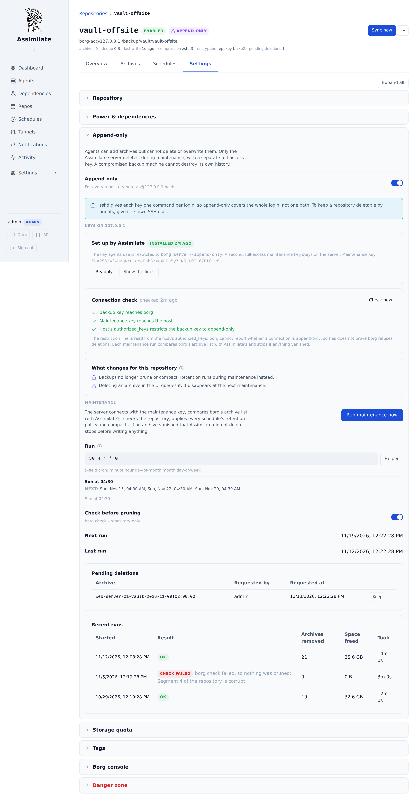

<!--
SPDX-License-Identifier: Apache-2.0
SPDX-FileCopyrightText: 2026 Alexander Mohr
-->

# Append-only Repositories

An append-only repository accepts new archives from the backup machines but cannot have archives deleted or overwritten by them. A backup machine that is compromised, or that runs ransomware, cannot destroy its own history. Assimilate sets this up on the [repository host](repository-hosts.md) and takes over pruning and compacting, which the backup machines can no longer do.



## How it works

The repository host enforces append-only, not borg's repository configuration. A restriction in the host's `~/.ssh/authorized_keys` forces the key the agents use to `borg serve --append-only`, so an agent with full control of its own machine still cannot lift it. Assimilate uses two keys:

| Key | Used by | Access on the host |
|-----|---------|--------------------|
| **Backup key**, the server's own SSH key | Every agent, through [SSH agent forwarding](ssh-agent-forwarding.md) | Restricted to `borg serve --append-only` for the login's repositories |
| **Maintenance key** | The server only | Unrestricted, like the server's key was before |

The maintenance key is generated by the server as `id_ed25519_maintenance` next to the server's own key in `SSH_KEY_DIR`, readable only by the server. It is never loaded into the server's SSH agent, which the relay offers to every agent. Server-side borg and SFTP use it directly.

### The setting belongs to a login

sshd runs one forced command per key per login, so append-only covers an SSH login: a repository host and the SSH user the repositories log in as. Every repository that logs in the same way switches together. The settings section names those repositories. To keep a repository deletable by its agents, give it an SSH user of its own.

!!! note
    A repository on a host that Assimilate manages for append-only keeps working for every other login on that host. Only the logins that were switched on are restricted.

## Prerequisites

- Admin access. The settings, and every endpoint behind them, are admin-only.
- A [repository](repositories.md) whose host the server can already log in to with its own key. If it cannot, the setup asks for the login's SSH password once.
- borg 1.x on the repository host. borg 2 replaces `--append-only` with `--permissions`, which this feature does not use.

## Turning it on

1. Open the repository and select **Settings → Append-only**.
2. Turn on **Append-only**. The server edits the host's `authorized_keys` over SFTP.
3. If the server's key cannot edit the file, the section asks for the login's SSH password. Enter it and select **Set up**. The password is used once and is not stored.

The server changes the file in an order that cannot lock it out:

1. It adds the maintenance key's line and logs in with that key.
2. Only then, logging in with the maintenance key, it replaces the server key's line with the restricted one. The restriction names every repository on the login with `--restrict-to-repository`.
3. It checks that the backup key still authenticates, and undoes the change if it does not.

Lines it does not manage, comments and blank lines included, are kept. SFTP cannot replace a file atomically, so the file as Assimilate first found it is copied to `~/.ssh/authorized_keys.assimilate-backup` before anything changes, and the copy is never overwritten by later changes.

### Setting it up by hand

For a host Assimilate cannot edit, select **Show the lines** and add both lines to the login's `authorized_keys`, in place of the server key's line:

```text
command="borg serve --append-only --restrict-to-repository '/srv/borg/nas-offsite'",restrict ssh-ed25519 AAAA... assimilate-server
ssh-ed25519 AAAA... assimilate-maintenance
```

Select **Check now** afterwards. Backups fail with a permission error until the maintenance key's line is there.

### Adding a repository to an append-only login

Adding a repository on a login that is append-only rewrites the restriction with the new path before borg runs against it, so the new repository works at once. **Reapply** does the same on demand, and also drops the paths of repositories that were removed.

## Connection check

**Check now** tries both keys against the host and reads its `authorized_keys`:

| Result | Meaning |
|--------|---------|
| **Backup key** | The key the agents use is accepted |
| **Maintenance key** | The maintenance key is accepted |
| **Restriction in place** | The file restricts the backup key to append-only access for exactly the login's repositories |

!!! warning "The check cannot prove borg refuses deletions"
    borg gives a client no way to ask whether its connection is append-only: `borg prune` and `borg delete` appear to succeed and `borg compact` silently does nothing. The check reads the file, not borg's behaviour. Assimilate protects itself against a restriction that went missing differently: maintenance notices deletions it did not make (below).

## Maintenance

An append-only repository is pruned and compacted by the server, on the repository's maintenance schedule, using the maintenance key. Backups on such a repository run neither `borg prune` nor `borg compact`.

Set the schedule under **Settings → Append-only → Maintenance**. It is a cron expression in the server's timezone, Sunday 04:30 by default. **Run maintenance now** starts a run at once, behind any other operation on the repository.

A run does these steps in order:

1. **Look.** It lists the repository with the maintenance key and compares the archives with Assimilate's records.
2. **Check.** Unless it is turned off, it runs `borg check --repository-only`. A failed check ends the run as **Check failed**, with nothing pruned.
3. **Delete** the archives users queued.
4. **Prune** with the retention of every enabled backup schedule that writes to the repository, the way the agent would have after each backup: each schedule prunes only the archives it wrote for each agent, and archives named before schedule ids existed are pruned with the most any of that agent's schedules keeps.
5. **Compact**, and record how much space it freed.

A run that does not end **OK** (**Stopped**, **Check failed** or **Failed**) sends the **Check failed** notification event to the channels that subscribe to it, with the outcome and its detail as the message, so a failing check or vanished archives do not wait to be found in the run history.

### When archives vanish

borg makes deletions that were requested over an append-only connection permanent the first time something writes with full access. A run therefore compares the archives before its first write (again after the check, which can take long on a large repository). If archives are gone that Assimilate did not delete, the run **stops** and writes nothing: the repository can then still be rolled back with borg's transaction log on the host (see the [borg documentation](https://borgbackup.readthedocs.io/en/stable/usage/notes.html#append-only-mode-forbid-compaction)).

This protects against deletions made before the run starts writing. Archives deleted over the append-only connection while the run is deleting or pruning cannot be told apart from the ones it removed itself, so they are not caught until the next run, which looks at what is left. Keep the host's transaction log until you have looked at a run's result.

A stopped repository shows **Maintenance stopped** on its card and header, lists the vanished archives, and has no next run. The periodic sync keeps the records of archives that vanished from an append-only repository instead of dropping them, so a deletion is not forgotten before maintenance looks.

- If the deletion was a mistake, roll the repository back on the host. The archives are listed again, and the next run finds nothing missing.
- If it was intended, select **Accept and resume**. The records of those archives are removed and the schedule continues.

!!! warning
    **Accept and resume** is the point after which the data is only really gone: the next maintenance run writes with full access. Roll back on the host first if the deletion was not intended.

## Deleting archives

Deleting an archive in an append-only repository queues the deletion. The archive stays in the list, struck through and marked **removed at next maintenance**, until the next run deletes it. **Keep** takes it off the queue again. The repository's size, and a [storage quota](quotas.md), still count the archive until then.

Append-only cannot be turned off while deletions are queued, since nothing would carry them out. Run maintenance or select **Keep** on each first.

## Turning it off

Turn off **Append-only**. The server logs in with the maintenance key, makes the server key's line a plain line again, and removes the maintenance key's line. Maintenance stops, its schedule is removed, and the run history is kept. Backups prune and compact after each run again.

!!! warning
    If maintenance is stopped because archives vanished, turning append-only off has the same effect as **Accept and resume**: the records of those archives are removed, and the server logs which ones. Look into why they vanished, and roll the repository back on the host if that was not intended, before turning it off.

## Configuration reference

| Setting | Default | Description |
|---------|---------|-------------|
| **Maintenance schedule** | `30 4 * * 0` | Cron expression, in the server's timezone |
| **Check before pruning** | On | Run `borg check --repository-only` before anything is written |
| `SSH_KEY_DIR` | see [Configuration](configuration.md) | Where the server keeps its keys, the maintenance key included |

## API Endpoints

| Method | Path | Description |
|--------|------|-------------|
| `GET` / `PUT` | `/api/repos/{repo_id}/append-only` | Get the state, or turn it on or off for the repository's login (admin only) |
| `POST` | `/api/repos/{repo_id}/append-only/check` | Try both keys and read the host's `authorized_keys` |
| `POST` | `/api/repos/{repo_id}/append-only/reapply` | Rewrite the host's `authorized_keys` for the login's repositories |
| `PUT` | `/api/repos/{repo_id}/append-only/maintenance` | Set the maintenance schedule |
| `POST` | `/api/repos/{repo_id}/append-only/maintenance/run` | Run maintenance now |
| `POST` | `/api/repos/{repo_id}/append-only/maintenance/resume` | Accept the vanished archives and resume a stopped repository |
| `DELETE` | `/api/repos/{repo_id}/archives/{archive_name}/deletion` | Take an archive off the deletion queue |

A request that turns append-only on or off, or reapplies it, answers `200` with the state even when it did not work: `setup_failure` then says what failed and whether the SSH password is needed.

## Related pages

- [Repository Management](repositories.md)
- [Repository Hosts](repository-hosts.md)
- [SSH Agent Forwarding](ssh-agent-forwarding.md)
- [Scheduling & Retention](scheduling.md#pruning)
- [Security](security.md#append-only-repositories)
