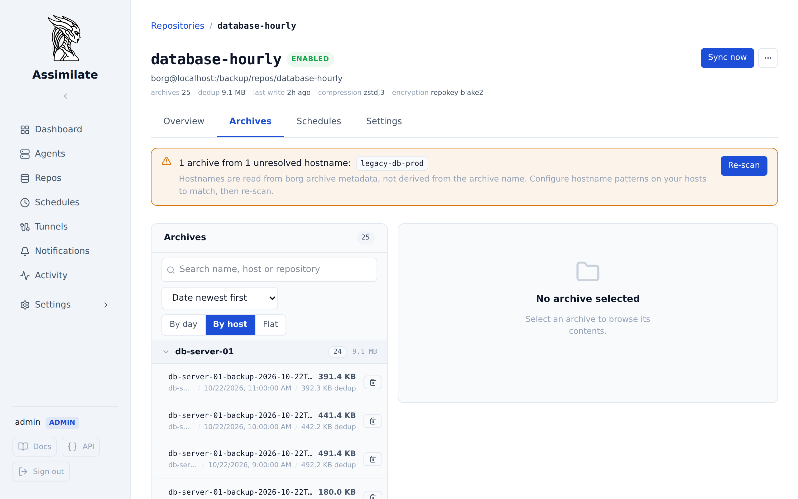
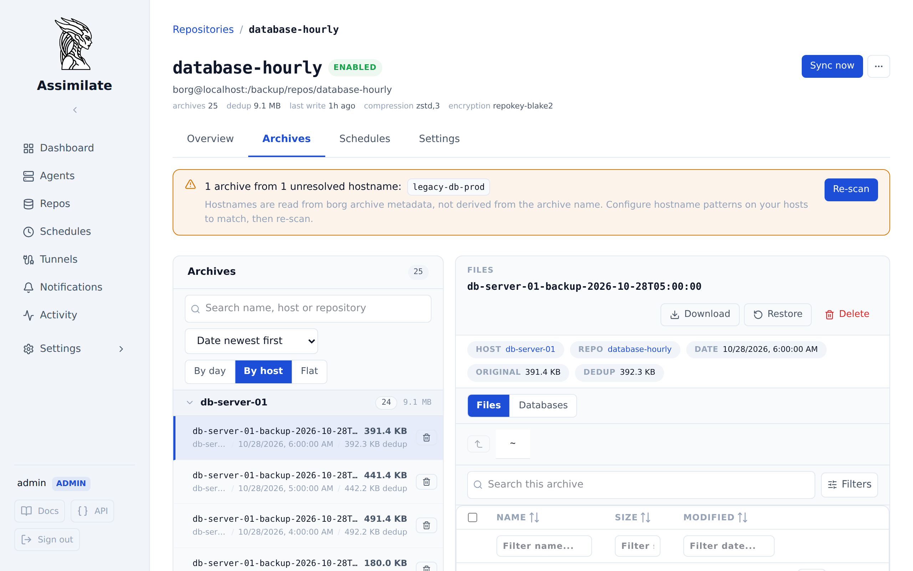
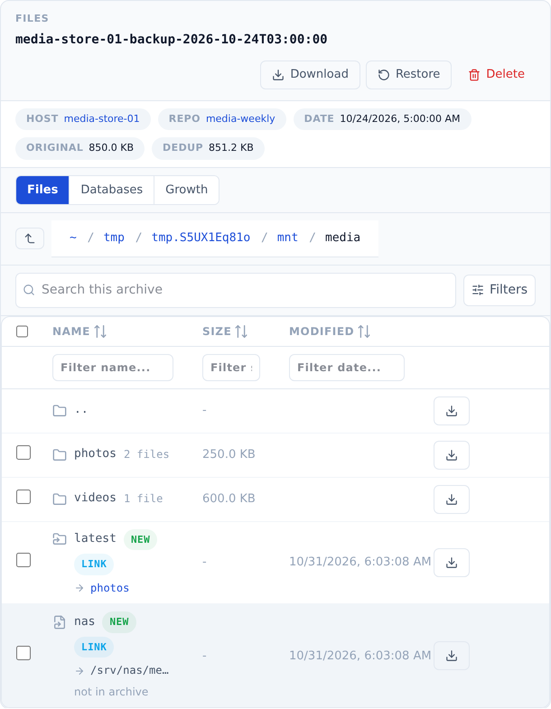
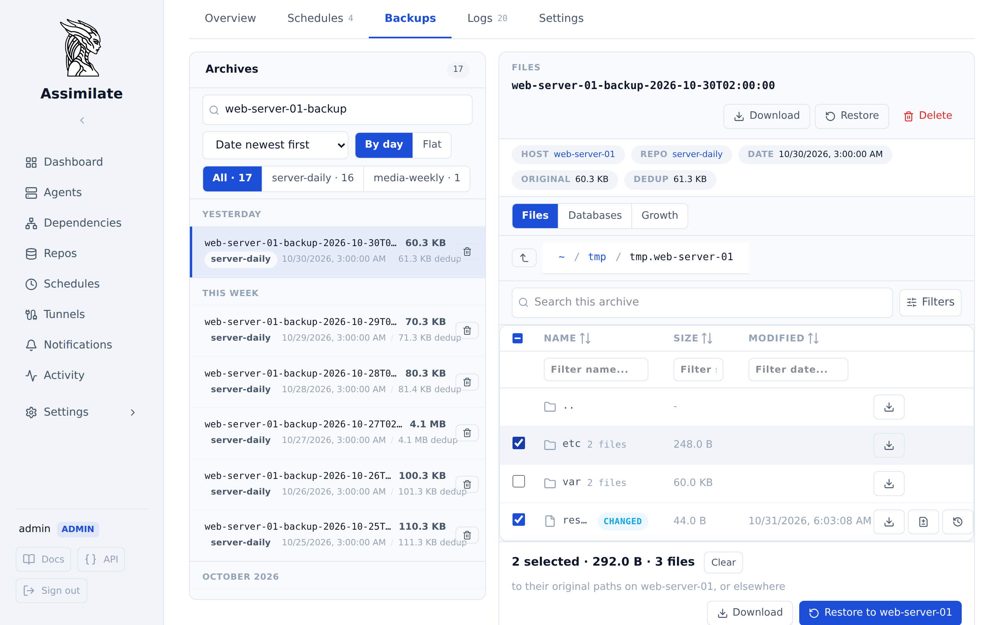
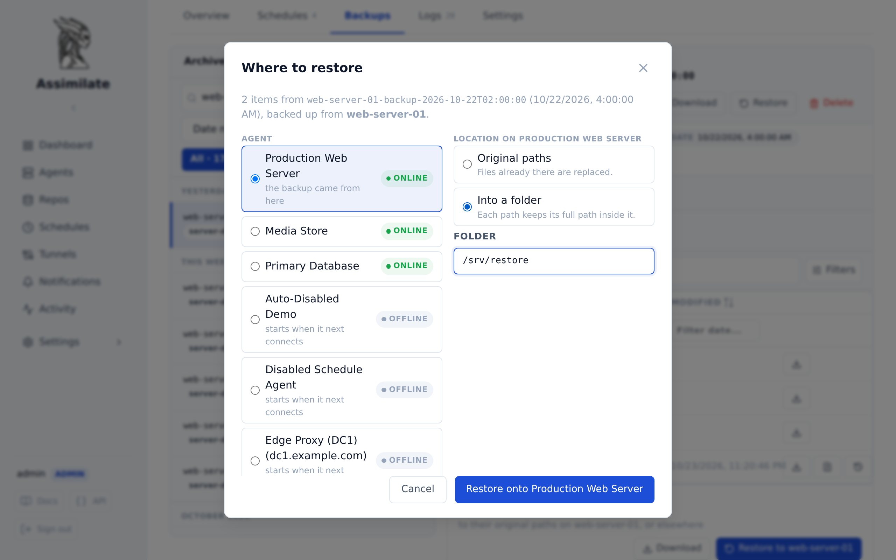
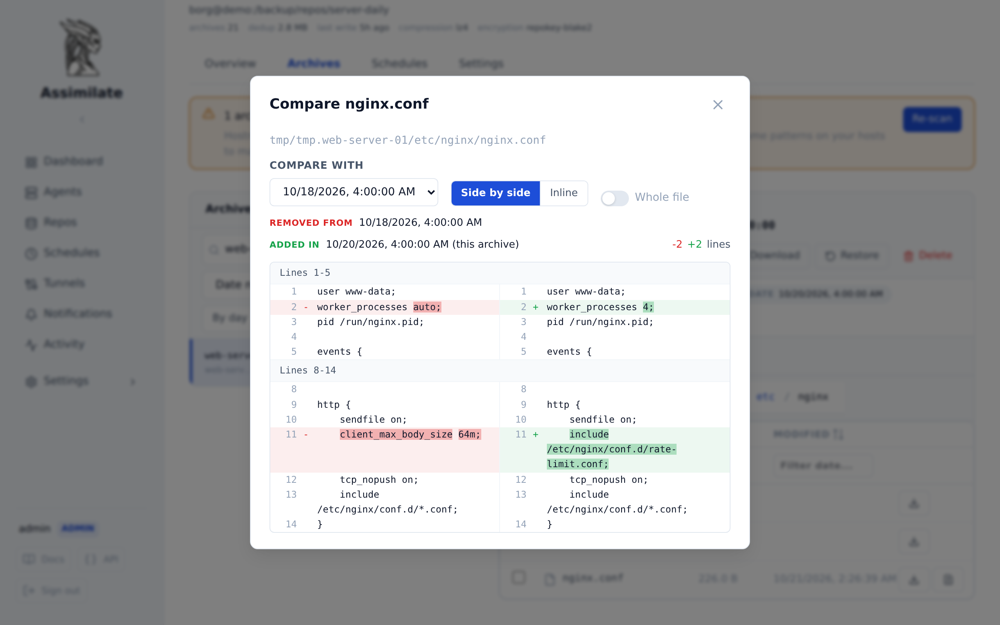
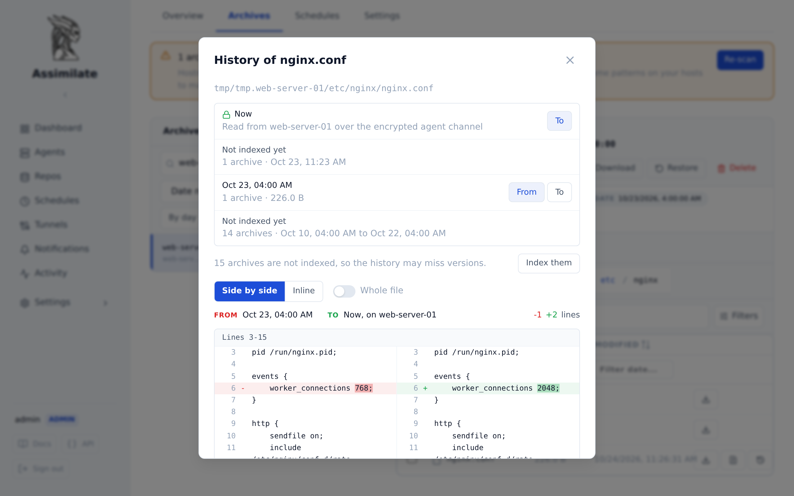

# Archive Browsing & Extraction

Archives are point-in-time snapshots created by each backup run. Assimilate lets you browse, inspect, and extract files from any archive directly in the web UI.

## Viewing Archives

Navigate to **Repos** in the sidebar, select a repository, then open the **Archives** tab. The list shows every archive stored in that repository.

You can also browse archives per schedule: open a schedule's detail view and switch to the **Backups** tab (see [Scheduling](scheduling.md#browsing-archives-from-a-schedule)). This shows only the archives created by that specific schedule, with the same file browser panel for browsing and extraction.

All four places — the repository's **Archives** tab, a schedule's **Backups** tab, an agent's **Backups** tab and the standalone **Archives** page — use the same archive selector and file browser, so the controls, the row layout and the available actions are identical wherever you reach them from.

Above the list are these controls:

| Control | What it does |
|---------|--------------|
| Search | Narrows the list to archives whose **name, host or repository** contains what you type |
| Sort | Orders by **date**, **original size**, or **deduplicated size**, ascending or descending |
| By day / By host / Flat | Groups the archives under **Today**, **Yesterday**, **This week** and then one heading per month; under one header per host; or lists them flat |
| Repository | Only when the list holds archives from more than one repository: **All**, or one repository, each with how many archives it holds |

The grouping starts on **By host** when the archives come from more than one host, and on **By day** when they are all one machine's, such as on an agent's Backups tab. **By host** is only offered when there is more than one host to group by. Picking another one keeps it.

In **By host** mode each group header carries the hostname, the number of archives it holds and their **total original size**, so a collapsed group still tells you something. The hostname itself is a link to that host's [agent page](agents.md); clicking anywhere else on the header collapses or expands the group. Groups start open; on a repository holding archives from more than three hosts they start collapsed instead, and you click a header to expand one.

Each row shows the archive name and its original size on the first line, then the host, the backup's start time and the deduplicated size underneath. The host is a link to that host's [agent page](agents.md), so you can jump to it without selecting the archive first; a list of one machine's archives leaves the host out. When the list spans several repositories, each row also carries a tag naming the repository the archive is in, since the same archive name can exist in each of them. A host that borg recorded but no agent claims is marked with an amber stripe — see [Re-scanning Unmatched Archives](repositories.md#re-scanning-unmatched-archives).

Click a row to open the archive in the file browser on the right. On a phone the two take turns: the open archive replaces the list, and **Archives** at the top of the browser goes back to it. Administrators also get a **delete** button on every row; it is always visible, not revealed on hover.



### Viewing a Single Archive

Links that point at one specific archive (for example from a host's backup history) open the **Archives** tab with an `?archive=<name>` query parameter. In this mode the page shows only a **Showing only `<name>`** banner and the file browser for that archive — the archive list, search box, sort selector, and group toggle are hidden, since none of them apply to a single result.

Click **Show all archives** in the banner to clear the filter and return to the full list.

## Archive Details

The header above the file list names the archive, its host and the repository it lives in, followed by its date and sizes. The repository matters whenever a schedule writes several copies: the same archive name exists in each of its target repositories, and **Download**, **Restore** and **Delete** in that header all act on the one named there. The repository name links to the repository itself.

The detail view shows statistics reported by `borg info`:

| Stat | Description |
|------|-------------|
| Original size | Total uncompressed size of all backed-up files |
| Compressed size | Size after compression |
| Deduplicated size | Actual new data written to the repository (after deduplication across all archives) |
| File count | Number of files included |
| Duration | Elapsed time from start to end |
| Start / End | Timestamps for the backup window |

The deduplicated size is typically much smaller than the original size because borg shares identical chunks across archives. This is the number that matters for storage capacity planning.

## Browsing Archive Contents

Archives can be browsed from three places in the UI, all of them the same component:

**Repositories page:** From the archive list on a repository detail view, click an archive to open the file tree browser in the right panel.

**Schedule detail page (Backups tab):** For backup-type schedules, the **Backups** tab lists every archive produced by the schedule. Select an archive from the left panel to browse its contents in the right panel. This lets you find the most recent backup of a file without leaving the schedule view. Because it is the same selector, a schedule that targets several hosts groups its archives by host here too, and administrators can delete an archive from this tab. A schedule that writes into several repositories lists every target's archives in one list, each tagged with its repository — see [Backups tab](scheduling.md#backups-tab).

**Agent detail page (Backups tab):** Every archive the agent has, in every repository it backs up to, in one list — see [Backups](agents.md#backups).

**Archives page:** The standalone **Archives** page adds a repository picker and the archive diff above the same two panes. Restores start from the archive browser, as everywhere else.



The browser starts at the repository root (`/`). Each entry shows:

- **Type** — file (`-`), directory (`d`) or symbolic link (`l`)
- **Path** — full path within the archive
- **Size** — file size in bytes
- **Modified** — last-modified timestamp
- **Mode** — Unix permission bits (e.g. `rwxr-xr-x`)

Click a directory to navigate into it. Use the breadcrumb path at the top to jump back up the tree. The browser loads up to 100 entries per directory by default; very large directories may be truncated.

Each archive and directory you open is also a step in your browser's history. The web browser's **Back** button returns to the directory you were in before, one step at a time, until it reaches the archive root; from there **Back** returns to the archive you had open before (or closes the archive), and only then leaves the page as usual. **Forward** opens them again. Both are kept in the URL: the open archive as a `browse` query parameter and the directory in it as `path` (for example `?tab=archives&browse=web-01-2026-03-01&path=/etc/nginx`), so a bookmark or a shared link opens that archive at that directory. Selecting a different archive opens it at its root. Where the list spans several repositories — a host's or a schedule's **Backups** tab — one name can be an archive in each, so `browse` names the repository too, as `<repository id>/<archive name>`.

The **Archives** page keeps the selected repository in the URL as well (`repo`), with that repository's archive and directory under the same per-repository parameters, so **Back** after switching repositories returns to the repository and archive open before.

The table fits the width of the file pane rather than of the window. When the pane is too narrow for every column — on a phone, or on a laptop-sized window where the archive list sits beside it — the **Modified** column is hidden and **Size** narrows, so each row's checkbox and buttons stay in view without scrolling sideways. Drag a column's edge to resize it; a column widened past the pane makes the table scroll horizontally.

The browser header names the archive and carries the actions that apply to the whole of it: **Download**, and for administrators **Restore** and **Delete**. Under it, a bar of chips reports the archive's host (a link to that host), its start time and both its original and deduplicated sizes.

Each table row has its own **Download** and, for a text file, **Compare** action. The `.` row is the directory you are currently looking at, so downloading it takes that whole subtree.

A folder's row shows what is inside it, everything below it included: how many files it holds next to its name, and their size in the **Size** column. Both are read from the archive's content index, so they appear once the archive has been indexed and never touch the repository.

A file that differs from the previous archive of the same machine and schedule carries a badge: **New** when that archive did not hold it in the same folder, **Changed** when its size or modification time is different. Hovering the badge names the archive it is compared with. The comparison reads that archive's content index one folder at a time as you open folders; while its index is still being built, files stay unmarked until you open the folder again. When two schedules back up different folders of one machine into the same repository, each schedule's archives are compared only with its own: the server records which schedule created each archive. Archives it has no schedule for, such as ones created outside Assimilate, are matched by name instead, the archive name without its trailing start time. The oldest archive of a series has nothing to compare with, so nothing in it is marked.

### Symbolic links

A symbolic link is marked in the file table with a link icon and a **Link** badge after its name, followed by where it points, exactly as the link stores it (`releases/2026-10-25`, `/usr/share/zoneinfo/UTC`). Its **Size** column shows `-`. Hover the name to see the link's full path and its target.



The browser looks the target up in the archive's content index:

- **In the archive** — the target is a link you can click. A link to a folder opens that folder, and so does clicking the link's row; a link to a file opens the folder that holds the file.
- **Not in the archive** — the target is grey and marked *not in archive*. Nothing was backed up at that path: it lies outside the backup's sources, it was excluded, or it did not exist when the backup ran. The link itself is still in the archive.

The target is worked out from its text, the way the system would follow it from the link's folder: a relative target starts in that folder, an absolute one at the root of the archive. Links are not followed through other links: a target path that runs through another link can read as not in the archive even though following the links would reach it, and a link whose target is itself a link counts as a link to a file, so opening it opens the folder holding that second link.

Restoring or downloading a link brings back the link, not what it points to. To restore what it points to as well, pick the target too.

Archives indexed before link targets were recorded still mark their links, without a target; the target appears once the archive's index is rebuilt (see [Index retention](#index-retention)). An archive browsed straight from borg, because its indexing failed, shows targets without looking them up.

### Searching the open archive

The search box above the file table searches the whole archive you have open, not just the folder on screen. Results appear as you type: every file and folder whose path contains the text, ignoring case, with the match highlighted. **Filters** narrows them by type (files or folders), by size in MiB and by the day a file was last modified; a dot on the button shows that a filter is set, and **Reset filters** clears them. A filter works without any text too, for example every file over 100 MiB.

The search reads the archive's content index, so it never locks the repository, and it works once the archive has been indexed. It shows the first 200 matches and says when there are more; narrow the search to see them.

Tick a result to pick it, the same as ticking it in its folder. The folder button on a result opens the folder it sits in, or the folder itself, and clears the search.

### Picking files to restore or download

Tick the checkbox on any row to pick that file or directory; the checkbox in the column header picks everything in the folder you are looking at. Picks are kept while you move between folders, so one restore can bring back things that sit in different places.

A picked folder covers everything inside it: open it and every entry is ticked. Unticking one of them keeps the rest of the folder picked, so you can take a whole folder except a few things. A folder with only some of its contents picked shows a partly filled checkbox, in the folder above it and in the column header. When every entry of a folder is ticked, the folder itself takes their place, so a restore names as few paths as it can.

A bar at the bottom of the browser counts what is picked, with how much it is and how many files once the content index has added up every picked folder, and offers:

- **Download** — one file downloads as itself, anything more as one `tar.lz4` the server streams. While it runs, **Cancel download** stops it.
- **Restore to *host*** (administrators) — opens **Where to restore**, below.
- **Clear** — drops the selection. Opening another archive drops it too.



### Where to restore

**Restore** in the selection bar, and **Restore** in the browser header for the whole archive, open the same dialog. It asks two things and spells out the answer before anything starts:

- **Agent** — every registered agent, with whether it is online. The machine the archive was backed up from is listed first and picked to begin with. An offline agent can be picked too; its restore starts when it next connects.
- **Location** — **Original paths** puts every file back where it was backed up from, replacing what is there. **Into a folder** restores under an absolute folder of your choice, each path keeping its full path inside it: `etc/nginx/nginx.conf` restored into `/srv/restore` lands at `/srv/restore/etc/nginx/nginx.conf`. A relative path, or one with `.` or `..` segments, is refused.

Under both, **Written on *agent* as** lists where the first few items will land. The restore then runs in the background on that agent, with a notification when it starts and when it ends — see [Restoring Files](restore.md#agent-side-restore).



New archives from successful backup runs are recorded and indexed in the background immediately after the backup report is saved. Archives discovered later through repository sync, including the [sync that follows every backup run](repositories.md#sync-after-every-backup), are also queued for indexing. Older archives that have not been indexed yet are indexed on first browse.

Indexing never stays stuck in progress. If the server stops while an archive is queued or being indexed, the unfinished job is discarded when the server starts again, and the archive is re-indexed the next time it is browsed or synced. If indexing fails, the archive is marked as failed instead, and browsing it reads the contents directly from borg.

The index is stored one compressed record per directory rather than one row per file, which is how the browser reads it. This keeps the index small even for repositories with many archives of the same file tree — on a repository whose index had grown to 10 GB, the packed layout is roughly a quarter of the size. Directories with very large numbers of entries are split across several records so that a listing only reads the part it displays.

### Index retention

The content index is usually the largest thing in the database, and most of it belongs to old archives nobody opens again. **Archive index retention** in **System → Settings** (`archive_index_retention_days`) drops the index of any archive that has been neither browsed nor indexed for that many days. It is `0` (keep forever) by default, so nothing is dropped until you choose a value.

Dropping an index never touches the archive itself, its tags or its backup reports, only the cached file tree. An archive whose index was dropped behaves exactly like one that was never indexed: the next browse shows it as being indexed, rebuilds the index from borg in the background, and lists it from the index again once that finishes. **Sync now** also re-indexes such archives along with any others that are missing an index.

A background job checks once an hour. Every browse counts as a use, so an archive you keep opening is never dropped, however old its index is. The job skips archives still being indexed. It drops indexes in batches of 100 archives, each waiting for any other operation on the same repository to finish first, and lets a backup or restore queued for that repository run between two batches, so even a large first pass never holds a repository up for long.

!!! note "Indexes rebuild after upgrading"
    The content index is derived data, so upgrading to a release that changes its storage layout discards the existing index instead of converting it. Archives are re-indexed automatically the next time they are browsed, or through **Sync now**. Nothing else is lost: archive tags, backup reports, and the archives themselves are unaffected.

## Extracting Files

To download a file from an archive:

1. Browse to the file in the archive contents view.
2. Click the **Download** icon next to the file.
3. The server streams the file directly from borg and your browser saves it with the original filename.

If borg fails before it has sent much of the file (wrong passphrase, repository locked, archive or path not found, SSH connection refused), the download fails with borg's error instead of starting. If borg fails partway through, for example because the SSH connection drops, the server breaks off the transfer. The browser then reports the download as failed instead of saving a truncated or empty file that looks complete.

To download the whole archive as `tar.lz4`, click **Download** in the browser header. To restore files or directories, pick them and use **Restore** in the selection bar; to restore the whole archive, use **Restore** in the header. Both ask [where to restore](#where-to-restore) first.

Administrators can permanently remove an archive from either **Delete** in the browser header or the delete button on its row in the archive list. Both open the same confirmation and delete the borg archive itself, the imported report, and any archive tags.

The `borg delete` runs in the background on the server so the UI is never blocked while it works. The repository detail page shows a **Deleting archive** indicator while the operation is in progress, and the archive disappears from the list once borg finishes. If the deletion fails, the archive remains in the list and a `archive_delete_failed` system event records the reason.

All server-side borg operations for a repository (backup, sync, content indexing, and archive deletion) run **sequentially** through a per-repository queue, so they never contend for the borg repository lock. Deleting several archives at once no longer returns a conflict — each deletion is queued and runs in turn, and the indicator shows how many operations are waiting (for example, *Deleting archive (+3 queued)*). Once the deletion queue drains, the archive list and the repository's total archive count are reconciled from borg (without re-reading file contents), so the count stays accurate.

A queued operation waits for as long as the one ahead of it takes, with no timeout, because a backup to a remote host can legitimately run for many hours. If an operation has been waiting for more than 10 minutes, the server logs a warning (visible under **Server Logs**) naming the repository, how long the operation has waited, how many operations are queued, and how long the current one has been running. The warning repeats every hour for as long as the wait continues. If the running operation is stuck rather than slow, **Reset** under **Cancel all running backups** on the System page releases the queue.

Deleting an archive only unlinks it from the repository's manifest — the segment data it referenced is not reclaimed until the repository is compacted. Assimilate automatically runs `borg compact` after each successful archive deletion to reclaim that space, shown as a **Compacting repository** indicator. If the compact itself fails, the deletion still stands — the failure is logged as an `archive_compact_failed` system event and the freed space is reclaimed on the next opportunity (for example, a scheduled backup's own compact step).

To pull in new archives and index their contents, use **Sync now** (admin only), which re-reads the repository from borg and indexes any archives that are not already indexed.

!!! warning "Restores overwrite files"
    Restoring writes directly to the original filesystem location on the matched host. Existing files may be overwritten without another prompt from borg.

The download uses the correct `Content-Type` for common file types (text, images, JSON, etc.) and falls back to `application/octet-stream` for unknown extensions.

!!! note "Large file extractions"
    Extraction streams data live from the borg repository over SSH and is not time-limited by the server. Downloading very large files (multi-GB) will hold an SSH connection open for the duration of the transfer. For large restores, consider running `borg extract` directly on the agent machine or repository host.

Only users with the **extract** permission on the repository can download files. Users with view-only access can browse archive contents but cannot download.

## Archive Naming

Borg names archives using a timestamp prefix by default. Assimilate passes the archive name to borg at backup time using the format:

```text
{hostname}-{schedule_type}-{YYYY-MM-DDTHH:MM:SS}
```

For example: `webserver-backup-2024-03-15T02:00:01`

The hostname comes from the agent machine. The schedule type is `backup`, `check`, or `verify`. You cannot rename archives after they are created — borg does not support in-place rename.

To use a custom prefix, configure the archive prefix in the repository's schedule settings. See [Scheduling](scheduling.md) for details.

## File Search

Assimilate can search for files by name within a single archive or across all archives in a repository. To find something in the archive you are browsing, use the search box above its file table instead — see [Searching the open archive](#searching-the-open-archive).

### Search Within an Archive

From the archive detail view, click **Search** and enter a file name or glob pattern (e.g. `*.log`, `config.yaml`). The results list matching paths with their size and modification time.

### Cross-Archive Search

From the repository's **Archives** tab, click **Search All Archives**. Enter a file name or glob pattern. The results show every archive that contains a matching path, allowing you to locate which backup snapshot holds a particular file version.

!!! tip
    Cross-archive search scans the index for each archive and may take a few seconds on repositories with many archives. The search is read-only and does not extract file data.

## Archive Diff

Compare two archives to see what changed between backup runs.

1. On the repository's **Archives** tab, select two archives using the checkboxes.
2. Click **Diff**.
3. The diff view lists every path that was added, removed, or modified between the two archives.

Each row in the diff shows:

| Column | Description |
|--------|-------------|
| **Status** | `added`, `removed`, or `modified` |
| **Path** | Full path within the archive |
| **Old size** | File size in the older archive (blank for added files) |
| **New size** | File size in the newer archive (blank for removed files) |

!!! note
    The diff compares path-level metadata. To see what changed inside a text file, compare the file itself, as described below.

### Comparing a file between archives

For a text file such as a configuration file or a script, you can see exactly which lines changed between two archives.



1. Open an archive in the file browser and navigate to the file.
2. Click the **Compare** button on the file's row. It only appears for regular files, and only when the list holds another archive from the same machine: the same path on another host is a different file.
3. The comparison opens against the most recent archive before this one, so it reads as what changed in this archive. Pick any other archive under **Compare with**. If the other archive does not hold the file, for example because a schedule with different sources wrote it, the comparison says the path was not found there; pick another archive.

Lines only in the other archive are marked `-` on a red background, lines only in this archive `+` on a green one, and the part of a changed line that actually differs is highlighted. The header totals the added and removed lines.

- **Side by side** puts the two versions in columns; **Inline** lists them one above the other. A phone opens on the inline view.
- By default only the changes are shown, with three unchanged lines around each. Turn on **Whole file** to see every line.

A file that is not UTF-8 text, or is larger than 1 MB in either archive, cannot be compared; the dialog says which version is the problem. You can still download or restore it.

!!! note
    Comparing a file reads both versions with `borg extract`, so it needs the same extract permission on the repository as downloading the file.

### File history

A file's history lists every version of it across the archives its host wrote into the repository, newest first, together with the file as it is on the host now. Compare any two of them, or compare a backup with the file now to see what changed since it was backed up.



1. Open an archive in the file browser and navigate to the file.
2. Click the **History** button on the file's row. It appears for every regular file, even in a host's only archive: the file now is always one more version.
3. The history opens on the newest stored version against the file as it is now. With the host offline it opens on the two newest stored versions instead.
4. Pick another pair with each row's **From** and **To** buttons. **From** is the side whose lines show as removed, **To** the side whose lines show as added.

The list folds consecutive archives in which the file has the same size and modification time into one version, and says how many archives hold it and over which dates. It also shows where the file was missing (**Not in these archives**), which covers a directory or a link at the same path too.

The history is read from the [archive index](#index-retention), not from borg, so it opens quickly however many archives there are. Archives that are not indexed yet are listed as **Not indexed yet**. Click **Index them** to index all of them one after another in the background; the list fills in as each one is done.

#### Comparing with the file now

The **Now** row reads the file on the host that wrote the archives, through its agent, over the [encrypted agent channel](agents.md#encrypted-connection). A padlock on the row marks it.

- The agent reads only regular files inside a backup source configured for the host, after resolving links, so a path outside every source, or a link leading out of one, is refused. The dialog says why a read failed: the file is outside the sources, is gone, is now a directory or a link, cannot be read, or the host is offline.
- It reads at most 1 MB, the same limit as for comparing two archives, and only UTF-8 text is compared line by line.
- The server compares the file in memory and keeps nothing of it.
- Reading a file live needs extract permission on the repository, as downloading one does, and every read is recorded in the [audit log](audit-log.md).

## Exporting as tar.lz4

To download an entire archive or a subtree as a compressed tar archive:

1. Open the archive detail view.
2. Click **Export**.
3. Optionally specify a sub-path to export only part of the archive tree.
4. Click **Download tar.lz4**. The server pipes `borg export-tar` output through lz4 compression and streams it to your browser.

!!! note "Large exports"
    Exporting a full archive streams all data live from the borg repository and is not time-limited by the server. Exports of large archives (multi-GB) may take several minutes. For very large restores, run `borg export-tar` directly on the agent machine.

If borg fails before the export produces much output (wrong passphrase, repository locked, archive or path not found), the download fails with borg's error instead of starting. If borg fails partway through, the server breaks off the transfer. The browser then reports the download as failed instead of saving a truncated file that looks complete.

The exported file is named `<archive-name>.tar.lz4`. You can decompress it with:

```bash
lz4 -d <archive-name>.tar.lz4 | tar -x
```

## Archive Tags

Tags are short labels you can attach to archives to mark significant snapshots (e.g. `pre-upgrade`, `weekly-baseline`, `release-1.2`).

### Adding Tags

From the archive detail view, click **Edit Tags** and enter one or more comma-separated tags. Tags are stored as archive metadata and persist across retention-policy runs — tagged archives are never pruned automatically.

!!! warning
    Pinned archives consume repository space indefinitely. Remove tags from archives you no longer need to retain.

### Filtering by Tag

On the repository's **Archives** tab, use the **Tag** filter dropdown to show only archives with a specific tag. This is useful for locating baseline snapshots among a long list of daily archives.

### Removing Tags

Open the archive detail view, click **Edit Tags**, remove the desired tag, and save. Once all tags are removed the archive is subject to normal retention-policy pruning on the next backup run.

## Pruning Archives

Old archives are removed automatically after each successful backup run according to the retention policy configured on the schedule. The policy controls how many daily, weekly, monthly, and yearly archives to keep.

Retention settings are per-schedule. See [Scheduling](scheduling.md) for how to configure `keep_daily`, `keep_weekly`, `keep_monthly`, and `keep_yearly`.

Manual pruning through the UI is not available. To prune outside of the normal schedule, run `borg prune` directly on the repository host or trigger a backup run (which includes pruning) from the [Repositories](repositories.md) page.

## Archive Integrity

Borg uses content-addressed, deduplicated chunk storage. Every chunk is identified by a cryptographic hash (BLAKE2b or SHA-256 depending on the encryption mode). This means:

- **Deduplication is automatic** — identical data across archives is stored once.
- **Corruption is detectable** — borg verifies chunk hashes on read. A corrupted chunk causes an error rather than silently returning bad data.

To actively verify repository integrity, run a **Check** schedule (see [Scheduling](scheduling.md)). A check reads all chunks and verifies their hashes without extracting files.

If the repository is corrupted beyond what borg can repair, the affected archives may become unreadable. Assimilate surfaces borg error output in the backup report. For recovery options, refer to the [BorgBackup documentation](https://borgbackup.readthedocs.io/en/stable/usage/check.html).

<!--
SPDX-License-Identifier: Apache-2.0
SPDX-FileCopyrightText: 2026 Alexander Mohr
-->
