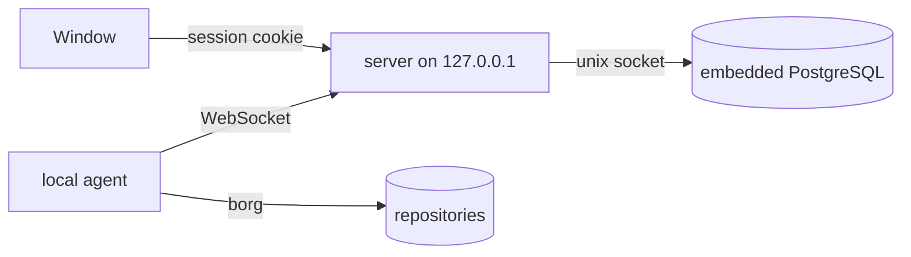
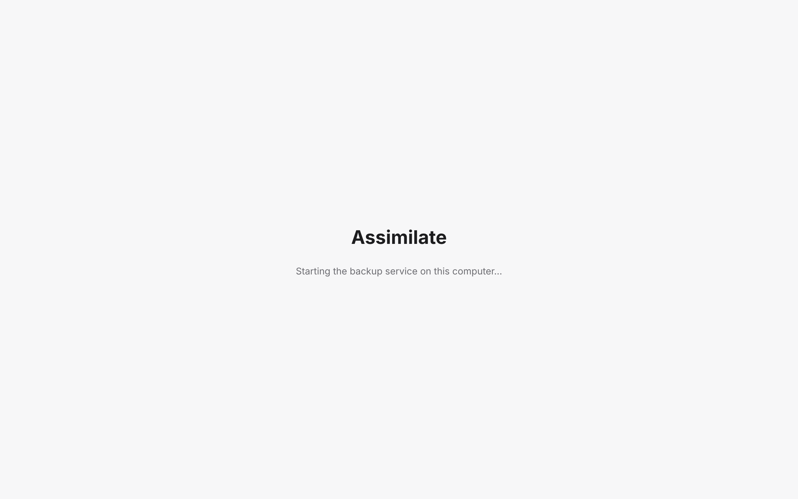
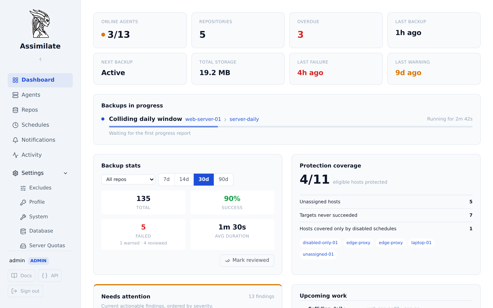
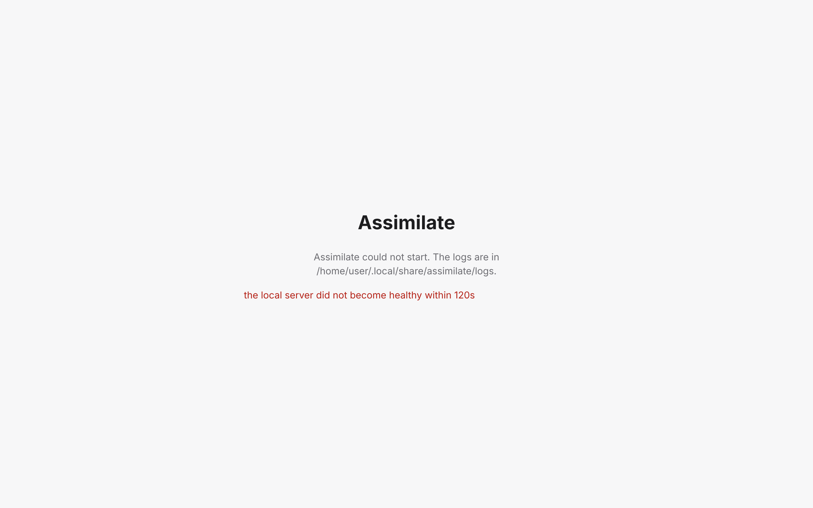

<!--
SPDX-License-Identifier: Apache-2.0
SPDX-FileCopyrightText: 2026 Alexander Mohr
-->

# Desktop App

The desktop app runs Assimilate for a single computer: it starts the server, a local agent and its own PostgreSQL database in the background and shows the web UI in a native window, signed in automatically. Use it to back up one machine to local or remote borg repositories without running a server.

## Install

Download the installer for your computer from the assets of a [GitHub release](https://github.com/alexmohr/assimilate/releases):

| Platform | Download | Requires |
|----------|----------|----------|
| Linux (x86_64) | `assimilate-desktop-<version>-x86_64-unknown-linux-gnu.deb` or `.rpm` | Ubuntu 26.04 or newer, Debian 13 or newer |
| Linux (ARM64) | `assimilate-desktop-<version>-aarch64-unknown-linux-gnu.deb` or `.rpm` | Ubuntu 26.04 or newer, Debian 13 or newer |
| macOS (Apple silicon) | `assimilate-desktop-<version>-aarch64-apple-darwin.dmg` | macOS 15 or newer |
| macOS (Intel) | `assimilate-desktop-<version>-x86_64-apple-darwin.dmg` | macOS 15 or newer |
| Windows (x86_64) | `assimilate-desktop-<version>-x86_64-pc-windows-msvc.exe` | Windows 10 or newer |

Each release also lists a `SHA256SUMS` file and carries GitHub build provenance for every installer, which `gh attestation verify <file> --repo alexmohr/assimilate` checks.

The latest build of `main` is the [Nightly](https://github.com/alexmohr/assimilate/releases/tag/nightly) prerelease, with the same files. It's replaced on every push to `main`, like the `nightly` container images, so use a version release for anything you depend on.

On Linux, install the `.deb` with `sudo apt install ./assimilate-desktop-<version>-<target>.deb`, or the `.rpm` with `sudo dnf install ./assimilate-desktop-<version>-<target>.rpm`. The app keeps its secrets in the Secret Service, which GNOME and KDE desktops provide.

!!! warning "macOS: the app isn't signed"
    The macOS app isn't signed with an Apple Developer ID or notarized, so macOS refuses to open it after download. Drag it to **Applications**, then remove the download quarantine once, as below.

```bash
xattr -dr com.apple.quarantine /Applications/Assimilate.app
```

The installer ships everything the app runs: the server and the agent, PostgreSQL 18 (built by [theseus-rs/postgresql-binaries](https://github.com/theseus-rs/postgresql-binaries)) and borg 1.4 (BorgBackup's own release build; on Windows, which BorgBackup doesn't build for, the [marcpope/borg-windows](https://github.com/marcpope/borg-windows) build), with their license texts in the app's `licenses` folder. On Linux it also ships the libxml2 2.13 library PostgreSQL links (`libxml2.so.2`), built from source, because Ubuntu 26.04 no longer provides that version. Nothing is downloaded when the app runs.

## How it works



On start the app:

1. Reads its secrets from the OS keychain, generating them on first run.
2. Starts its PostgreSQL cluster. The cluster listens on a unix socket in the app's data folder only, never on TCP. Windows has no unix sockets for PostgreSQL, so there the cluster listens on `127.0.0.1` only and requires its superuser password.
3. Starts the server on a free port on `127.0.0.1`, with `ASSIMILATE_DEPLOYMENT_MODE=desktop`.
4. Signs in as the built-in `admin` user. On first run it replaces the default `admin` password with a generated one.
5. Registers the local agent, issues it a fresh token and starts it.
6. Opens the web UI in the window, already signed in.

Authentication stays on: the app signs in for you instead of switching it off, so other programs on the computer can't use the server without a session.

Until the server is up, the window shows a bundled startup page under a strict Content Security Policy: it loads only its own script and styles and can't reach the network. Once signed in, the window shows the server's web UI under the server's own Content Security Policy, the same as in a browser.



Closing the window keeps backups running in the background. Open the window again or quit the app from its tray icon. Quitting stops the agent, the server and the database, in that order.

The tray icon also shows how the backups are doing. It gets a red dot when a scheduled backup's last finished run failed, or when one is overdue, and its tooltip says how many: for example *Assimilate: 1 backup failed, 2 backups overdue*. Otherwise the tooltip says the backups are up to date, that the first backup hasn't run yet, or that nothing is scheduled. Disabled schedules don't count. The app checks once a minute, and the dot goes away once the next run of each failed backup succeeds.

## What desktop mode hides

A single computer has one user and one agent, so the window leaves out the pages that manage several: Users, Groups, Roles and SSH Tunnels. See `ASSIMILATE_DEPLOYMENT_MODE` in [Configuration](configuration.md).



The app's own agent is listed under **Agents** as **This computer**, with the computer's hostname.

The app also starts, updates and restarts that agent itself, so the agent page leaves out the actions that install or restart an agent on a server: **Deploy agent**, **Upgrade agent** and **Redeploy agent**, and the note explaining why **Restart agent** is unavailable. The agent is updated by installing a newer version of the app. The server refuses SSH deploys in desktop mode too.

The app also issues its agent a fresh token every time it starts, so **Regenerate token** is left out as well: a token regenerated by hand would disconnect the agent until the app restarted.

## Data and secrets

| Platform | Data folder |
|----------|-------------|
| macOS | `~/Library/Application Support/assimilate` |
| Linux | `$XDG_DATA_HOME/assimilate`, or `~/.local/share/assimilate` |
| Windows | `%LOCALAPPDATA%\assimilate` |

The data folder holds the database, the server's SSH keys and the logs: `logs/server.log` and `logs/agent.log` for the server and the agent, and `logs/desktop.log` for the app itself. The app appends to its log on every start and creates the `logs` folder if it's missing. Debug builds also print the app's log to the terminal. With `ASSIMILATE_DESKTOP_DATA_DIR` set, the logs are under that directory instead.

The app keeps three secrets in the OS keychain (Keychain Services on macOS, the Secret Service on Linux, the Credential Manager on Windows), under the service name `assimilate-desktop`:

| Account | Holds |
|---------|-------|
| `server-secret-key` | `ASSIMILATE_SECRET_KEY`, which encrypts the stored repository passphrases |
| `admin-password` | The password of the built-in `admin` user |
| `postgres-password` | The embedded database's superuser password |

!!! warning "Keep your repository passphrases"
    Repository passphrases in the app's database are encrypted with `server-secret-key`. If that keychain entry is lost, the app can't decrypt them. Keep each repository's passphrase or key export somewhere outside the app.

## Running from source

The app lives in `desktop/`, its own Cargo workspace. On Linux, install Tauri's build dependencies first:

```bash
sudo apt-get install libwebkit2gtk-4.1-dev libxdo-dev libssl-dev libayatana-appindicator3-dev librsvg2-dev
```

Build the server, the agent and the web UI, then run the app with the environment variables below pointing at them and at a PostgreSQL installation:

```bash
cargo build -p server -p agent
(cd frontend && npm ci && npm run build)
ASSIMILATE_DESKTOP_SERVER_BIN=$PWD/target/debug/server \
ASSIMILATE_DESKTOP_AGENT_BIN=$PWD/target/debug/agent \
ASSIMILATE_DESKTOP_STATIC_DIR=$PWD/frontend/dist \
ASSIMILATE_DESKTOP_POSTGRES_DIR=<postgres-install-dir> \
ASSIMILATE_DESKTOP_DATA_DIR=/tmp/assimilate-desktop \
ASSIMILATE_DESKTOP_EPHEMERAL_SECRETS=1 \
cargo run --manifest-path desktop/Cargo.toml
```

`<postgres-install-dir>` is the directory that contains PostgreSQL's `bin/initdb`, for example `/usr/lib/postgresql/16` on Debian and Ubuntu.

| Variable | Default | Required | Description |
|----------|---------|----------|-------------|
| `ASSIMILATE_DESKTOP_DATA_DIR` | Platform data folder | No | Put all app data under this directory instead. |
| `ASSIMILATE_DESKTOP_SERVER_BIN` | `assimilate-server` next to the app | No | The server binary. |
| `ASSIMILATE_DESKTOP_AGENT_BIN` | `assimilate-agent` next to the app | No | The agent binary. |
| `ASSIMILATE_DESKTOP_POSTGRES_DIR` | `postgres` in the app's resources | No | The PostgreSQL installation (contains `bin/initdb`). |
| `ASSIMILATE_DESKTOP_STATIC_DIR` | `web` in the app's resources | No | The built web UI. |
| `ASSIMILATE_DESKTOP_DOCS_DIR` | `docs` in the app's resources, if present | No | The built documentation site. |
| `ASSIMILATE_DESKTOP_BORG_BIN` | `borg/borg.exe` in the app's resources, if present, else `borg` on `PATH` | No | The borg binary for the server and the agent. |
| `ASSIMILATE_DESKTOP_EPHEMERAL_SECRETS` | — | No | Debug builds only. Keep secrets in memory instead of the OS keychain. Data encrypted in such a run can't be read by the next one. |

### Building the installers

`desktop/bundle.toml` pins the PostgreSQL and borg releases the installers ship, and on Linux the libxml2 source, each by SHA-256. `scripts/desktop_bundle.py` downloads them, refuses any file whose digest differs, and stages them with the server, the agent, the web UI and the docs under `desktop/`. Tauri's CLI then builds the installers for the current platform:

```bash
target="$(rustc -vV | sed -n 's/^host: //p')"
cargo build --release --locked -p server -p agent
(cd frontend && npm ci && npm run build)
pip install -r docs/requirements.txt && mkdocs build --strict
```

On Linux, build the libxml2 PostgreSQL links, then stage with it:

```bash
scripts/build-libxml2.sh "$(python3 scripts/desktop_bundle.py libxml2-source --target "$target")" target/libxml2.so.2
python3 scripts/desktop_bundle.py stage --target "$target" \
  --server target/release/server --agent target/release/agent \
  --web frontend/dist --docs docs_html --libxml2 target/libxml2.so.2
```

On macOS and Windows, stage without it:

```bash
python3 scripts/desktop_bundle.py stage --target "$target" \
  --server target/release/server --agent target/release/agent \
  --web frontend/dist --docs docs_html
```

Then build the installers:

```bash
cd desktop && npx @tauri-apps/cli@2.12.3 build --config tauri.bundle.conf.json
```

CI builds the installers for all four targets on every pull request, checks the GitHub build attestation of each download `bundle.toml` marks `attested` (borg; the pinned PostgreSQL release publishes none), and starts the whole stack from the server, agent and PostgreSQL exactly as each installer ships them. On every push to `main` it replaces the Nightly prerelease's files with the new build. A version tag creates its GitHub release, if there isn't one yet, once the container images, the agent binaries and the installers are all built, and attaches the installers and agent binaries.

## If the app can't start

If startup fails, the startup page shows the error and the folder that holds the logs. Check `logs/desktop.log` first, then `logs/server.log` and `logs/agent.log`.



## Related pages

- [Architecture](architecture.md)
- [Security](security.md)
- [Configuration](configuration.md)
