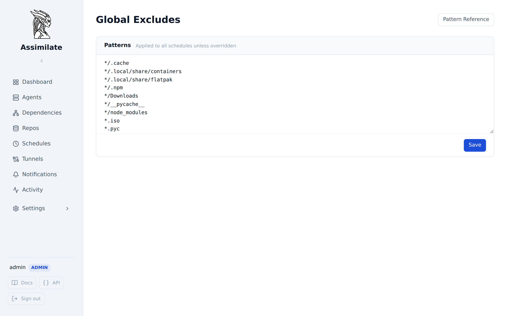

# Global Excludes

Global exclude patterns define paths and files that are excluded from all backup schedules by default. Manage them from the **Excludes** page under **Settings** in the sidebar.



## How Global Excludes Work

When a backup runs, the agent passes exclude patterns to `borg create --exclude`. Global excludes apply to every schedule on every host unless a schedule explicitly opts out by enabling **Ignore global excludes** in its configuration.

This means you can define patterns once (e.g., cache directories, temporary files, build artifacts) and have them apply fleet-wide without duplicating them on every schedule.

## Managing Patterns

The Excludes page presents a plain-text editor — one pattern per line. Add, remove, or reorder patterns, then click **Save**.

Patterns are evaluated in order. Borg checks each file path against the pattern list and skips the first match.

## Pattern Syntax

Assimilate passes patterns directly to borg. Borg matches them against the path as stored in the archive, which has no leading slash: `/home/alex/.cache` is `home/alex/.cache`.

!!! warning
    Every style except `re:` is anchored at the start of that path. A bare `.cache` matches only a top-level `.cache` and excludes nothing under `/home/<user>`. Start a pattern with `/` for a path from the root, or with `*/` (`**/` for `sh:`) to match under every user. `pp:` and `pf:` take no wildcards, so they need the whole path. The Excludes page flags patterns that are anchored this way. A pattern written as a full path from the root, such as `home/*/Downloads`, is correct and is not flagged.

### Fnmatch (default, `fm:`)

Patterns without a prefix are case-sensitive fnmatch patterns. `*` matches any characters, including `/`:

| Pattern | Effect |
|---------|--------|
| `/var/cache` | The absolute path `/var/cache` and everything below it |
| `*/.cache` | A `.cache` directory under any directory, for every user |
| `*.pyc` | Any path ending in `.pyc` |
| `home/*/Downloads` | `Downloads` in any home directory below `/home` |

### Shell (`sh:`)

Like fnmatch, but `*` stops at `/` and `**/` crosses directories:

| Pattern | Effect |
|---------|--------|
| `sh:**/.cache` | A `.cache` directory at any depth |
| `sh:home/*/Downloads` | `Downloads` directly inside each home directory |

### Path Prefix (`pp:`)

Matches one directory and everything below it, from the start of the path. It takes no wildcards, so `*` is an ordinary character here:

| Pattern | Effect |
|---------|--------|
| `pp:/proc` | The path `/proc` and everything below it |
| `pp:home/alex/.cache` | That directory and everything below it |

### Path Full Match (`pf:`)

Matches exactly one path, from the start of the path, and nothing below it. It takes no wildcards:

| Pattern | Effect |
|---------|--------|
| `pf:/etc/hostname` | Only the file `/etc/hostname` |

### Regex (`re:`)

Full regular expression, searched anywhere in the path. It is the only style that is not anchored:

| Pattern | Effect |
|---------|--------|
| `re:\.git/objects/` | Git object directories anywhere |
| `re:/tmp/[^/]+\.sock$` | Socket files in `/tmp` |

For the full pattern syntax reference, see the [BorgBackup documentation](https://borgbackup.readthedocs.io/en/stable/usage/help.html#borg-patterns).

## Per-Schedule Override

Individual schedules can override global excludes in two ways:

1. **Add schedule-specific patterns** — these are merged with global excludes.
2. **Ignore global excludes** — check this option in the schedule configuration to use only the schedule's own patterns.
3. **Add include patterns** — rescue specific paths from any of the excludes above instead of adding to them. See [Include Patterns](scheduling.md#include-patterns).

See [Scheduling](scheduling.md) for per-schedule exclude configuration.

## Recommended Patterns

The repository ships a ready-made set for Linux hosts as `excludes.common`. Paste it into the Excludes page as a starting point. Every pattern starts with `/` or `*`, so it applies to all users:

```text
# ===========================================================
# Containers, VMs, app stores
# ===========================================================
*/.docker/machine
*/.local/share/containers
*/.local/share/flatpak
*/.local/share/Steam
*/.steam
/snap
/var/lib/containerd
/var/lib/containers
/var/lib/docker
/var/lib/flatpak
/var/lib/kubelet
/var/lib/lxc
/var/lib/lxd
/var/lib/rancher
/var/lib/snapd

# ===========================================================
# IDEs & editors - extensions, plugins (re-downloadable)
# ===========================================================
*/.emacs.d/elpa
*/.emacs.d/straight
*/.local/share/JetBrains
*/.local/share/nvim/lazy
*/.local/share/nvim/mason
*/.local/share/nvim/site/pack
*/.vim/bundle
*/.vim/plugged
*/.vscode*

# ===========================================================
# Browsers - caches & session storage
# ===========================================================
*/.config/chromium/*/Cache
*/.config/chromium/*/Code Cache
*/.config/google-chrome/*/Cache
*/.config/google-chrome/*/Code Cache
*/.config/google-chrome/*/Service Worker/CacheStorage
*/.mozilla/firefox/*/cache2
*/.mozilla/firefox/*/thumbnails

# ===========================================================
# OS: temporary, runtime, virtual filesystems
# ===========================================================
*/lost+found
/dev
/lost+found
/proc
/run
/sys
/tmp
/var/lock
/var/run
/var/spool
/var/tmp

# ===========================================================
# OS: logs, caches, crash dumps, swap
# ===========================================================
*.log
/swap.img
/swapfile
/var/cache
/var/log
/var/lib/systemd/coredump

# ===========================================================
# Package managers - system
# ===========================================================
/var/lib/apt/lists
/var/lib/pacman/sync

# ===========================================================
# Package managers - language / userland
# ===========================================================
# .NET / conda / misc
*/.conda/pkgs
*/.nuget/packages

# Go
*/go/pkg/mod/cache

# Homebrew
*/.homebrew/cache

# Java / JVM
*/.gradle/caches
*/.gradle/daemon
*/.gradle/native
*/.gradle/wrapper
*/.m2/repository

# Node.js
*/.bower_cache
*/.bun/install
*/.local/share/pnpm
*/.npm
*/.pnpm-store
*/.yarn/cache
*/node_modules

# Python
*.pyc
*.pyo
*/.local/share/uv
*/.local/share/virtualenv
*/.mypy_cache
*/.pyenv/versions
*/.pytest_cache
*/.ruff_cache
*/.tox
*/.venv
*/.virtualenvs
*/__pycache__

# Ruby
*/.bundle/cache
*/.gem
*/.rbenv/versions

# Rust
*/.cargo*
*/target/debug
*/target/release
*rustup*

# Version managers
*/.asdf/installs
*/.local/share/mise
*/.sdkman/archives

# ===========================================================
# User: downloads, caches, trash, thumbnails
# ===========================================================
*/.cache
*/.local/share/Trash
*/.thumbnails
*/.Trash
*/.Trash-*
*/Downloads

# ===========================================================
# Miscellaneous re-downloadable / generated data
# ===========================================================
*.gguf
*.iso
*/.android/cache
*/.electron
*/.nvm/.cache

# ===========================================================
# Build artifacts & junk
# ===========================================================
# No core-dump patterns: */core would exclude directories named core, and
# */core.* would exclude source files such as core.py or core.rs.
# systemd-coredump is covered by /var/lib/systemd/coredump above.
*.swo
*.swp

# ===========================================================
# BSD-specific (ignored harmlessly on Linux)
# ===========================================================
/usr/obj
/usr/ports/distfiles
/var/db/portsnap

# ===========================================================
# Catch-all: anything with "cache" in the name
# ===========================================================
*cache*
```

Review the list before saving. These entries are choices, not requirements:

- `*/Downloads` and `*.iso` drop files you may want to keep.
- `*/.local/share/Steam`, `*/.steam`, the Flatpak and Snap stores, and the container storage directories hold data that downloads or pulls again, but also anything stored only there.
- `*cache*` at the end matches any path with a lowercase `cache` in its name, so it also covers most of the explicit cache entries above it. Patterns are case-sensitive, so it does not cover the capitalised `Cache` and `Code Cache` browser entries, which stay needed.
- `*/.cargo*` excludes the whole `.cargo` directory, including `credentials.toml` and `config.toml`. Narrow it to `*/.cargo/registry` and `*/.cargo/git` to keep those files.

`/usr`, `/lib`, `/bin` and `/opt` are not excluded. Add them only when the backup targets data rather than a full system restore. Avoid overly broad patterns that exclude important data.

To keep a path that a broad pattern would drop, add an [include pattern](scheduling.md#include-patterns).

## API Endpoints

Global excludes are stored as a single newline-separated block of patterns and edited as a whole, not as individually addressable records.

| Method | Path | Description |
|--------|------|-------------|
| `GET` | `/api/excludes` | Get the global exclude patterns as raw text |
| `PUT` | `/api/excludes` | Replace the global exclude patterns from raw text |

See the full [API Reference](api-reference.md) for request/response schemas.

<!--
SPDX-License-Identifier: Apache-2.0
SPDX-FileCopyrightText: 2026 Alexander Mohr
-->
