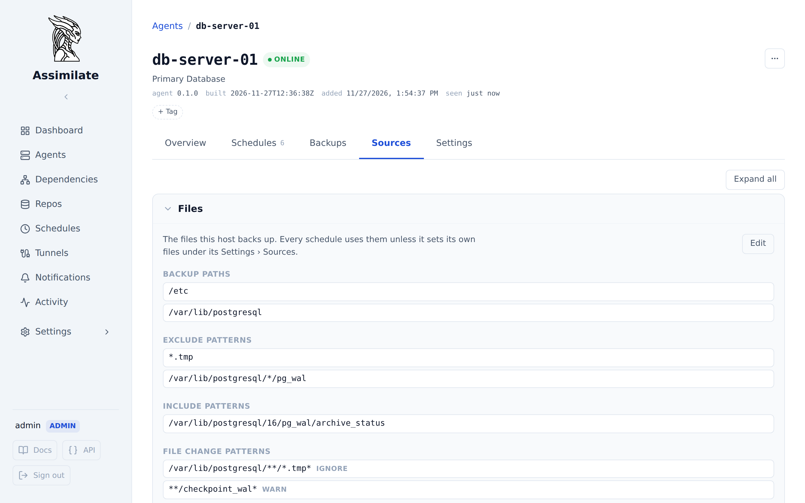

<!--
SPDX-License-Identifier: Apache-2.0
SPDX-FileCopyrightText: 2026 Alexander Mohr
-->

# File Change Patterns

File change patterns let you control how warnings about files that change during a backup are handled. By default, any file that is modified while being backed up generates a warning. You can configure specific path patterns to:

- **ignore** — suppress the warning entirely
- **warn** — keep the warning (default)
- **fatal** — fail the backup

## Configuration

File change patterns are part of a file set, with the paths, excludes and commands they belong to:

- **On a host** — **Agents** → select a host → **Sources** → **Files**. Every schedule that takes the host's files uses them.
- **On a schedule with its own files** — **Schedules** → select a schedule → **Settings** → **Sources**, with **Files** set to **Own files** (or the **Sources** step of a new schedule). They replace the host's patterns for that schedule, together with the rest of the host's file set.

A run uses the patterns of exactly one set; the two are never combined. See [Sources](scheduling.md#sources).

### Writing patterns

Each line is a glob pattern, optionally followed by an action keyword. Patterns are matched against the full warning message text, which is the path plus borg's `: file changed while we backed it up` (see [Pattern Syntax](#pattern-syntax) below) — write the path out from the root and let a trailing `*` or `**` cover the rest of the message:

```text
/tmp/logs/** ignore
/etc/config: * fatal
/var/www/cache/** warn
```

If no action is specified, `warn` is assumed:

```text
/tmp/logs/**          ← equivalent to `/tmp/logs/** warn`
```

Blank lines and lines starting with `#` are skipped, so patterns can be commented.

### Patterns on a host

Patterns on a host are useful for host-specific noise, such as a database's WAL files, that every schedule backing up the host should ignore.



The **first matching pattern wins**, so put a narrower pattern above a broader one.

## Action Reference

| Action   | Behavior                                                              |
| -------- | --------------------------------------------------------------------- |
| `ignore` | The warning is silently discarded; the backup continues with no alert. A run whose warnings were _all_ ignored is recorded as a success, even though borg itself exited with its warning status |
| `warn`   | The warning is preserved in the report (default; backward compatible) |
| `fatal`  | The backup is stopped and reported as failed with an error message    |

A run whose remaining warnings are _all_ file changes sends a **Backup File Changed** [notification](notifications.md#supported-events) instead of **Backup Warning**, so a channel can follow one without the other. If any other warning is in the mix, the run sends **Backup Warning** as before.

## Pattern Syntax

> **Not the same glob dialect as Exclude Patterns.** The exclude patterns configured elsewhere on the agent page are passed straight through to borg, where a single `*` matches across `/`. File change patterns are matched by Assimilate itself using a stricter, git-style glob where `*` does **not** cross `/`. A pattern that works as an exclude pattern will often need `**` here to have the same reach — see below.

- `*` matches any number of characters **within a single path component** — it does not match `/`, so it won't reach into subdirectories.
- `**` matches any number of characters **including `/`** — use it to cover every file anywhere under a directory, no matter how deeply nested.
- `?` matches any single character.

The pattern is matched against the full warning message text, not just the file path — a bare path like `/etc/config` will only match if the _entire_ message is exactly `/etc/config`, which is never the case, because the message continues with `: file changed while we backed it up`. Cover that trailing text too, and anchor the pattern at the root of the path rather than opening it with a `*`: a leading `*` cannot cross `/` either, so `*access.log*` never matches an absolute path. For the message `/var/log/nginx/access.log: file changed while we backed it up`:

```text
/var/log/nginx/access.log*    ← that one file, whatever the message says after it
/var/log/nginx/**             ← every file under that directory
**/access.log*                ← a file of that name wherever it lives
/etc/config: *                ← an exact path with no directory below it
```

Directories with deeply nested, frequently-changing files (e.g. a database's write-ahead log) need a trailing `**`, not a single `*`:

```text
/data/influxdb/wal/*   ← only matches files directly in wal/, NOT nested ones like wal/<shard>/<segment>.wal
/data/influxdb/wal/**  ← matches every file under wal/, at any depth
```

## Backward Compatibility

Existing schedules without file change patterns continue to work as before — all file changes produce warnings. The feature is entirely opt-in.
