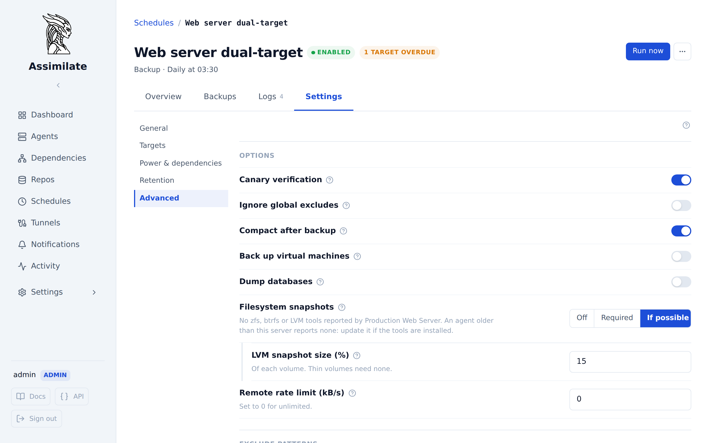

<!--
SPDX-License-Identifier: Apache-2.0
SPDX-FileCopyrightText: 2026 Alexander Mohr
-->

# Filesystem Snapshots

A backup schedule can read its sources from filesystem snapshots instead of the live files. Right before `borg create`, the agent snapshots the ZFS dataset, btrfs subvolume or LVM logical volume under each backup source. borg then reads the snapshot under the source's original path, and the agent removes the snapshot once borg is done. Every file in the archive is read as it was at one moment, so a database file, a mail store or a VM image that changes during a long backup is still consistent with the files around it.

The archive holds the original paths. Browsing, search, diff and restore work on it like on any other archive.

## Prerequisites

- An [agent](agents.md) on a Linux host, running as `root`. The agent snapshots, mounts and runs borg in a private mount namespace, which needs `CAP_SYS_ADMIN`.
- The tools of the filesystems the sources live on, on the agent's `PATH`:

| Filesystem | Tools |
|------------|-------|
| ZFS | `zfs` |
| btrfs | `btrfs` (btrfs-progs) |
| LVM (ext4, XFS and any other filesystem on a logical volume) | `lvcreate`, `lvremove`, `lvs`, `mount`, `umount` |

- For a classic (thick) LVM volume, free extents in its volume group for the snapshot. A thin volume's snapshot shares its pool and needs none.

The agent reports which tools it found when it connects. Point it at a tool outside the `PATH` with `ASSIMILATE_ZFS_BINARY`, `ASSIMILATE_BTRFS_BINARY`, `ASSIMILATE_LVCREATE_BINARY`, `ASSIMILATE_LVREMOVE_BINARY`, `ASSIMILATE_LVS_BINARY`, `ASSIMILATE_MOUNT_BINARY` or `ASSIMILATE_UMOUNT_BINARY`.

## Turn snapshots on

Open the schedule, then **Settings → Advanced**, or the **Advanced** step of a new schedule.

1. Set **Filesystem snapshots**:
    - **Off** reads the live files. This is the default.
    - **Required** reads every source from a snapshot. A source that cannot be snapshotted fails the run before borg starts, and every snapshot already taken is removed again.
    - **If possible** reads each source from a snapshot where it can. A source that cannot be snapshotted is backed up live, and the run ends with a warning that names it.
2. Set **LVM snapshot size (%)** for sources on classic LVM volumes. See [Sizing LVM snapshots](#sizing-lvm-snapshots).
3. Click **Save**.

When a connected host of the schedule found none of the tools, the setting says so.

## What is snapshotted

For each backup source the agent looks up the filesystem the source lies on, and every filesystem mounted below it. Each of those is snapshotted once, even when several sources share it:

| Filesystem | Snapshot | Read from |
|------------|----------|-----------|
| ZFS dataset | `zfs snapshot <dataset>@assimilate-<run>` | `<mount point>/.zfs/snapshot/assimilate-<run>` |
| btrfs subvolume | `btrfs subvolume snapshot -r`, inside the subvolume as `.assimilate-snapshot-<run>` | The read-only snapshot subvolume |
| LVM logical volume | `lvcreate --snapshot`, named `assimilate-<volume>-<run>` | Mounted read-only below `/run/assimilate/snapshots/<run>/` |

`<run>` is `schedule-<id>-<time>-<random>` for a scheduled run and `manual-<time>-<random>` for a backup started without a schedule. The random part keeps two runs apart that start in the same second, such as the runs of one schedule to two repositories.

A btrfs snapshot does not include the subvolumes nested inside its own, so the agent also snapshots every subvolume below a source. An XFS snapshot is mounted with `nouuid,norecovery`, because XFS refuses a second filesystem with the same UUID and a read-only mount must not replay the log.

Filesystems that keep no data on disk, such as `/proc`, `/sys` or a `tmpfs`, are read live without a warning. Any other filesystem that is not on ZFS, btrfs or an LVM volume, such as ext4 on a plain partition or an NFS share, cannot be snapshotted. **Required** then fails the run, and **If possible** backs that source up live.

## How borg reads the snapshots

borg runs in a private mount namespace of its own. There, each snapshot is bind-mounted over the path of the filesystem it was taken of, outermost first, so borg reads `/var/lib/postgresql` and finds the snapshot. The rest of the host never sees these mounts.

Some directories below a source must stay live, because borg writes to them while it runs. The agent binds them back over the snapshot:

- borg's cache, configuration, security and key directories (`BORG_CACHE_DIR`, `BORG_CONFIG_DIR`, `BORG_SECURITY_DIR`, `BORG_KEYS_DIR`, or their defaults under `BORG_BASE_DIR` or `HOME`)
- the temporary directory
- the directory of the run's [database dump](database-dumps.md) pipes
- every filesystem below a source that is not snapshotted itself

## The run's timeline

Each snapshot shows on the run's timeline, next to the [power management](power-management.md) steps: when it was taken, when it was removed, and why one could not be taken or removed. Open a run in the schedule's or the host's **Logs** tab and click **Show detail**.

## Cleanup

The agent removes a run's snapshots as soon as borg exits, whether the backup succeeded, failed or was cancelled. A cancelled run waits for borg to stop first, because a snapshot that borg still reads cannot be removed.

Before taking a snapshot, the agent writes it to a record in `/var/lib/assimilate/snapshots/` (or `$ASSIMILATE_STATE_DIR/snapshots/`). Should the agent crash or the host reboot during a backup, the next start of the agent removes every snapshot those records name. A snapshot that cannot be removed keeps its record, and the next start tries again.

## Sizing LVM snapshots

A classic LVM snapshot stores the blocks of its volume that change while it exists. Once it is full, LVM invalidates it and the backup fails. **LVM snapshot size** sets its size in percent of the volume it snapshots, from 1 to 100, with a default of 10.

Size it for the writes the volume sees during one backup. A volume that changes 2 GiB an hour and backs up in 30 minutes needs a little over 1 GiB of snapshot. Check the free extents of the volume group with `vgs`.

## Configuration reference

| Setting | Values | Default | Description |
|---------|--------|---------|-------------|
| Filesystem snapshots | Off, Required, If possible | Off | Whether the schedule's backups read from snapshots, and whether a source that cannot be snapshotted fails the run |
| LVM snapshot size (%) | 1-100 | 10 | Size of a classic LVM snapshot, in percent of its volume |

The schedule's export carries both settings as `fs_snapshot` (`off`, `required` or `best_effort`) and `lvm_snapshot_percent`.

## Caveats

- A snapshot is crash consistent: it holds what was on disk at one moment, like after a power cut. A database that must be quiesced first still needs a [database dump](database-dumps.md) or a pre-backup command.
- Snapshots are taken after the [pre-backup commands](scheduling.md#pre-and-post-backup-commands) run, so a command that flushes or locks an application can prepare the files the snapshot captures.
- The btrfs snapshot lies inside the subvolume it is taken of. In the archive it shows as an empty `.assimilate-snapshot-<run>` directory.
- A schedule with a source on another host's filesystem, such as an NFS mount, has nothing to snapshot there. Snapshot it on the host that owns it.

## Related pages

- [Scheduling & Retention](scheduling.md)
- [Database Dumps](database-dumps.md)
- [VM Snapshots](vm-snapshots.md)
- [Agent Management](agents.md)
