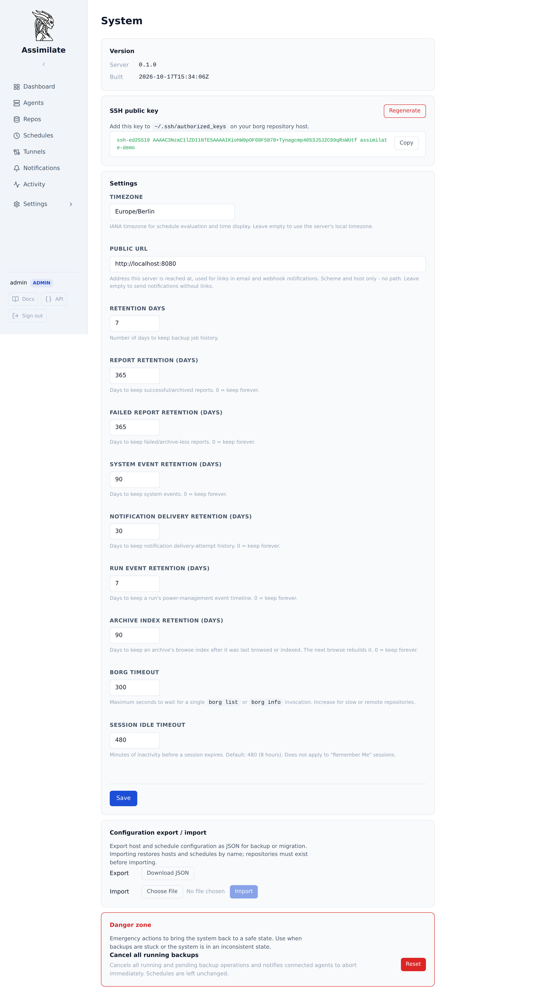

<!--
SPDX-License-Identifier: Apache-2.0
SPDX-FileCopyrightText: 2026 Alexander Mohr
-->

# Prometheus Metrics

Assimilate serves backup, repository, agent and scheduler health at `GET /metrics` in the [Prometheus text exposition format](https://prometheus.io/docs/instrumenting/exposition_formats/). Point Prometheus at it to alert on overdue or failing backups, disconnected agents and repositories running out of quota, alongside the rest of your infrastructure. The endpoint is off until an admin enables it, and it accepts only its own read-only credential.



## Prerequisites

- An admin account. Only admins can change the metrics settings and create monitoring tokens.
- A Prometheus server (or any scraper that reads the text format) that can reach the Assimilate server.

## Enable the endpoint

1. Open **System** and find the **Prometheus metrics** panel.
2. Check **Serve `/metrics`**.
3. Optionally, list the networks that may scrape without a token under **Networks allowed without a token**, one IP address or CIDR range per line.
4. Click **Update metrics**.

While the endpoint is off, `/metrics` answers `404`. The setting is stored in the database, so it survives restarts and applies to every request immediately.

## Authenticate the scraper

`/metrics` accepts two kinds of access and nothing else:

- **A monitoring token.** Open **API tokens**, click **New**, name the token, set **Access** to **Monitoring (read-only)** and click **Create**. Copy the token: it is shown once. The **Access** field is shown to admins only; other users always create full tokens. Send it as `Authorization: Bearer <token>`.
- **An allowed network.** A client whose address is inside a network listed in the settings may scrape without a token. Behind a reverse proxy, set `ASSIMILATE_TRUSTED_PROXIES` (see [Configuration](configuration.md)) so the client address is the scraper's, not the proxy's.

A monitoring token can only read `/metrics`. Every other endpoint refuses it with `401`, so the credential in your Prometheus configuration can never read backups or change anything. In the other direction, session cookies and full API tokens are not accepted at `/metrics`. Monitoring tokens are stored as SHA-256 hashes like every other API token, and **Last used** records each scrape.

```bash
curl -H "Authorization: Bearer <token>" https://backups.example.com/metrics
```

```text
# HELP assimilate_agent_connected Whether the host's agent is connected to the server (1) or not (0).
# TYPE assimilate_agent_connected gauge
assimilate_agent_connected{host="web-server-01"} 1
```

## Configure Prometheus

```yaml
scrape_configs:
  - job_name: assimilate
    scheme: https
    metrics_path: /metrics
    authorization:
      type: Bearer
      credentials_file: /etc/prometheus/assimilate-token
    static_configs:
      - targets: ["backups.example.com"]
```

The server renders the metrics at most once every 10 seconds and serves that rendering to every scrape in between, so several scrapers, or a short scrape interval, add no database load. A scrape interval of 30 to 60 seconds is plenty: backups run on cron schedules.

## Metrics

Every metric is a gauge. A value the server does not know is left out rather than reported as `0`: a target that has never succeeded has no `assimilate_backup_last_success_timestamp_seconds` series at all, so `absent()` and `unless` work as expected.

### Labels

| Label | Value |
|-------|-------|
| `host` | The agent's hostname, followed by its domain when one is set (`edge-proxy.dc1.example.com`), so two hosts sharing a hostname stay apart. |
| `schedule` | The schedule's name. A schedule without one is labelled with its primary repository's name, or `Schedule #<id>` once that repository is gone. |
| `schedule_id` | The schedule's ID. Schedule names need not be unique; the ID keeps their series apart. |
| `repository` | The repository's name. |
| `repository_host` | The address of the [repository host](repository-hosts.md) the repository lives on. |

Label values are escaped as the exposition format requires. Cardinality is bounded by the number of hosts, schedules and repositories: archive names and run IDs never appear in a label.

### Schedule targets

A schedule target is one host backing up to one repository of one schedule. A schedule with two hosts and two repositories has four targets.

| Metric | Labels | Description |
|--------|--------|-------------|
| `assimilate_schedule_enabled` | target labels, `type` | `1` while the schedule is enabled, `0` while it is disabled. `type` is `backup`, `check` or `verify`. |
| `assimilate_backup_last_success_timestamp_seconds` | target labels | Unix time the target's latest successful backup finished. Absent until one has. |
| `assimilate_backup_last_run_status` | target labels, `status` | One series per outcome (`success`, `warning`, `failed`): `1` for the outcome the latest finished backup ended with, `0` for the others. Absent until a backup has finished. A running, cancelled or skipped run does not count as finished. |
| `assimilate_backup_deadline_timestamp_seconds` | target labels | Unix time after which the target is overdue: the next scheduled run after its latest success, plus a 30 minute grace period. This is the same deadline the [dashboard](dashboard.md) uses. Absent for a disabled schedule, a target that has never succeeded, and a cron expression that does not parse. |
| `assimilate_backup_overdue_seconds` | target labels | Seconds the target is past its deadline, `0` while it is not overdue. Present exactly when the deadline is. |

Target labels are `schedule_id`, `schedule`, `host`, `repository` and `repository_host`. The backup metrics cover `backup` schedules only. Targets on hidden hosts, imported placeholder hosts and disabled repositories are left out, as they are on the dashboard.

### Repositories

| Metric | Labels | Description |
|--------|--------|-------------|
| `assimilate_repository_size_bytes` | `repository`, `repository_host` | Total size of every archive before compression and deduplication. |
| `assimilate_repository_deduplicated_size_bytes` | `repository`, `repository_host` | Size after compression and deduplication. [Quotas](quotas.md) are measured against this. |
| `assimilate_repository_archives` | `repository`, `repository_host` | Number of archives. |
| `assimilate_repository_stats_updated_timestamp_seconds` | `repository`, `repository_host` | Unix time the statistics above were last read from borg. |
| `assimilate_repository_quota_warn_bytes` | `repository`, `repository_host` | The quota's warn threshold. Absent without an enabled quota that sets one. |
| `assimilate_repository_quota_critical_bytes` | `repository`, `repository_host` | The quota's critical threshold. Absent without an enabled quota that sets one. |

The size, archive and update metrics are absent until the repository has been read from borg once.

### Agents

| Metric | Labels | Description |
|--------|--------|-------------|
| `assimilate_agent_connected` | `host` | `1` while the host's agent is connected to the server, `0` otherwise. |
| `assimilate_agent_info` | `host`, `version`, `borg_version` | Always `1`. `version` is the agent version the agent last reported; `borg_version` comes from the host's latest backup report that carried one. A label is left out while its value is unknown. |
| `assimilate_agent_last_seen_timestamp_seconds` | `host` | Unix time the server last saw the agent. |

### Server

| Metric | Labels | Description |
|--------|--------|-------------|
| `assimilate_build_info` | `version` | Always `1`. `version` is the server version. |
| `assimilate_scheduler_last_tick_timestamp_seconds` | — | Unix time the scheduler last finished a pass over the schedules. It runs every 30 seconds. Absent until its first pass after the server started. |
| `assimilate_jobs_running` | — | Repositories with an operation (a backup, check, sync, deletion, ...) running right now. |
| `assimilate_jobs_queued` | — | Repository operations waiting for the one running on their repository to finish. |

### Not available

These are not exported because the server does not record them:

- **The result of the last repository check.** A `check` schedule's outcome is sent as a [notification](notifications.md) but not stored, so there is nothing to report between runs. Alert on the `check_failed` notification instead.
- **The age of the oldest queued job.** The server counts queued operations per repository but does not record when each was queued. `assimilate_jobs_queued` reports how many are waiting.

## Example alert rules

```yaml
groups:
  - name: assimilate
    rules:
      - alert: AssimilateBackupOverdue
        expr: assimilate_backup_overdue_seconds > 0
        for: 15m
        labels:
          severity: critical
        annotations:
          summary: "{{ $labels.host }} has not backed up to {{ $labels.repository }} on schedule"
          description: "{{ $labels.schedule }} is {{ $value | humanizeDuration }} past its deadline."

      - alert: AssimilateBackupNeverSucceeded
        expr: |
          assimilate_schedule_enabled{type="backup"} == 1
          unless on (schedule_id, host, repository)
          assimilate_backup_last_success_timestamp_seconds
        for: 1d
        labels:
          severity: warning
        annotations:
          summary: "{{ $labels.host }} has never backed up to {{ $labels.repository }}"

      - alert: AssimilateBackupFailed
        expr: assimilate_backup_last_run_status{status="failed"} == 1
        labels:
          severity: warning
        annotations:
          summary: "The latest {{ $labels.schedule }} backup of {{ $labels.host }} failed"

      - alert: AssimilateAgentDisconnected
        expr: assimilate_agent_connected == 0
        for: 15m
        labels:
          severity: warning
        annotations:
          summary: "The agent on {{ $labels.host }} is not connected"

      - alert: AssimilateSchedulerStopped
        expr: |
          time() - assimilate_scheduler_last_tick_timestamp_seconds > 300
          or absent(assimilate_scheduler_last_tick_timestamp_seconds)
        for: 5m
        labels:
          severity: critical
        annotations:
          summary: "The Assimilate scheduler has not run for 5 minutes"

      - alert: AssimilateQuotaCritical
        expr: |
          assimilate_repository_deduplicated_size_bytes
          >= on (repository, repository_host)
          assimilate_repository_quota_critical_bytes
        labels:
          severity: critical
        annotations:
          summary: "{{ $labels.repository }} is over its critical quota"

      - alert: AssimilateMetricsDown
        expr: up{job="assimilate"} == 0
        for: 5m
        labels:
          severity: critical
        annotations:
          summary: "Prometheus cannot scrape Assimilate"
```

`AssimilateSchedulerStopped` also fires while the scrape itself fails, since the series is then absent; `AssimilateMetricsDown` tells the two apart.

## Grafana dashboard

[`contrib/grafana/assimilate-dashboard.json`](https://github.com/alexmohr/assimilate/blob/main/contrib/grafana/assimilate-dashboard.json) is a starting dashboard: overdue targets, last backup age per target, agent connections, repository sizes against their quotas, and the job queue. Import it in Grafana under **Dashboards → New → Import** and pick your Prometheus data source.

## Configuration reference

The settings are stored in the database and managed through the **System** page or `GET`/`PUT /api/system/metrics` (admin only).

| Setting | Default | Required | Description |
|---------|---------|----------|-------------|
| `enabled` | `false` | Yes | Whether `/metrics` is served. While off it answers `404`. |
| `allowed_networks` | `[]` | No | IP addresses or CIDR ranges whose clients may scrape without a monitoring token. At most 64 entries. A bare address is a single host (`/32` or `/128`). |

## Related pages

- [Security](security.md#api-tokens) — API tokens and their scopes
- [Dashboard](dashboard.md) — the same overdue and failure findings in the UI
- [Notifications](notifications.md) — push alerts without Prometheus
- [API Reference](api-reference.md) — the OpenAPI description of `/metrics`
