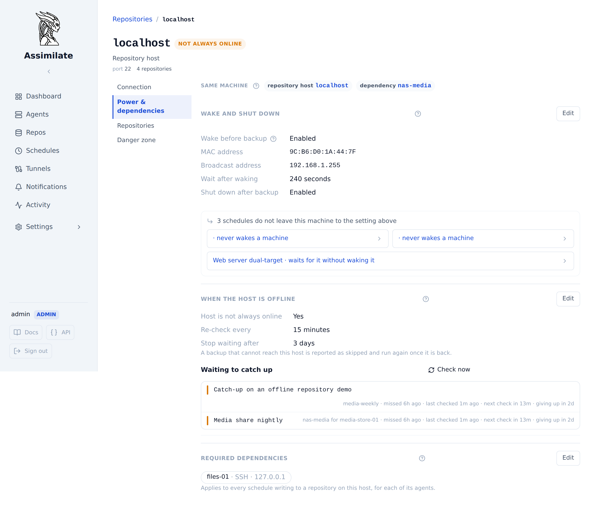
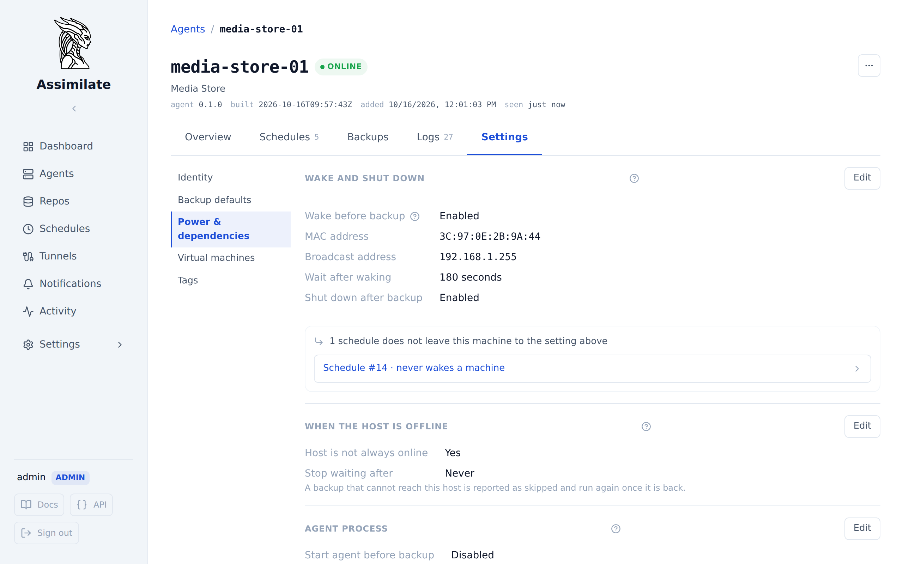
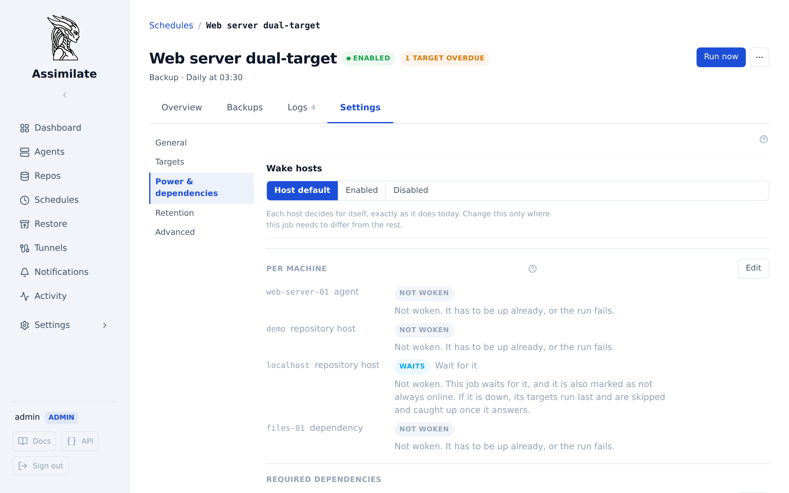
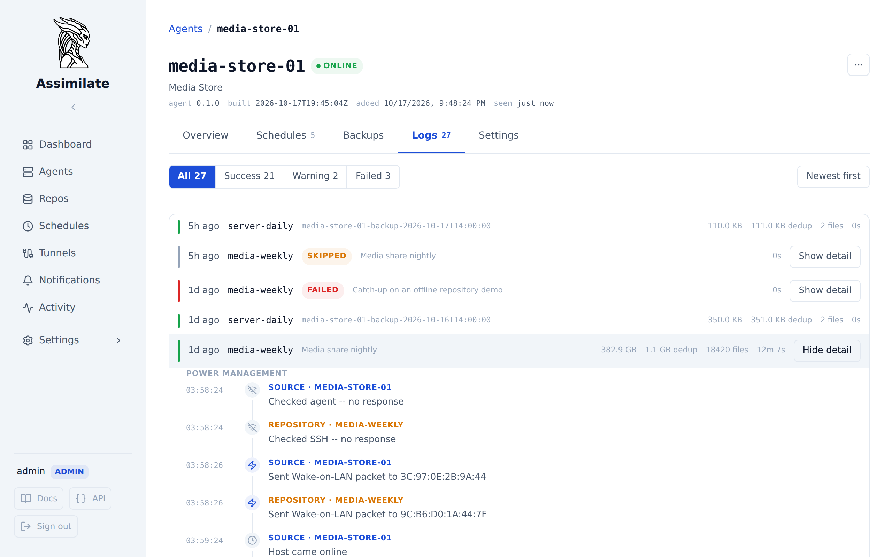

# Power Management

Assimilate can wake a powered-down host before a backup needs it, and power it back down once the backup is done — for both the source host (an agent's machine) and the repository host (the SSH destination borg writes to). Reachability is always checked first: a host that already responds is never disturbed, and only what a given run itself turned on is ever turned back off.

Power settings belong to the **machine**, not to what runs on it. An agent's host, a [repository host](repository-hosts.md) and the [dependencies](dependency-hosts.md) on the same box are one machine with one set of settings — MAC address, broadcast address, timeout, whether it is shut down afterwards, whether it is always online — shown as the same **Power & dependencies** pane on every page that shows one of its roles (see [Machines](#machines) below). The machine's own **Wake before backup** setting is the *default* answer for every schedule that needs it. A single schedule can override that answer in either direction, or wait for the machine without waking it at all; see [Per-Schedule Overrides](#per-schedule-overrides) below.

## How It Works

Before a scheduled backup runs, the server checks each of the two hosts it needs independently and concurrently — one being slow to wake never holds up the other:

1. **Source host** (the agent): if the agent is already connected over its WebSocket, nothing happens. Otherwise, if waking is enabled, the server sends a Wake-on-LAN packet and waits for the agent to reconnect. If the agent still isn't connected once the host is up (or waking is disabled) and starting the agent process over SSH is enabled, the server starts it and waits again.
2. **Repository host**: if it already answers SSH, nothing happens. Otherwise, if waking is enabled, the server sends a Wake-on-LAN packet and waits for SSH to become reachable.

After the backup finishes — whether it succeeded or failed — the server undoes only what *this run itself* turned on:

- A host is shut down only if this run woke it. A host that was already on when the backup started is left running.
- The agent process is stopped only if this run started it.

If two schedules concurrently rely on the same host, it stays up until every one of them has finished with it — a host woken for one schedule is never shut down out from under another that is still using it.

Every step is recorded to the run's timeline, visible in the backup's detail view (see [Run Timeline](#run-timeline) below), and pushed live if the view is open while it happens.

Once both hosts are up, the run checks every [dependency host](dependency-hosts.md) its target needs, waking one that does not answer if it is set up for that. A machine that is only a dependency is never shut down. One that is the same machine as a repository host *is* that host's machine, and the machine is shut down only once no run that needs the dependency is still going.

## Machines

Every agent, repository host and dependency is on a machine. Most machines play one role; the NAS that holds your repositories and also serves the share a pre-backup command mounts plays two. Whatever page you open it from — the agent's **Settings → Power & dependencies**, the repository host's **Power & dependencies**, or the dependency's **Power & dependencies** — you edit the same machine, and the pane says which other roles share it, each linked to its own page.

The pane has the same sections everywhere:

| Section | What it holds |
|---------|---------------|
| **Same machine** | The roles sharing this machine, when there is more than one |
| **Wake and shut down** | How the machine is woken, and whether it is shut down after a backup that woke it. Below it, the schedules that do not leave the machine to this setting |
| **When the host is offline** | Whether the machine is always online, and what is waiting on it (see [below](#when-the-host-is-offline)) |
| The role's own sections | An agent's **Agent process**, and the **Required dependencies** of an agent or a repository host |

A dependency joins a repository host's machine from its own pane (**Machine → Same as a repository host**), and leaves it the same way. Machines are never merged because they share a MAC address: two roles are one machine only when you say so.

!!! note
    Upgrading merges every dependency that was already linked to a repository host into that host's machine. Where the two had different availability settings, the merged machine is not always online if either was, re-checks at the shorter interval and waits the longer window (indefinitely, if either did); the Activity Log records a **Machine migrated** entry for each such merge so you can review it.

## Prerequisites

- **Wake-on-LAN**: the host's network interface must have WOL enabled in firmware/BIOS and in the OS, and the network between the Assimilate server and the host must allow broadcast UDP traffic on port 9. Wake-on-LAN packets do not cross routed network boundaries unless the router is configured to forward them.
- **Starting the agent process over SSH**: the server's SSH key must already be authorized on the host — deploy it once from the agent's header (**Deploy SSH key**, or as part of **Deploy agent**; see [Agent Deployment](agents.md#agent-deployment)). Starting the process requires the deploying user to have permission to manage systemd units (directly, or via passwordless `sudo`).
- **Shutting a host down**: uses the same SSH connection and permission requirements as starting the agent — the connecting user needs permission to run `shutdown` (directly or via passwordless `sudo`).

## Configuring an Agent's Host

From the agent's detail page, **Settings → Power & dependencies** (admins only):

**Wake and shut down** (the machine's):

| Field | Description |
|-------|--------------|
| **Wake before backup** | Send a Wake-on-LAN packet if the agent doesn't already respond. The default for this machine's jobs — a schedule can override it either way |
| **MAC address** | Required when wake is enabled, and required for any schedule that overrides this machine to be able to wake it |
| **Broadcast address** | Optional — defaults to the global broadcast address (`255.255.255.255`) when unset |
| **Wait after waking** | How long to wait for the agent to reconnect before the backup is marked failed |
| **Shut down after backup** | Only takes effect if this run woke the machine. Configurable whenever a MAC address is set, including with wake off — a machine woken only by a single job still needs to power down. An agent's machine is shut down over the agent's SSH host, so set that first |

**Agent process** (the agent's own):

| Field | Description |
|-------|--------------|
| **Start agent before backup** | Start the agent's systemd unit over SSH if it still isn't connected once the host is up. Requires the SSH key to have been deployed to the host at least once already |
| **SSH host / port** | Where to reach the host for starting the agent process and for shutting it down |
| **Service name** | Name of the systemd unit managing the agent process (defaults to `assimilate-agent`) |
| **Stop agent after backup** | Only takes effect if this run started the agent process |

The agent's **Required dependencies** are in the same pane; see [Dependency Hosts](dependency-hosts.md#requiring-a-dependency).

## Per-Schedule Overrides

A machine's **Wake before backup** setting decides what happens for every schedule that needs it. Where one job needs to differ, set it on that job instead: from the schedule's detail page, **Settings → Power & dependencies**.

**Wake hosts** sets what the job does about all of its machines at once:

| Setting | What the job does |
|---------|-------------------|
| **Host default** | Leaves it to each machine's own setting. This is what every schedule does unless told otherwise. |
| **Enabled** | Wakes every machine this job needs, including one whose own setting is off — as long as it has a MAC address on file. |
| **Disabled** | Never wakes anything for this job, whatever its machines are set to. A machine that is not already up fails the run. |

**Per machine**, on a saved schedule, lists every machine the job needs — its agents, the hosts of its repositories and its dependencies — and lets you choose for one machine at a time:

| Choice | What the job does about that machine |
|--------|--------------------------------------|
| **Same as above** | Follows **Wake hosts**. |
| **Wake** | Wakes it, whatever **Wake hosts** and the machine's own setting say. |
| **Don't wake** | Never wakes it. It has to be up already, or the run fails. |
| **Wait for it** | Never wakes it, and when it is not there, waits for it instead of failing — see [Waiting for a Machine](#waiting-for-a-machine). Not offered for an agent: an agent that is not connected has nothing to run the backup with. |

Each row shows what tonight's run will do with that machine — **Wakes**, **Waits**, **Not woken** or **Cannot wake** — resolved against the setting above as you edit it, so the answer is on screen rather than reconstructed from each machine's own page. The choices are saved on their own, with the section's **Edit** and **Save**; **Wake hosts** is saved with the rest of the schedule. Both are available on backup, check and verify schedules alike.

Only *waking* is overridden. Two things follow the machine's own settings in every case:

- **Starting the agent process over SSH** keeps following the agent's **Start agent before backup** setting. A machine that is already powered on needs no wake for its agent to be started.
- **Shutting a machine down** still only happens where this run is what woke it, so **Disabled**, **Don't wake** and **Wait for it** remove the shutdown by removing the wake rather than suppressing it separately.

Because a schedule can wake a machine whose own setting is off, the machine's pane keeps the wake details on screen and **Shut down after backup** configurable whenever a MAC address is set, and it names every schedule that does not leave the machine to its own setting, with what that schedule does. The list is shown to admins only, since it names schedules regardless of who owns them. What a run actually does is never affected by who is looking.

!!! warning
    A job that asks to wake a machine with no MAC address on file cannot. The schedule's pane says **Cannot wake** for that machine before you save, and a run that hits it records a **Cannot wake** step on the run timeline rather than failing silently.

### Waiting for a Machine

**Wait for it** is for a machine this job should not wake but should not fail on either — the NAS that holds an offsite copy and powers itself up a few times a week, say. It behaves as if the machine were marked as [not always online](#when-the-host-is-offline), for this one schedule:

- **A repository host** is asked whether it answers before the run powers anything up. If it does not, every target writing to it is moved to the end of the run, so the other targets are written first; each is asked again when its turn comes. A target whose host still does not answer is reported as **skipped**, and caught up once the host is back, like any [catch-up run](scheduling.md#catch-up-runs).
- **A dependency** is checked as usual but never woken. If it does not answer, the agent's run is skipped and caught up once it does.

Each skip records a **Backup waiting for host** entry in the [Activity Log](activity.md) and sends the [notification](notifications.md) of the same name. It is a separate event from **Backup skipped (repository offline)** and **Backup skipped (dependency offline)**, which keep meaning that the machine itself is marked as not always online, so you can be told about one without the other.

A machine that is marked as not always online *and* woken by the job is woken first; only if it still does not answer is the target skipped and caught up.

## Configuring a Repository Host

From the [repository host's](repository-hosts.md) page, **Power & dependencies** (admins only). The settings apply to every repository on the host: they are facts about the machine, so repositories on one NAS cannot disagree about which MAC address wakes it or whether it is shut down afterwards. A repository's own **Settings → Power & dependencies** pane shows them read-only and links to the host.

The same machine sections as above apply, minus anything agent-process related — a repository host isn't running Assimilate, it's just an SSH destination borg writes to, so there is nothing to start or stop beyond the machine itself. Reachability reuses the same SSH connection check as the **Test Connection** button on a repository's settings. The host's **Required dependencies** apply to every schedule writing to it; see [Dependency Hosts](dependency-hosts.md#requiring-a-dependency).

A run that writes to several repositories on one host wakes it once and shuts it down only after the last of them is done.

## When the Host Is Offline

Waking handles a host that is off but can be switched on. Some hosts cannot be — a laptop that is simply not there at 02:00, a VM that boots on its own schedule, a NAS that powers down overnight — and for those the question is what a missed backup *means*. Below the wake settings on every **Power & dependencies** pane, the machine's **When the host is offline** section answers it:

| Setting | Effect |
|---------|--------|
| **Host is not always online** | Off (the default): an unreachable machine is a failed backup, unless the schedule [waits for it](#waiting-for-a-machine). On: it is reported as skipped, and the run is caught up once the machine is back |
| **Re-check every** | How often the machine is asked whether it is back — over SSH for a repository host, on its port for a dependency. Not shown for a machine that is only an agent: an agent reconnects on its own |
| **Stop waiting after** | How long a pending catch-up waits before it is abandoned and reported as a failed backup. Empty waits indefinitely |

The section also lists every run currently waiting on the machine — for any of its roles — with what it missed and how much of its window is left, and **Check now** asks the machine immediately instead of waiting out the interval, catching up everything waiting on it. The settings are admin-only, like the rest of the pane, and are saved separately from the wake settings above them, so marking a laptop as not always online never fails because its wake details are incomplete.

See [Hosts That Are Not Always Online](scheduling.md#hosts-that-are-not-always-online) and [Catch-Up Runs](scheduling.md#catch-up-runs) for exactly what is reported when, and how a caught-up run avoids colliding with the schedule's next one.

## Run Timeline

A backup run's detail view shows every power-management step recorded around it, in order — the source, repository and [dependency](dependency-hosts.md#run-timeline) hosts' events interleaved by time, since they run independently. A run whose hosts were already reachable records nothing here beyond what the backup itself reports; most runs never touch this at all.

A **Cannot wake** step means a schedule asked to wake a host that has no MAC address on file. The run continues — the host simply is not woken, and the backup fails naturally if it never comes up.

!!! note
    A manually triggered ("Run Now") run never wakes a host itself, so it rarely records more than a teardown step — typically nothing at all unless it happens to be the last participant releasing a host a concurrent scheduled run woke.

## Server Restarts

A server restart does not lose track of a machine a run woke. Each hold a run keeps on a machine is saved in the database, and when the server starts again it counts those holds as held again, so a run that starts after the restart on the same machine does not shut it down while the interrupted run still needs it.

The backup itself carries on on the agent while the server is down, and the agent reports its result once it reconnects. About once a minute the server checks each held machine's interrupted run: once the run has reported back (or had no backup report to begin with), the server releases its hold exactly as the run would have, so the machine is shut down (or its agent stopped) if no other run still needs it, the run woke (or started) it, and the machine is set to shut down after a backup.

If an interrupted run still has not reported back 24 hours after it took its hold, the server stops waiting for it. The machine is left as it is rather than shut down under a backup that may still be running, and the Activity Log records a **Power release abandoned** warning naming the run and the machine. Check whether the machine is still on and shut it down yourself if it should not be.

<!--
SPDX-License-Identifier: Apache-2.0
SPDX-FileCopyrightText: 2026 Alexander Mohr
-->
