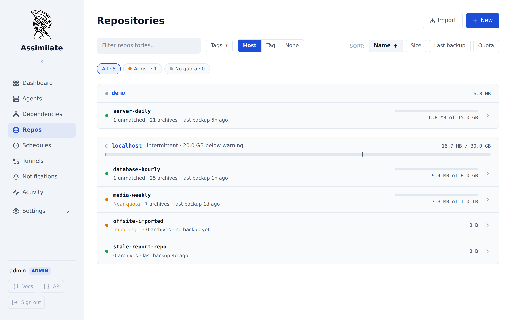
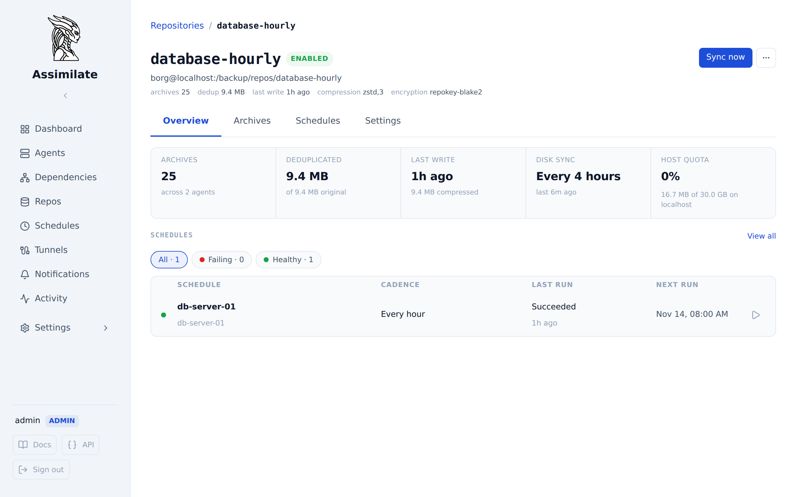
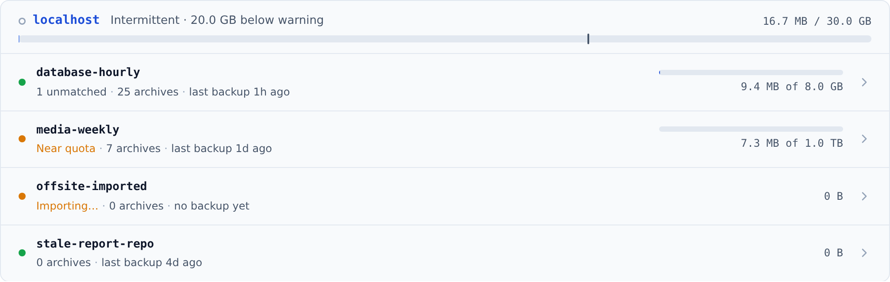
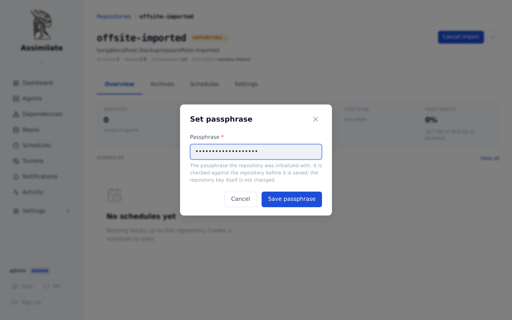

# Repository Management

A repository is a borg backup destination — an SSH-accessible path where archives are stored. Each repository has its own encryption passphrase, compression settings, and access controls.

## SSH Setup Prerequisites

Assimilate connects to borg repositories over SSH using the server's Ed25519 key pair. Before creating a repository, the server's public key must be authorized on the repository host.

**View the server's public key** under **System** in the admin UI, or retrieve it via:

```bash
ssh-add -L
```

Add the key to `~/.ssh/authorized_keys` on the borg repository host:

```bash
echo "<server-public-key>" >> ~/.ssh/authorized_keys
```

To make a repository append-only, so agents cannot delete from it, turn it on in the repository's settings: Assimilate edits the host's `authorized_keys` itself. See [Append-only Repositories](append-only.md).

Once the key is in place, use the **Test Connection** button in the repository form to verify SSH connectivity and confirm that `borg` is installed on the remote host.

On the first successful borg connection, Assimilate records the repository host's SSH key against the repository and pins it to a dedicated, per-repository `known_hosts` file for all server-side borg operations. If the repository host's key later changes, syncs fail with a host-identification-changed error until an admin reviews the new key's fingerprint and accepts it from the repository's page.

For the full SSH agent forwarding setup — including Docker and systemd configurations — see [SSH Agent Forwarding](ssh-agent-forwarding.md).

## Creating a Repository

There are two paths for adding a repository:

| Path | When to use |
|------|-------------|
| **Init new** | The remote path does not yet exist — Assimilate runs `borg init` |
| **Import existing** | A borg repository already exists at the path — register it without reinitializing |

Both paths are available from **Repositories → New Repository** in the UI.



The Repositories list page shows all registered repositories with:

- **Text filter** — search by repository name
- **Tag filter** — filter by one or more tags
- **Quota filter pills** — narrow the list to **At risk** repositories (at or above their own warning threshold) or repositories with **No quota** configured; the **All** pill always shows the total count
- **Group by** — **Host** (the default) puts the repositories that share an SSH host in one panel under that host's storage pool (see [Quota by Host](#quota-by-host) below), **Tag** puts them in one panel per tag, and **None** lists every repository in a single panel. **Tag** appears once a repository tag exists
- **Sort buttons** — sort by Name, Size, Last Backup, or Quota (utilization of each repository's own quota; repositories with no quota sort last). Sorting applies when grouped by tag or not grouped — while grouped by host, each host orders its own repositories by size instead

Each panel lists its repositories as rows under one line of column heads: **Repository**, **Status**, **Archives**, **Last backup** and **Size of quota**. Click a row to open the repository.

- **Repository** — the name, over the SSH target (`user@host:path`), the encryption type and the compression algorithm. Outside the host grouping, a repository on a host that is not always online also reads **host sleeps** here.
- **Status** — one badge naming what most needs attention, in this order: **Import failed**, **Importing** (with progress), **Disabled**, **Over quota** (at the critical threshold), **Near quota** (at the warning threshold), **N unmatched** (imported archives no schedule claims yet), or **Healthy**. Hover a quota badge to see the action its threshold takes. A row whose status is **N unmatched** opens the repository on its Archives tab.
- **Archives** — the archive count.
- **Last backup** — how long ago the newest archive was written, or **Never**.
- **Size of quota** — with its own [storage quota](quotas.md) configured, a usage bar on the quota's scale and the size against the ceiling, for example `6.8 MB of 15 GB`. Without one, the deduplicated size alone.

On a phone each row stacks into three lines: the name with the last backup at the right, then the archive count and size, then the status in its colour.



The repository detail page opens with a header naming the repository, its SSH target, its status and what it holds, with **Sync now** as its primary action and **Show passphrase** behind the overflow menu. Four tabs follow:

- **Overview** — archives, deduplicated and original size, last write and disk-sync cadence, plus the repository's schedules
- **Archives** — the archive list and the file browser
- **Schedules** — every schedule writing to this repository
- **Settings** — the repository's own connection fields, its [append-only](append-only.md) setting and maintenance, its [storage quota](quotas.md), its tags, the borg console, and the danger zone (Confirm relocation, Break lock, Remove repository, Delete repository, Reset and re-import)

!!! warning "Break lock"
    **Break lock** clears a stale `borg` lock on the repository. It also detects and clears a
    stale *local cache lock* left behind by a backup process that was crashed, OOM-killed, or
    forcibly terminated (e.g. a killed container) — something plain `borg break-lock` does not
    do, since it only ever clears the repository's own lock. Only use Break lock when you are
    certain no backup is currently running against the repository; breaking a lock during an
    active backup will corrupt it.

## Init New Repository

Use this path when the remote directory is empty or does not exist yet.

1. Enter the SSH connection details: host, user, port (default 22), and repository path.
2. Use the **Browse** button to navigate the remote filesystem and select a path (see [Folder Browser](#folder-browser)).
3. Select an encryption type (see [Encryption Types](#encryption-types)).
4. Enter a passphrase. Choose a strong, unique passphrase — it cannot be recovered if lost.
5. Optionally select a compression algorithm (see [Compression](#compression)).
6. Click **Initialize**. The server runs `borg init` on the remote host and registers the repository.

The borg output is shown after initialization. If the remote path already contains a borg repository, the server returns a conflict error — use **Import Existing** instead.

## Import Existing Repository

Use this path when a borg repository already exists at the remote path and you want to register it in Assimilate without reinitializing.

1. Enter the SSH connection details and the exact path to the existing repository.
2. Enter the passphrase that was used when the repository was originally initialized.
3. Click **Save**. The repository is registered and will appear in the repository list.

No `borg init` is run. The passphrase is stored encrypted at rest and used for all future backup and archive operations.

### Import Progress

After saving, the server runs `borg info` and `borg list` in the background to sync existing archives. While this is in progress:

- The repository's row on the list shows an **Importing** status with its progress.
- The repository detail page shows an importing indicator.
- If the import fails (e.g. SSH timeout, wrong passphrase), the row reads **Import failed** (hover it for the error) and the detail page shows the error.

During a full repository sync, Assimilate also prunes archives that no longer exist in borg from the database. The scheduled disk sync uses the same full reimport path, so it refreshes the complete archive list instead of only adding new entries.

### Sync after every backup

Every finished backup run is followed by a sync of the repository it wrote to, whatever the run's outcome. A failed run still syncs: `borg create` may have written its archive before `borg prune`, `borg compact` or a post-backup hook failed the run. A cancelled run syncs too, since an archive written before the cancellation, or one pruned before it, has changed the repository all the same. The sync imports archives the database does not know yet and removes the records of archives the run's [retention policy](scheduling.md#retention-policy) pruned, so the archive list matches the repository without waiting for the next disk sync. The archive the run reported writing is always kept.

The sync runs in the background and does not delay the backup's report or its notifications. It waits its turn in the repository's operation queue, so it never contends with another backup, sync, indexing job or deletion for the borg repository lock. If the run woke the repository host and the host shuts down after backups, the shutdown waits until the sync has finished. A cancelled run does not hold the host up this way, so if its host shuts down first, the sync fails and the next sync picks up the changes. A failed sync shows its error on the repository detail page like any other sync.

### Full resync and content indexing

The **Sync now** action on the repository detail page re-reads every archive from borg and then builds the browsable **content index** (the file tree used for archive browsing, search, diff, and restore). Because borg archives are immutable:

- Archives whose content index is already complete are **skipped** — a resync never re-scans an archive it has already indexed. An archive whose index was dropped by [index retention](archives.md#index-retention) counts as not indexed and is re-scanned.
- Stats are only re-fetched for archives that don't have them yet.

Indexing runs in the background and the repository badge shows live progress: the **bar advances as each archive finishes** (so it never sits at 100% while work remains), and the status line shows the archive currently being scanned together with a running file count and the file being processed, e.g. *Indexing 'host-2026-06-10T02:00:00' (3/84) — 12,345 files · home/user/project/main.rs*. You can navigate away — indexing continues and the UI updates automatically via WebSocket.

For large repositories with many archives, the initial import and first full index may take several minutes.

### Archive-to-Host Matching

During import, each archive's hostname is resolved to a registered agent:

1. **Exact match** — the archive hostname matches an agent's hostname directly.
2. **Pattern match** — the hostname matches a glob pattern configured on an agent (see [Agent Management — Hostname Aliases](agents.md#hostname-aliases-glob-patterns)).
3. **Unmatched** — a placeholder agent is created with an "(imported)" badge.

Unmatched archives can be resolved later by adding hostname patterns and running a re-scan.

## Re-scanning Unmatched Archives

After adding hostname aliases to agents, you can re-scan a repository to match previously unmatched archives against the updated patterns.

1. Open the repository detail page.
2. Click **Re-scan Archives** (admin only).
3. The server evaluates all unmatched archives against current hostname patterns.
4. A toast shows how many archives were matched and how many remain unmatched.
5. Placeholder agents with no remaining archives are automatically cleaned up.

## Encryption Migration

Admins can migrate a repository to a different encryption mode (e.g. from `repokey` to `repokey-blake2`).

1. Open the repository detail page.
2. Click **Migrate Encryption** and select the target encryption mode.
3. Click **Confirm**.

The server:

1. Renames the existing repository to `<path>.migrated-<date>` on the remote host.
2. Runs `borg init` at the original path with the new encryption mode.
3. Updates the database record.

The old repository is preserved at the `.migrated-*` path and can be removed manually once you've confirmed the migration is successful. This operation is audit-logged.

!!! warning
    Migration creates a new empty repository. Existing archives remain in the old (renamed) repository. You will need to run new backups to populate the migrated repository.

## Folder Browser

The built-in folder browser lets you navigate the remote filesystem over SFTP to select a repository path without typing it manually.

Click the **Browse** button next to the repository path field. The browser connects to the SSH host using the server's key and lists directories. Navigate to the desired parent directory and either select an existing directory or type a new subdirectory name.

The selected path is written back into the repository path field.

The folder browser requires the SSH host and user fields to be filled in first.

## Encryption Types

Assimilate supports all borg encryption modes. The encryption type is set at `borg init` time and cannot be changed afterwards.

| Mode | Description |
|------|-------------|
| `repokey` | Passphrase-protected key stored in the repository |
| `repokey-blake2` | Same as `repokey` with BLAKE2b MAC — **recommended** |
| `keyfile` | Passphrase-protected key stored on the agent machine |
| `keyfile-blake2` | Same as `keyfile` with BLAKE2b MAC |
| `authenticated` | No encryption, HMAC authentication only |
| `authenticated-blake2` | No encryption, BLAKE2b authentication only |
| `none` | No encryption, no authentication |

**Recommendation:** Use `repokey-blake2`. It stores the key in the repository (no separate key file to manage), uses the faster and more secure BLAKE2b MAC, and is the most common choice for server-managed backups.

Avoid `none` for any data that should remain confidential. For details on borg encryption internals, see the [BorgBackup documentation](https://borgbackup.readthedocs.io/en/stable/usage/init.html).

## Compression

Compression is applied per-archive at backup time. It can be changed on an existing repository — the new setting applies to future archives only.

| Algorithm | Trade-off |
|-----------|-----------|
| `lz4` | Very fast, low CPU, moderate ratio — **default, good for most cases** |
| `zstd` (level 1–22) | Balanced speed and ratio; level 3 is a good starting point |
| `zlib` (level 1–9) | Slower than lz4, similar ratio; legacy option |
| `none` | No compression — useful when data is already compressed (e.g., media files) |

For general-purpose backups, `lz4` is the default and works well. Use `zstd,3` when storage space is a priority and CPU overhead is acceptable.

## Repository Tags

Tags are short labels that help organize repositories when managing many agents. A repository can have multiple tags.

Tags are set in the repository edit form. On the repository list, filter by them or group by them with **Group by → Tag**. They have no effect on backup behavior — they are purely organizational.

## Quota by Host

The Repositories page groups repositories sharing an SSH host into one panel by default, so it is clear at a glance which repositories belong to which backup destination. Set **Group by** to **None** for a single sortable list.

Each panel's header names the host (a link to its [repository host](repository-hosts.md) page for admins), with a **Not always online** badge on a host that sleeps, a summary such as `3 repos · 4.2 GB below warn`, and the combined usage at the right. When the host has a [storage quota](server-quotas.md) configured and you have admin access, a storage pool bar runs under the header: it is scaled to the host quota, with one segment per repository sized to its share of the combined usage, and a mark at the host quota's warning threshold.



The rows under the header keep their own scale: a repository's **Size of quota** column measures it against its own [storage quota](quotas.md), never against the host's. Its share of the host is the segment in the pool bar.

Combining a quota filter pill or the text filter with host grouping dims — rather than removes — the rows that don't match, so the pool bar always reflects the host's true combined usage; the header notes how many of the host's repositories are shown. A host none of whose repositories match keeps only its header.

A host with no configured host quota, or when viewing as a non-admin user, still groups its repositories together, without the pool bar.

## Passphrase Management

The passphrase is required by borg to encrypt and decrypt archives. Assimilate stores it encrypted at rest using AES-256-GCM, derived from the `ASSIMILATE_SECRET_KEY` environment variable.

**Viewing the passphrase** is restricted to admins. Navigate to the repository detail page and choose **Show passphrase** from the header’s overflow menu. The decrypted passphrase is fetched from the server and displayed once.

### Setting the passphrase

Choose **Set passphrase** from the repository header's overflow menu to tell Assimilate which passphrase the repository uses. This is the step a repository created by a [config import](configuration.md#repository-passphrase-handling) waits on, since passphrases are never exported, and the fix when the stored passphrase no longer matches the repository.



Assimilate runs `borg info` with the passphrase you enter before saving it. If borg rejects it, the dialog shows the error and nothing is stored. Once it is saved, the repository is no longer held back as **importing**, an import failure left by the old passphrase is cleared, the passphrase is pushed to the agents with the rest of their configuration, and the change is recorded in the [audit log](audit-log.md) as `set_repo_passphrase`. A passphrase cannot be set while a sync of the repository is running, or while another borg process holds the repository's lock; try again once it finishes, or use **Break lock** in the repository's Settings tab if the lock is stale.

This does not change the repository's key: it records the passphrase the key already has. Admins only.

The passphrase is never logged or transmitted in plaintext. See [Security](security.md) for details on the encryption scheme.

!!! warning "Passphrase is irrecoverable"
    If you lose the passphrase, the repository contents are permanently inaccessible. Assimilate cannot recover it. Store the passphrase in a secure location (e.g., a password manager) independent of Assimilate.
    If `ASSIMILATE_SECRET_KEY` is changed or lost, all stored passphrases become unreadable. Keep this value stable and back it up separately. See [Configuration](configuration.md) for details.

## Editing and Deleting

**Editing** a repository updates its host, SSH user, path, compression, and enabled state. The encryption type cannot be changed after initialization — borg does not support re-encrypting an existing repository. The passphrase is set separately, with [Set passphrase](#setting-the-passphrase).

The **Host** picker lists the known [repository hosts](repository-hosts.md); a host's port comes with it. **Add a new host...** takes a hostname and port no other repository uses yet. Moving a repository to another host takes that host's SSH host key, power and availability settings. To change a host itself — its hostname, port or key — edit it on the host's own page, which moves every repository on it.

Changing the host or path does not move or modify the remote repository. It only updates the connection details Assimilate uses to reach it.

Toggling **Disk sync** on schedules a periodic `borg info`/`borg list` resync of this repository, independent of any backup schedule, using the same cron expression and visual [Cron Expression Builder](scheduling.md#cron-expression-builder) that backup schedules use.

### Repository Relocation Safety

When you change a repository's path, SSH host, or SSH port, borg needs to accept that the repository has moved. Assimilate handles this securely:

1. **On edit**: The server marks the repository as "relocation pending."
2. **Next backup**: The agent sets `BORG_RELOCATED_REPO_ACCESS_IS_OK=yes` for that single backup run, allowing borg to accept the new location.
3. **After success**: The relocation flag is cleared automatically. Subsequent backups no longer accept relocations.

This means borg will only accept a repository relocation **once**, immediately after an admin changes the connection details. If an attacker swaps the remote repository at any other time, borg will refuse to operate on it.

!!! note
    No manual action is required. The relocation acceptance is automatic and one-shot. If the first backup after a path change fails for an unrelated reason, the flag remains set until a backup succeeds.

**Deleting** a repository removes it from Assimilate — the database record, stored passphrase, and associated schedules are deleted. The remote borg repository and its archives are **not** deleted. You must remove the remote data manually if desired.

Deletion requires admin privileges.

## Power

Waking a powered-down machine, shutting it back down, whether it is expected to be online, and the dependencies every backup to it requires are facts about the machine, so they are set on its [repository host](repository-hosts.md#power-dependencies), once for every repository on it. The repository's **Settings → Power & dependencies** pane shows its host's settings read-only, with **Edit on host** for admins, and lists the schedules currently waiting on this repository. See [Power Management](power-management.md) for the full behavior, and [When the Host Is Offline](power-management.md#when-the-host-is-offline) for what an unreachable host means.

## Repository Permissions

By default, repository visibility follows the owner model. Admins can grant per-user access to specific repositories using the permissions panel on the repository detail page.

| Permission | Effect |
|------------|--------|
| `can_view` | User can see the repository and its archives |
| `can_backup` | User can trigger manual backups |
| `can_modify_schedules` | User can create, edit, and delete backup schedules for this repository |
| `can_extract` | User can browse and extract files from archives |
| `can_delete` | User can delete archives |

Admins always have full access regardless of per-user permissions. For a broader overview of access control, see [Security](security.md).

<!--
SPDX-License-Identifier: Apache-2.0
SPDX-FileCopyrightText: 2026 Alexander Mohr
-->
