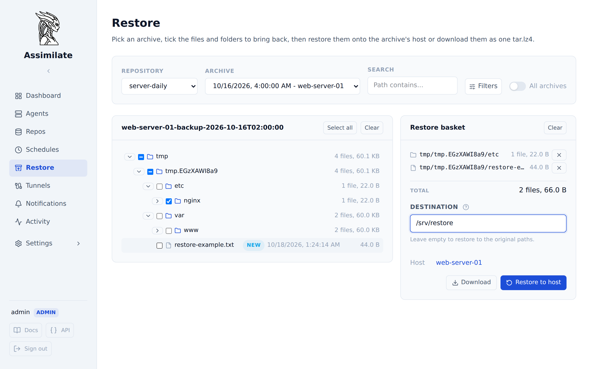
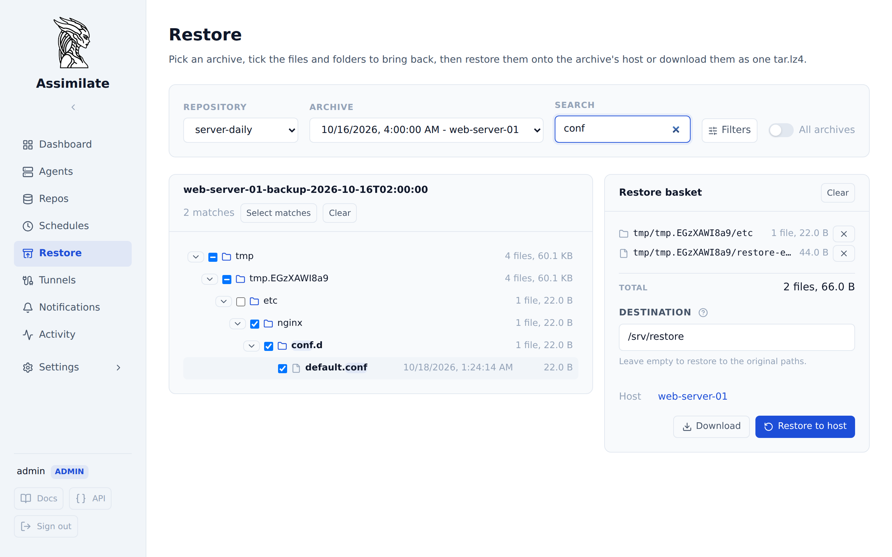
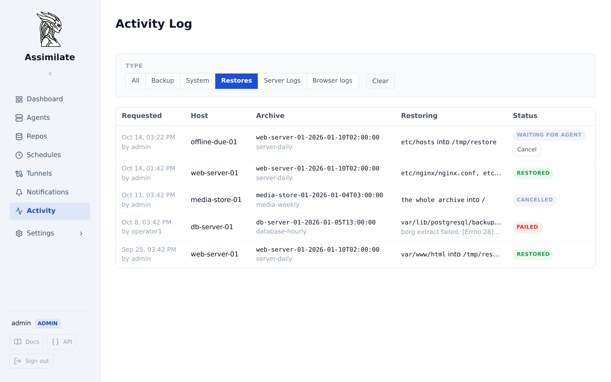
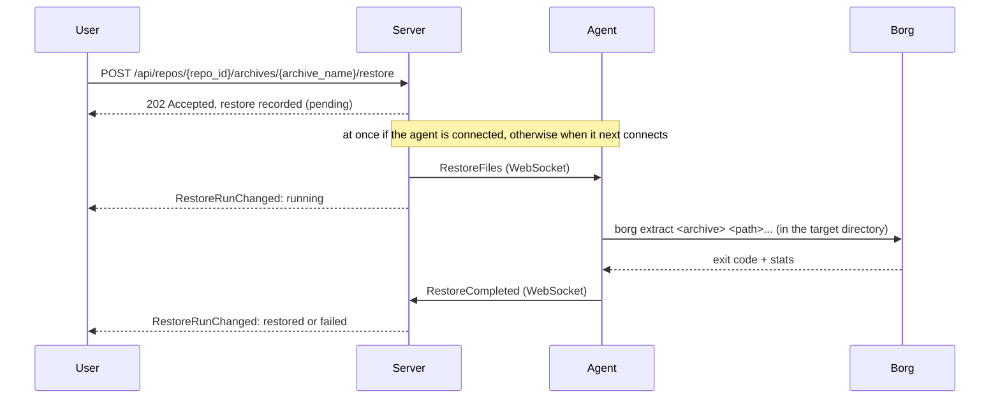

<!--
SPDX-License-Identifier: Apache-2.0
SPDX-FileCopyrightText: 2026 Alexander Mohr
-->

# Restoring Files

Assimilate supports two restore paths: downloading files directly to your browser, or restoring files to the agent machine's filesystem. The **Restore** page puts both on one screen: pick an archive, tick any number of files and folders, and restore or download them together. Choose the path based on the destination you need.

## Prerequisites

- The target repository must be accessible (agent connected or repository reachable via SSH). An agent-side restore for an offline host waits until its agent connects.
- You need the **extract** permission on the repository to download. Restoring onto a host is limited to administrators.

## Restore Page

Open **Restore** in the sidebar, or click **Select files** in the header of any archive browser to open it on that archive. The page has three parts: a bar for choosing the archive and searching it, the archive's file tree on the left, and the restore basket on the right.

1. Choose the **Repository** and the **Archive**. The archive list names each archive by its date, and by its host when the repository holds more than one; the newest archive opens by default. The page keeps both in the URL (`/restore?repo=<id>&archive=<name>`), so a link opens the same archive.
2. Tick the files and folders to restore in the tree. Ticking a folder selects everything below it.
3. Optionally enter a **Destination** in the basket.
4. Click **Restore to host** to restore the basket onto the archive's host, or **Download** to save it as one `tar.lz4`.

### The File Tree

The tree reads the archive's content index, so it opens instantly once an archive has been indexed. An archive that was never indexed is indexed on first open, as in the [archive browser](archives.md#browsing-archive-contents).

| Element | Meaning |
|---------|---------|
| Checkbox | Ticked: the entry and everything below it are in the basket. Mixed: something inside the folder is ticked, not all of it. |
| Folder totals | Number of files and their combined size, counted from the index for the whole folder. |
| File size and date | The file's size and last-modified time. |
| **New** / **Changed** badge | The file is missing from, or differs in size or modification time from, the previous archive of the same host. Shown once that archive is indexed too. |
| **Load more** | The folder holds more than 200 entries; load the next 200. |

Click a folder's chevron or name to open it. **Select all** ticks every top-level entry, which is the whole archive; **Clear** empties the basket.

Unticking a file inside a ticked folder leaves the rest of the folder ticked: the folder is replaced in the basket by its other entries.

The tree works from the keyboard. Tab moves into the tree, then:

| Key | Action |
|-----|--------|
| ↑ / ↓ | Move to the previous or next row |
| → | Open a folder, or move into an open one |
| ← | Close a folder, or move to its parent |
| Space | Tick or untick the row |
| Enter | Open or close a folder |
| Home / End | Move to the first or last row |

### Searching

Type in **Search** to filter the tree as you type. The search runs on the server against the archive's content index and matches any part of the path, ignoring case. The tree then shows only the matching entries and the folders on the way to them, opened, with the match highlighted. Ticking works the same way while a search is active, and what you tick stays in the basket when you change or clear the search. **Select matches** ticks every match.

**Filters** narrows the search further, with or without search text:

| Filter | Keeps |
|--------|-------|
| Type | Files only, or folders only |
| Min size / Max size | Entries within the size range, in MiB |
| Modified from / Modified to | Entries last modified within the date range, both days included |

A search lists at most 200 matches; narrow it to see the rest.

Turn on **All archives** to search the repository's recent archives instead of the open one. Click a match to open the archive it came from with the tree searched down to that path.

### The Restore Basket

The basket lists what is ticked, one entry per ticked file or folder, with each entry's size and a running total for the whole basket. Use the **×** button on an entry to remove it.

| Field | Description |
|-------|-------------|
| Destination | Absolute directory on the host to restore under. Empty restores every path to its original location. |
| Host | The archive's host. The basket restores onto that host only. |

With a destination, every path keeps its full archive path below it: `etc/nginx/nginx.conf` restored to `/srv/restore` becomes `/srv/restore/etc/nginx/nginx.conf`. The destination must start with `/` and must not contain `.` or `..` segments or control characters. The server and the agent both check it again before anything is written.

**Restore to host** asks for confirmation first. The confirmation names the destination, shows where the first paths end up, and warns that existing files there are overwritten. The whole basket is restored by one `borg extract` run, and the basket follows that restore until it ends. It is listed on the Activity Log's **Restores** tab like any other restore.

**Download** streams the whole basket as one `tar.lz4` file, which the browser saves as it arrives.

Restore to host needs an agent for the archive's host; if it is offline, the restore waits for it. An archive whose host no agent claims can be downloaded only.

## Browser Download

Use browser download to retrieve individual files or a directory tree directly to your local machine. To download several files and folders as one file, use the [Restore page](#restore-page).

1. Navigate to **Repos**, select a repository, and open the **Archives** tab.
2. Click the archive you want to restore from.
3. Navigate to the file or directory you want.
4. Click **Download** to save it locally, or **Restore to host** to restore it directly to its original location.
5. Use the actions on the root `.` row to download or restore the whole archive.

The server streams data live from the borg repository. For details on the export format, see [Exporting as tar.lz4](archives.md#exporting-as-tarlz4).

!!! note "Large downloads"
    Large downloads stream data live over SSH and are not time-limited by the server. For multi-GB restores, agent-side restore avoids holding a browser connection open for the duration of the transfer. When downloading through the restore wizard's **Download to browser** option, a **Cancel Download** button is shown while the transfer is in progress; cancelling stops the transfer and the underlying `borg` process on the server immediately.

## Virtual Machines

A staged virtual machine is restored in two stages: the file restore below puts its directory back on disk, then the agent merges the increment chain and defines the domain. Both stages are driven from the agent's **Virtual machines** section - see [VM Snapshots](vm-snapshots.md#restore-a-domain).

## Databases

A database dump in an archive is restored straight into its database server, without restoring the dump file first: switch the archive browser to **Databases** - see [Database Dumps](database-dumps.md#restore-a-database). A database restore is tracked like a file restore below.

## Agent-Side Restore

Agent-side restore extracts files directly on the agent machine — no data passes through the Assimilate server or your browser. This is the right approach for large restores or when the destination is the agent's own filesystem.

Navigate to the archive browser and click **Restore to host** beside a file or directory. Confirm the operation to extract it to its original location. Use the root `.` row to restore the whole archive. The [Restore page](#restore-page) restores any number of ticked paths in one run, to their original locations or under a destination directory. The restore wizard on the **Archives** page restores selected paths to any target path on any host.

A restore request carries the archive paths and an optional target directory. Without a target, or with `/`, each path goes back to its original location. All paths of one request are restored by a single `borg extract` run in the target directory. The audit log records each restore with its paths, how many there were (`path_count`), the target directory and the host.

### Restore Status

A restore runs in the background. Starting one records it and returns at once, however long `borg extract` takes, so a large restore never runs into a request timeout. A restore moves through these states:

| Status | Meaning |
|--------|---------|
| **Waiting for agent** | The host is offline. The restore starts as soon as its agent connects again. |
| **Restoring** | The agent is running `borg extract`. |
| **Restored** | `borg extract` finished; the number of files restored is recorded. |
| **Failed** | `borg extract` failed, or the agent restarted while it ran. The reason is recorded. |
| **Cancelled** | It was cancelled while it was still waiting for the agent. |

The archive browser shows a notification when a restore starts and another when it ends. The restore wizard follows the restore it started until it ends; you can close it at any time without stopping the restore.

Every restore is listed on the **Restores** tab of the [Activity Log](activity.md#restores), newest first, with its host, archive, paths, target, status and who requested it. The list updates live.

!!! note "Offline hosts"
    A restore for a host whose agent is offline waits for it. Use **Cancel** on the Restores tab to drop a waiting restore before the agent comes back. A restore the agent is already running cannot be cancelled.

!!! note "Agent restarts"
    If the agent process restarts while a restore is running, the restore it was running is lost with it and is marked failed with `Agent '<host>' restarted while the restore was running`. A brief network drop that leaves the agent process running does not affect it: the agent reports the result once it has reconnected. An agent older than the server cannot tell the server which process it is, so every reconnect of such an agent, a brief network drop included, fails the restore it was running; update the agent to avoid this.

!!! note "Database errors"
    If the server's database rejects the result the agent reports, for example while the database is briefly unreachable, the server keeps the result and tries again, waiting up to a minute between tries, until the database accepts it. The restore stays **Restoring** until then. A result that has not been stored when the server shuts down is lost; the restore then stays **Restoring** until the agent process next restarts.

### Overwriting Existing Files

By default, `borg extract` overwrites existing files at the target path. Ensure the target path is correct before starting — there is no undo.

A target path that is relative, or contains `.` or `..` segments or control characters, is rejected before the restore is recorded, and an agent refuses one it receives.

!!! warning "Data loss risk"
    Restoring to a non-empty directory will overwrite existing files without prompting. Set the target path to an empty staging directory if you want to inspect files before replacing production data.

## Restore Flow

## Related Pages

- [Archive Browsing & Extraction](archives.md) — browse archive contents and download individual files
- [Scheduling & Retention](scheduling.md) — configure backup schedules and retention policies
- [Agent Management](agents.md) — manage connected agents
