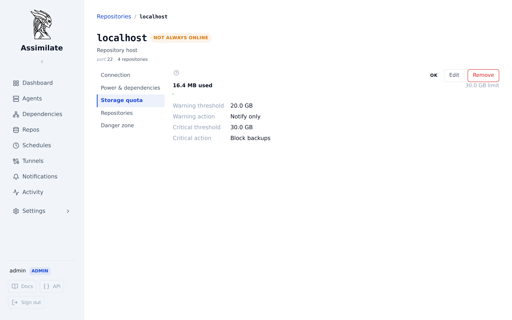
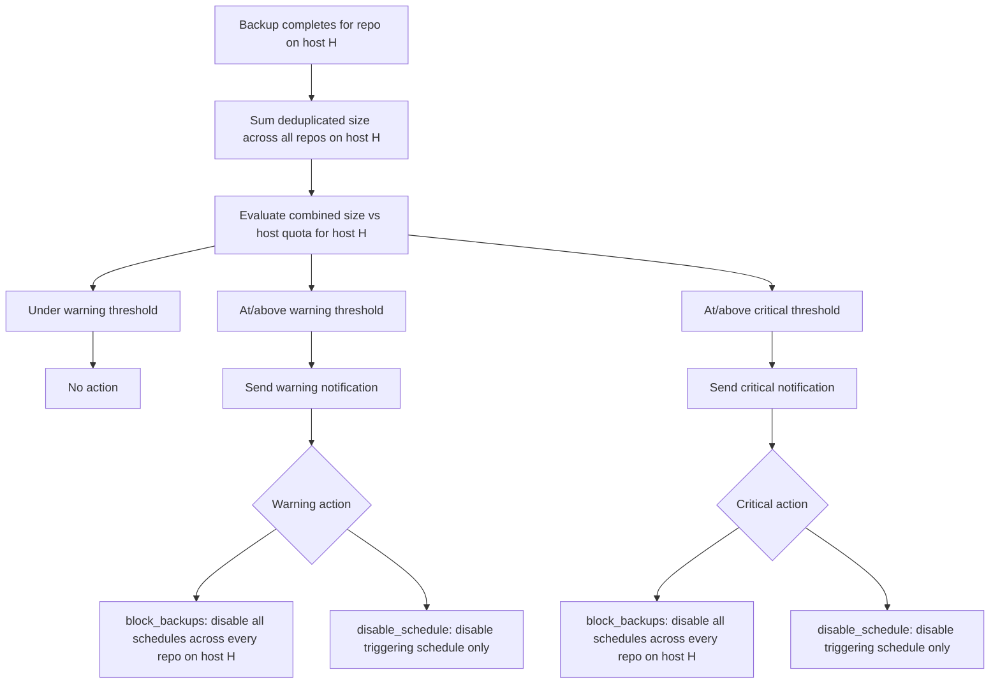

<!--
SPDX-License-Identifier: Apache-2.0
SPDX-FileCopyrightText: 2026 Alexander Mohr
-->

# Host Storage Quotas

A host storage quota (also called a server quota) applies a combined storage limit across every repository that shares the same SSH host, for the case where multiple repositories reside on one server with a shared disk quota. A per-repository [quota](quotas.md) can't see usage on sibling repositories, so a disk that's shared by several repos needs a limit evaluated against their *combined* size instead.

A host's quota is set in the **Storage quota** section of its [repository host](repository-hosts.md) page, next to its connection and power settings, and requires admin access.

A repository's **Overview** tab shows admins a **Host quota** tile with how full its host is against that quota; clicking it opens the host's **Storage quota** section.

Once a host quota exists, admins can also see it visualized on the [Repositories](repositories.md) list: click **Group by host** to view each host as a storage pool bar, with every repository on it drawn as a segment sized to its share of the combined usage.

## Configuring a Host Quota

1. Open the host: on **Repositories**, open a repository, then its **Settings** tab, and click the host's address (or click a repository's **Host quota** tile).
2. Select **Storage quota**. It shows the combined deduplicated size of every repository on the host.
3. Click **Configure quota** (or **Edit** if one is already set).
4. Enter the **Warning** and **Critical** thresholds in GB.
5. Choose the **action** for each threshold — the same three actions available for repository quotas.
6. Toggle **Enabled** and click **Save**.

## Actions

| Action | Behaviour |
|--------|-----------|
| `notify_only` | Send a notification; all schedules keep running normally |
| `block_backups` | Disable every schedule for every repository on this host, in addition to notifying |
| `disable_schedule` | Disable only the schedule whose backup triggered the breach, in addition to notifying |

As with repository quotas, disabling a schedule immediately pushes an updated configuration to its assigned agents, and a disabled schedule can be re-enabled from the [Scheduling](scheduling.md) page.

## Enforcement Flow

Host quota status is evaluated after each backup completes, alongside the repository-level quota check for the repository that just backed up:

Combined usage is read from each repository's authoritative `borg info` statistics, not derived from individual backup reports.

## Removing a Host Quota

Click **Remove** in the host's **Storage quota** section. No threshold is enforced on the host until one is configured again.

## Related Pages

- [Storage Quotas](quotas.md) — per-repository warning/critical thresholds and actions
- [Repository Management](repositories.md) — configure repositories, including the shared SSH host
- [Scheduling & Retention](scheduling.md) — re-enable a schedule disabled by a quota action
- [Dashboard](dashboard.md) — storage overview across all repositories
