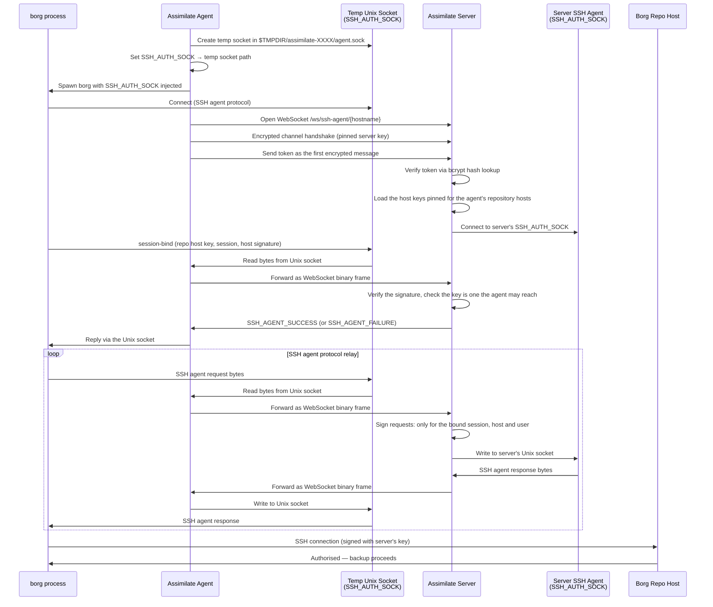

# SSH Agent Forwarding

SSH agent forwarding lets every agent machine authenticate to borg repositories using SSH keys held exclusively on the Assimilate server. No SSH private keys need to be distributed to or stored on agent machines.

## Overview

In a typical multi-host borg setup each backup machine needs its own copy of the SSH private key that authorises access to the borg repository server. This creates a key-management burden and a larger attack surface — a compromised agent machine exposes the repository key.

Assimilate eliminates this by relaying the SSH agent protocol over WebSocket. The server holds the key; agents borrow signing operations from it on demand. From borg's perspective it is talking to a local SSH agent — the relay is transparent.

See [Architecture](architecture.md) for the high-level component diagram.

## How It Works



Before each backup the agent creates a temporary Unix domain socket in a private directory under `$TMPDIR`. For every connection borg makes to that socket the agent opens a new WebSocket to the server's relay endpoint at `/ws/ssh-agent/{hostname}`, completes the encrypted channel handshake against the server key it pins, and sends its token as the first encrypted message. The server authenticates the request by verifying the token against the bcrypt hash stored in the database, then connects to its own `SSH_AUTH_SOCK` and relays SSH agent requests between the encrypted WebSocket and the local agent socket, one request and its reply at a time.

The relay reads each request's message type and forwards only the two a backup needs: listing the keys (`SSH_AGENTC_REQUEST_IDENTITIES`) and signing an SSH login with one of them (`SSH_AGENTC_SIGN_REQUEST`). A signature is forwarded only for a login to one of the agent's own repository hosts, as described in [Which logins the relay signs](#which-logins-the-relay-signs). Every other request, such as adding, removing or locking keys or a protocol extension other than `session-bind@openssh.com`, would change the SSH agent that every agent machine and the server itself share, so the server answers it with `SSH_AGENT_FAILURE` without passing it on and logs a warning naming the host. A message larger than 256 KiB, the limit OpenSSH's own agent applies, ends the relay. As soon as either side closes, the server closes the other, so no connection to the SSH agent outlives its WebSocket. When the backup finishes the temporary socket directory is removed automatically.

### Which logins the relay signs

Every agent machine borrows the same server key, and every repository host trusts it, so a signature from it would log in to any of them. The relay therefore signs a login only when it can tell which repository host the login is for and that host belongs to the agent asking.

OpenSSH 8.9 and later tell their SSH agent which server a connection logs in to with the `session-bind@openssh.com` extension. It carries the server's host key, the SSH session's identifier, and the server's own signature over that identifier, which only a connection that really reached that server can produce. For each relay connection the server:

1. Verifies the host's signature in the `session-bind`. Ed25519, ECDSA (P-256, P-384, P-521) and RSA (`rsa-sha2-256`, `rsa-sha2-512`) host keys are supported.
2. Accepts the bind only if the host key is the one [pinned](#agent-setup) for a repository host that one of the agent's own schedules backs up to, and answers it with `SSH_AGENT_SUCCESS` itself. The server's SSH agent never sees it.
3. Forwards a sign request only if it signs an SSH public key login (`publickey`, or OpenSSH's host-bound variant) whose session identifier is the one bound last on that connection, whose host key, when the login names one, is the bound one, and whose user is the SSH user of one of the agent's repositories on that host.

Anything else is answered with `SSH_AGENT_FAILURE` and a warning naming the agent's host and the reason, with no key material in it. That includes a sign request before any bind, a bind to some other agent's repository host, and a request to sign anything other than an SSH login, such as an `ssh-keygen -Y sign` file signature. A login an agent machine cannot complete through the relay falls back to the keys on that machine itself, if it has any.

!!! warning
    This check is fail-closed. A login the relay cannot tie to one of the agent's own repository hosts is never signed. That happens when the agent machine's OpenSSH is older than 8.9, which sends no `session-bind`, and when the repository host has no pinned host key. See [Troubleshooting](#relay-refuses-to-sign-a-login).

Repositories on the same repository host share its host key, so the relay cannot tell them apart. On the repository host itself, limit each key to its repositories with `borg serve --restrict-to-path`, as described in [Borg Repository Authorization](#borg-repository-authorization).

On a macOS agent the temporary socket is a unix socket as on Linux.

On a Windows agent the temporary socket is a named pipe instead, `\\.\pipe\assimilate-ssh-agent-<random>`, which only the agent's own user, Administrators and LocalSystem can open. It is closed when the backup finishes.

## Server Setup

On a Windows server, without `SSH_AUTH_SOCK` set, the server uses the Windows OpenSSH agent service at `\\.\pipe\openssh-ssh-agent`. Start the **OpenSSH Authentication Agent** service and load the key with `ssh-add` as the user the server runs as. The server only uses an agent pipe created by LocalSystem, the Administrators group or its own user, so a pipe another user made under that name while the service was stopped is refused.

### Systemd

Load the borg SSH private key into an ssh-agent on the server host and make `SSH_AUTH_SOCK` available to the Assimilate service process.

```bash
# Start an ssh-agent and load the key
eval $(ssh-agent)
ssh-add /path/to/borg_ed25519_key

# Print the socket path — you will need it below
echo $SSH_AUTH_SOCK
```

Add the socket path to the systemd unit file:

```ini
[Service]
Environment=SSH_AUTH_SOCK=/run/user/1000/gnupg/S.gpg-agent.ssh
```

If you use `gpg-agent` as your SSH agent the socket is typically at `/run/user/<uid>/gnupg/S.gpg-agent.ssh`. For a standalone `ssh-agent` started at login the path is printed by `echo $SSH_AUTH_SOCK` in the same session.

!!! warning
    The socket path must be readable by the user the Assimilate service runs as. If the service runs as a dedicated system user, ensure that user has access to the socket or use a system-level agent (e.g. `ssh-agent` started in the service unit itself).

After updating the unit file reload and restart the service:

```bash
systemctl daemon-reload
systemctl restart assimilate
```

### Docker

The official Docker image manages its own Ed25519 key pair — no host SSH agent or key mounting is required.

```yaml
services:
  server:
    image: assimilate-server
    volumes:
      - ssh_keys:/app/ssh

volumes:
  ssh_keys:
```

On first start the container generates an Ed25519 key pair in the `ssh_keys` volume, loads it into a container-local ssh-agent, and sets `SSH_AUTH_SOCK` automatically. The public key is:

- Printed to container logs at startup (`docker compose logs server | grep "Public key"`)
- Visible in the admin UI under **System → SSH Public Key**

Add the public key to `~/.ssh/authorized_keys` on the borg repository host to authorise backups.

!!! note
    The `ssh_keys` volume persists the key pair across container restarts. Do not delete it — if the key is lost you will need to re-authorise the new key on every borg repository host.

## Agent Setup

!!! note
    No configuration is required on the agent. SSH agent forwarding is automatic.

The agent uses the same `BORG_SERVER_URL`, `BORG_AGENT_TOKEN` and `BORG_SERVER_KEY` environment variables it already needs to connect to the server. Each relay connection opens with the same [encrypted channel](agents.md#encrypted-connection) handshake as the agent's main connection, so the token and the relayed SSH agent traffic never cross the network in the clear, and an agent never relays to a server that cannot prove it holds the pinned key. Before each backup it attempts to establish the SSH relay. If the relay succeeds, `SSH_AUTH_SOCK` is injected into the borg subprocess environment. If it fails for any reason the backup continues without forwarding and borg falls back to whatever SSH keys are available locally on the agent machine.

Assimilate records each repository server's SSH host key and sends that pin to assigned agents. Before running borg, the agent writes the pin to a private temporary `known_hosts` file and uses `StrictHostKeyChecking=yes`. The connection fails if the repository server presents a different key, and the temporary file is removed after the operation.

## Borg Repository Authorization

The borg repository host must trust the server's SSH public key. Retrieve the public key and add it to the authorised keys file on the repository host.

```bash
# Retrieve the server's public key (run on the server or via the admin UI)
ssh-add -L
```

On the borg repository host:

```bash
echo "<paste public key here>" >> ~/.ssh/authorized_keys
```

For tighter security, restrict the key to borg operations only using a `command=` prefix in `authorized_keys`:

```text
command="borg serve --restrict-to-path /backup/repos",restrict ssh-ed25519 AAAA... assimilate-server
```

!!! warning
    The `restrict` keyword disables port forwarding, agent forwarding, and X11 forwarding for this key. Combined with `command=`, it limits the key to running `borg serve` only — recommended for production repository hosts.

Every agent borrows this key, so whatever it may do on the host, a compromised agent may do too. To stop agents from deleting from a repository, make it [append-only](append-only.md): Assimilate restricts this key to `borg serve --append-only` and keeps a second key, which the relay never offers to agents, for the server's own pruning and compacting.

## Failure Modes

| Condition | Behaviour |
|-----------|-----------|
| `SSH_AUTH_SOCK` not set on server | Relay endpoint closes immediately; agent logs a warning; backup proceeds without forwarding |
| Server's ssh-agent socket unreachable | Same as above — relay closes, backup falls back to local keys |
| Token authentication fails | Server closes the WebSocket; agent logs a warning; backup proceeds without forwarding |
| Agent sends a request other than listing keys, binding the session or signing | Server answers `SSH_AGENT_FAILURE` and keeps relaying; the server's SSH agent never sees the request. A request to change keys logs a warning naming the host; an unknown protocol extension is logged at debug level |
| `session-bind` names a host that is not one of the agent's repository hosts, or its signature does not verify | Server answers `SSH_AGENT_FAILURE`, logs `ssh relay: refused a session-bind` with the reason, and signs nothing on that connection |
| Sign request without an accepted `session-bind` (OpenSSH older than 8.9), or for another session, host or user | Server answers `SSH_AGENT_FAILURE` and logs `ssh relay: refused a sign request` with the reason; `ssh` falls back to the agent machine's own keys |
| Repository host has no pinned host key | Logins to it are never signed through the relay |
| The agent's repository hosts cannot be read from the database | Relay closes; backup falls back to local keys |
| Network interruption during relay | Active borg SSH connection drops; borg retries according to its own retry logic |
| Key not authorised on repo host | SSH authentication fails; borg exits with an error; backup is marked failed |
| Temp socket directory creation fails | Agent logs an error; backup proceeds without forwarding |

In all cases except the last two the backup can still succeed if the agent machine has its own SSH key authorised on the repository host.

## Troubleshooting

**Socket not found / `SSH_AUTH_SOCK` not set**

The server process does not have `SSH_AUTH_SOCK` in its environment. Check the systemd unit file or Docker configuration. For systemd, verify with:

```bash
systemctl show assimilate --property=Environment
```

For Docker, check container logs:

```bash
docker compose logs server | grep -i ssh
```

### Key not authorised on repository host

Verify the server's public key is in `~/.ssh/authorized_keys` on the repo host:

```bash
ssh-add -L  # on the server — copy this output
cat ~/.ssh/authorized_keys  # on the repo host — confirm it is present
```

Test the connection manually from the server:

```bash
ssh -i /path/to/borg_key borg@repo-host echo ok
```

### Relay refuses to sign a login

If the server logs `ssh relay: refused a sign request` or `ssh relay: refused a session-bind` for an agent's host, check the `reason` field:

- **sign request on a connection without an accepted session-bind**: the agent machine's OpenSSH is older than 8.9 and sends no `session-bind`. Check with `ssh -V` on the agent machine and upgrade OpenSSH. The relay cannot tell which host such a client logs in to, so it never signs for it.
- **session-bind names a host that is not one of this agent's repository hosts**: the host the agent connected to presents a host key no repository host of this agent has pinned. Either the agent has no schedule backing up to that repository host, or the host's key changed (see [Repository host key rotated](#repository-host-key-rotated)), or the agent reached a different machine than intended.
- **sign request logs in as a user no repository of this agent uses on the bound host**: the agent machine logged in as another user than the repository's configured SSH user. Check the repository's **SSH user**.
- **session-bind signature does not verify** or **unsupported or unreadable type**: the host's signature could not be checked. DSA host keys are not supported; use an Ed25519, ECDSA or RSA host key.

A repository host with no pinned host key is never signed for. Saving the repository again pins the key the host presents.

### Repository host key rotated

If the repository host was reprovisioned or its SSH host key was intentionally replaced, backups fail until Assimilate refreshes the repository configuration. Save the repository again after verifying the new host-key fingerprint through a trusted channel; Assimilate records the currently presented key and distributes the new pin to assigned agents.

If the failure persists after the rotation, verify you are reaching the intended repository host and that no jump host or DNS override is pointing agents at the wrong machine.

### WebSocket connection refused or firewall blocking

The agent connects to the server on the same port and URL used for the main WebSocket connection. If the main agent connection works but SSH forwarding does not, check that the `/ws/ssh-agent/` path is not blocked by a reverse proxy or firewall rule.

For nginx, ensure the proxy passes WebSocket upgrade headers:

```nginx
location /ws/ {
    proxy_pass http://assimilate;
    proxy_http_version 1.1;
    proxy_set_header Host $http_host;
    proxy_set_header X-Forwarded-Proto $scheme;
    proxy_set_header Upgrade $http_upgrade;
    proxy_set_header Connection "upgrade";
}
```

The same block also serves the web UI's [live updates WebSocket](security.md#live-updates-websocket) at `/ws/ui`, which only accepts pages from the server's own origin. `$http_host` passes the browser's `Host` through with its port, where nginx's `$host` would drop it. On the default port 443 the browser sends no port, so the server also needs `X-Forwarded-Proto` to know the scheme: list nginx's address in `ASSIMILATE_TRUSTED_PROXIES` (see [Configuration](configuration.md)), or the live updates socket refuses every page with `403`.

### Backup succeeds but uses wrong key

If the backup succeeds but you suspect it is using a local key rather than the server's key, check the agent logs for a line like `ssh relay: failed to connect to relay` or `SSH_AUTH_SOCK not set`. If forwarding is working correctly the agent logs will show `ssh relay connection opened` before the backup starts.

<!--
SPDX-License-Identifier: Apache-2.0
SPDX-FileCopyrightText: 2026 Alexander Mohr
-->
